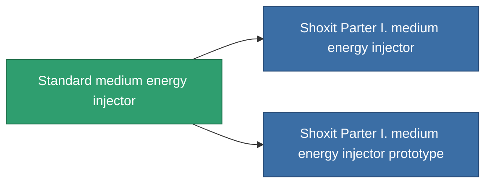

<!-- Generated by tools/generate from the live database (source: entitydefaults definition 649, aggregatevalues via aggregatefields).
     Do not edit by hand; regenerate instead. -->

# Standard medium energy injector

|  |  |
|---|---|
| Definitie | `def_standard_medium_core_booster` |
| Tier | T1 |
| Levenspunten | 100 |
| Volume | 1 |
| Massa | 200 |
| Categorie | Modules / Enhancements |
| Tier line | **Standard medium energy injector** (T1) → [Shoxit Parter I. medium energy injector](/nl/content/items/named1-medium-core-booster/) (T2) → [Follypsos medium energy injector](/nl/content/items/named2-medium-core-booster/) (T3) → [Cerepter II. medium energy injector](/nl/content/items/named3-medium-core-booster/) (T4) |

## Statistieken

| Veld | Waarde |
|---|---|
| core_usage | 0 |
| cpu_usage | 25 |
| cycle_time | 11k |
| powergrid_usage | 250 |

<!-- production:generated -->
## Productie

**Geproduceerd uit 2 componentën, onderzoekslevel 4** — monteer de componenten om het te bouwen (volledige lijst in [Recepten](/nl/content/recipes/)):

**Bouwtekening:** [Standard medium energy injector CT](/nl/content/items/standard-medium-core-booster-cprg/)

<svg class="prod-card-icon" aria-hidden="true"><use href="#mi-grid"/></svg><a class="prod-card-name" href="/nl/content/items/axicol/">Cryoperine</a>

vereist: <b>200</b>

<svg class="prod-card-icon" aria-hidden="true"><use href="#mi-grid"/></svg><a class="prod-card-name" href="/nl/content/items/titanium/">Titanium</a>

vereist: <b>200</b>

## Gebruikt in productie

**Component van 2 items** — alles dat het in productie gebruikt:

