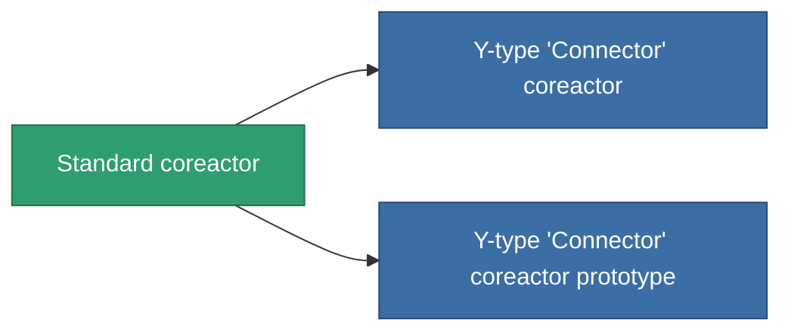

<!-- Generated by tools/generate from the live database (source: entitydefaults definition 42, aggregatevalues via aggregatefields).
     Do not edit by hand; regenerate instead. -->

# Standard coreactor

|  |  |
|---|---|
| Definitie | `def_standard_powergrid_upgrades` |
| Tier | T1 |
| Levenspunten | 100 |
| Volume | 0.5 |
| Massa | 100 |
| Categorie | Modules / Power |
| Tier line | **Standard coreactor** (T1) → [Y-type 'Connector' coreactor](/nl/content/items/named1-powergrid-upgrades/) (T2) → [Palp coreactor](/nl/content/items/named2-powergrid-upgrades/) (T3) → [E-set 15VaW coreactor](/nl/content/items/named3-powergrid-upgrades/) (T4) |

## Statistieken

| Veld | Waarde |
|---|---|
| cpu_usage | 35 |
| powergrid_max_modifier | 1.1 |

<!-- production:generated -->
## Productie

**Geproduceerd uit 2 componentën, onderzoekslevel 3** — monteer de componenten om het te bouwen (volledige lijst in [Recepten](/nl/content/recipes/)):

**Bouwtekening:** [Standard coreactor CT](/content/items/standard-powergrid-upgrades-cprg/)

<svg class="prod-card-icon" aria-hidden="true"><use href="#mi-grid"/></svg><a class="prod-card-name" href="/nl/content/items/axicol/">Cryoperine</a>

vereist: <b>300</b>

<svg class="prod-card-icon" aria-hidden="true"><use href="#mi-grid"/></svg><a class="prod-card-name" href="/nl/content/items/titanium/">Titanium</a>

vereist: <b>200</b>

## Gebruikt in productie

**Component van 2 items** — alles dat het in productie gebruikt:

