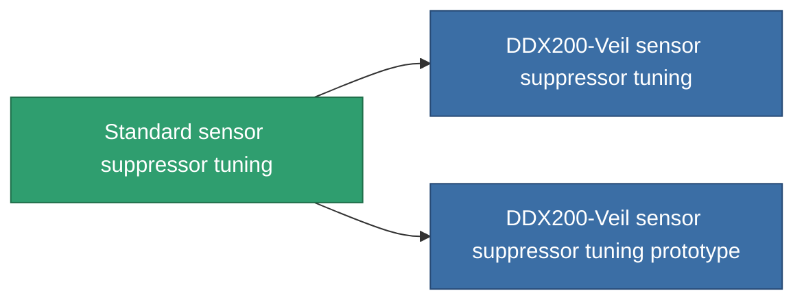

<!-- Generated by tools/generate from the live database (source: entitydefaults definition 4579, aggregatevalues via aggregatefields).
     Do not edit by hand; regenerate instead. -->

# Standard sensor suppressor tuning

|  |  |
|---|---|
| Definitie | `def_standard_sensor_supressor_booster` |
| Tier | T1 |
| Levenspunten | 100 |
| Volume | 0.5 |
| Massa | 150 |
| Categorie | Modules / Sensors & scanning |
| Tier line | **Standard sensor suppressor tuning** (T1) → [DDX200-Veil sensor suppressor tuning](/nl/content/items/named1-sensor-supressor-booster/) (T2) → [Radiocor sensor suppressor tuning](/nl/content/items/named2-sensor-supressor-booster/) (T3) → [DDX700-Mist sensor suppressor tuning](/nl/content/items/named3-sensor-supressor-booster/) (T4) |

## Statistieken

| Veld | Waarde |
|---|---|
| core_usage_sensor_dampener_modifier | 1.1 |
| cpu_usage | 55 |
| effect_enhancer_sensor_dampener_locking_range_modifier | 0.95 |
| effect_enhancer_sensor_dampener_locking_time_modifier | 1.15 |
| powergrid_usage | 20 |

<!-- production:generated -->
## Productie

**Geproduceerd uit 3 componentën, onderzoekslevel 5** — monteer de componenten om het te bouwen (volledige lijst in [Recepten](/nl/content/recipes/)):

**Bouwtekening:** [Standard sensor suppressor tuning CT](/content/items/standard-sensor-supressor-booster-cprg/)

<svg class="prod-card-icon" aria-hidden="true"><use href="#mi-grid"/></svg><a class="prod-card-name" href="/nl/content/items/axicol/">Cryoperine</a>

vereist: <b>150</b>

<svg class="prod-card-icon" aria-hidden="true"><use href="#mi-grid"/></svg><a class="prod-card-name" href="/nl/content/items/prilumium/">Prilumium</a>

vereist: <b>150</b>

<svg class="prod-card-icon" aria-hidden="true"><use href="#mi-grid"/></svg><a class="prod-card-name" href="/nl/content/items/titanium/">Titanium</a>

vereist: <b>50</b>

## Gebruikt in productie

**Component van 2 items** — alles dat het in productie gebruikt:

