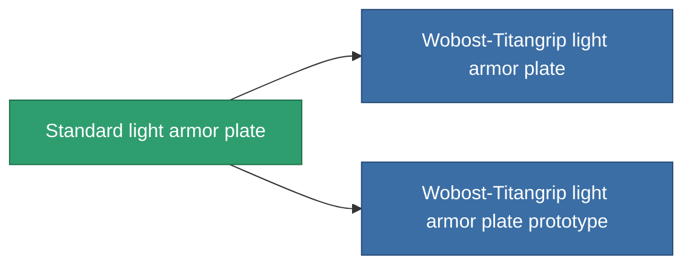

<!-- Generated by tools/generate from the live database (source: entitydefaults definition 14, aggregatevalues via aggregatefields).
     Do not edit by hand; regenerate instead. -->

# Standard light armor plate

|  |  |
|---|---|
| Definitie | `def_standard_small_armor_plate` |
| Tier | T1 |
| Levenspunten | 100 |
| Volume | 1 |
| Massa | 500 |
| Categorie | Modules / Armor |
| Tier line | **Standard light armor plate** (T1) → [Wobost-Titangrip light armor plate](/nl/content/items/named1-small-armor-plate/) (T2) → [Invigor I. light armor plate](/nl/content/items/named2-small-armor-plate/) (T3) → [Karapas light armor plate](/nl/content/items/named3-small-armor-plate/) (T4) |

## Statistieken

| Veld | Waarde |
|---|---|
| armor_max | 450 |
| cpu_usage | 1 |
| massiveness | 0.1 |
| powergrid_usage | 15 |
| signature_radius | 0.35 |

<!-- production:generated -->
## Productie

**Geproduceerd uit 2 componentën, onderzoekslevel 1** — monteer de componenten om het te bouwen (volledige lijst in [Recepten](/nl/content/recipes/)):

**Bouwtekening:** [Standard light armor plate CT](/nl/content/items/standard-small-armor-plate-cprg/)

<svg class="prod-card-icon" aria-hidden="true"><use href="#mi-grid"/></svg><a class="prod-card-name" href="/nl/content/items/plasteosine/">Plasteosine</a>

vereist: <b>350</b>

<svg class="prod-card-icon" aria-hidden="true"><use href="#mi-grid"/></svg><a class="prod-card-name" href="/nl/content/items/titanium/">Titanium</a>

vereist: <b>250</b>

## Gebruikt in productie

**Component van 2 items** — alles dat het in productie gebruikt:

