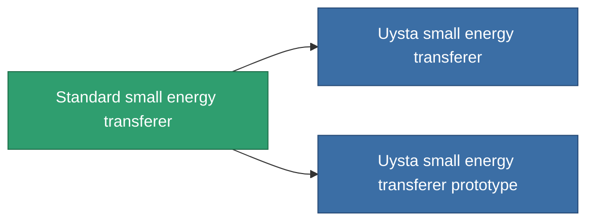

<!-- Generated by tools/generate from the live database (source: entitydefaults definition 32, aggregatevalues via aggregatefields).
     Do not edit by hand; regenerate instead. -->

# Standard small energy transferer

|  |  |
|---|---|
| Definitie | `def_standard_small_energy_transfer` |
| Tier | T1 |
| Levenspunten | 100 |
| Volume | 0.5 |
| Massa | 100 |
| Categorie | Modules / Enhancements |
| Tier line | **Standard small energy transferer** (T1) → [Uysta small energy transferer](/nl/content/items/named1-small-energy-transfer/) (T2) → [Bithom small energy transferer](/nl/content/items/named2-small-energy-transfer/) (T3) → [Livostid PT3 small energy transferer](/nl/content/items/named3-small-energy-transfer/) (T4) |
| Opmerking | range = optimal_range * 	energy_transferers_optimal_range_modifier    cel core += energy_transfer_amount  sajat core -= energy_transfer_amount - 10% |

## Statistieken

| Veld | Waarde |
|---|---|
| core_usage | 10 |
| cpu_usage | 35 |
| cycle_time | 10k |
| energy_transfer_amount | 40 |
| falloff | 0 |
| optimal_range | 15 |
| powergrid_usage | 30 |

<!-- production:generated -->
## Productie

**Geproduceerd uit 2 componentën, onderzoekslevel 2** — monteer de componenten om het te bouwen (volledige lijst in [Recepten](/nl/content/recipes/)):

**Bouwtekening:** [Standard small energy transferer CT](/content/items/standard-small-energy-transfer-cprg/)

<svg class="prod-card-icon" aria-hidden="true"><use href="#mi-grid"/></svg><a class="prod-card-name" href="/nl/content/items/axicol/">Cryoperine</a>

vereist: <b>250</b>

<svg class="prod-card-icon" aria-hidden="true"><use href="#mi-grid"/></svg><a class="prod-card-name" href="/nl/content/items/titanium/">Titanium</a>

vereist: <b>100</b>

## Gebruikt in productie

**Component van 2 items** — alles dat het in productie gebruikt:

