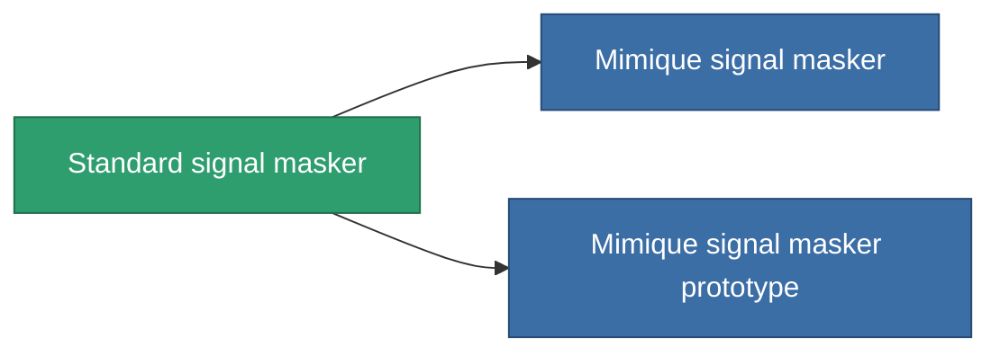

<!-- Generated by tools/generate from the live database (source: entitydefaults definition 2897, aggregatevalues via aggregatefields).
     Do not edit by hand; regenerate instead. -->

# Standard signal masker

|  |  |
|---|---|
| Definitie | `def_standard_stealth_modul` |
| Tier | T1 |
| Levenspunten | 100 |
| Volume | 0.5 |
| Massa | 250 |
| Categorie | Modules / Enhancements |
| Tier line | **Standard signal masker** (T1) → [Mimique signal masker](/nl/content/items/named1-stealth-modul/) (T2) → [MSMD signal masker](/nl/content/items/named2-stealth-modul/) (T3) → [Longlag signal masker](/nl/content/items/named3-stealth-modul/) (T4) |

## Statistieken

| Veld | Waarde |
|---|---|
| core_usage | 2 |
| cpu_usage | 100 |
| cycle_time | 10k |
| effect_stealth_strength_modifier | 35 |
| powergrid_usage | 5 |

<!-- production:generated -->
## Productie

**Geproduceerd uit 3 componentën, onderzoekslevel 6** — monteer de componenten om het te bouwen (volledige lijst in [Recepten](/nl/content/recipes/)):

**Bouwtekening:** [Standard signal masker CT](/nl/content/items/standard-stealth-modul-cprg/)

<svg class="prod-card-icon" aria-hidden="true"><use href="#mi-grid"/></svg><a class="prod-card-name" href="/nl/content/items/axicol/">Cryoperine</a>

vereist: <b>450</b>

<svg class="prod-card-icon" aria-hidden="true"><use href="#mi-grid"/></svg><a class="prod-card-name" href="/nl/content/items/plasteosine/">Plasteosine</a>

vereist: <b>50</b>

<svg class="prod-card-icon" aria-hidden="true"><use href="#mi-grid"/></svg><a class="prod-card-name" href="/nl/content/items/titanium/">Titanium</a>

vereist: <b>200</b>

## Gebruikt in productie

**Component van 2 items** — alles dat het in productie gebruikt:

