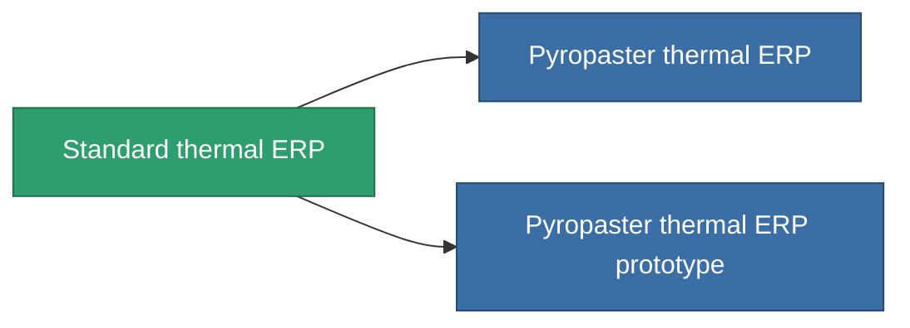

<!-- Generated by tools/generate from the live database (source: entitydefaults definition 3297, aggregatevalues via aggregatefields).
     Do not edit by hand; regenerate instead. -->

# Standard thermal ERP

|  |  |
|---|---|
| Definitie | `def_standard_thermal_kers` |
| Tier | T1 |
| Levenspunten | 100 |
| Volume | 1 |
| Massa | 500 |
| Categorie | Modules / Enhancements |
| Tier line | **Standard thermal ERP** (T1) → [Pyropaster thermal ERP](/nl/content/items/named1-thermal-kers/) (T2) → [DE-melt thermal ERP](/nl/content/items/named2-thermal-kers/) (T3) → [Dyoriva thermal ERP](/nl/content/items/named3-thermal-kers/) (T4) |

## Statistieken

| Veld | Waarde |
|---|---|
| chemical_damage_to_core_modifier | 0.2 |
| cpu_usage | 50 |
| explosive_damage_to_core_modifier | 0.1 |
| kinetic_damage_to_core_modifier | 0.1 |
| powergrid_usage | 15 |
| thermal_damage_to_core_modifier | 0.5 |

<!-- production:generated -->
## Productie

**Geproduceerd uit 5 componentën, onderzoekslevel 5** — monteer de componenten om het te bouwen (volledige lijst in [Recepten](/nl/content/recipes/)):

**Bouwtekening:** [Standard thermal ERP CT](/nl/content/items/standard-thermal-kers-cprg/)

<svg class="prod-card-icon" aria-hidden="true"><use href="#mi-grid"/></svg><a class="prod-card-name" href="/nl/content/items/axicol/">Cryoperine</a>

vereist: <b>200</b>

<svg class="prod-card-icon" aria-hidden="true"><use href="#mi-grid"/></svg><a class="prod-card-name" href="/nl/content/items/isopropentol/">Isopropentol</a>

vereist: <b>100</b>

<svg class="prod-card-icon" aria-hidden="true"><use href="#mi-grid"/></svg><a class="prod-card-name" href="/nl/content/items/plasteosine/">Plasteosine</a>

vereist: <b>100</b>

<svg class="prod-card-icon" aria-hidden="true"><use href="#mi-grid"/></svg><a class="prod-card-name" href="/nl/content/items/titanium/">Titanium</a>

vereist: <b>200</b>

<svg class="prod-card-icon" aria-hidden="true"><use href="#mi-grid"/></svg><a class="prod-card-name" href="/nl/content/items/vitricyl/">Vitricyl</a>

vereist: <b>200</b>

## Gebruikt in productie

**Component van 2 items** — alles dat het in productie gebruikt:

