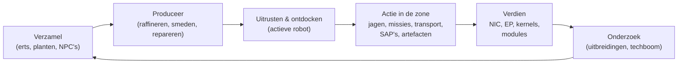

# Wat je in het spel kunt doen

Elke speleractie, georganiseerd per systeem. De commandonaam is de server-side
identificatie — de client presenteert deze acties in de eigen UI. De toelichting
per actie staat op de systeemspecifieke pagina's.

Het spel in één lus: verdien en besteed je weg om een tierladder omhoog te klimmen.

## Systemen

| Systeem | Pagina | Onderwerp |
|---|---|---|
| Aan de slag | [getting-started](/nl/features/getting-started/) | personages maken/kiezen, eerste robot, accountbasis |
| Beweging | [movement](/nl/features/movement/) | zones, docking, wachtrij, teleportaties, vonksprongen, poorten |
| Verzamelen | [gathering](/nl/features/gathering/) | scannen, oogsten, bronzenverzameling |
| Gevecht | [combat](/nl/features/combat/) | vechten, schadestypen, interferentie, alarmen, killrapporten, SOS |
| NPC's & PVE-jacht | [npcs](/nl/features/npcs/) | NPC-rangen & facties, zwakke punten, spawntypen, TAP's, tactieken |
| Verkenning | [exploration](/nl/features/exploration/) | artefacten en relikwieën |
| Robots & uitrusting | [robots](/nl/features/robots/) | robots selecteren, modules, munitie, presets, tinten |
| Modules & uitrusting | [modules](/nl/features/modules/) | de modulefamilies en uitrustingsregels |
| Vonken | [sparks](/nl/features/sparks/) | vonkautorisatie, wisselen, vaardigheidsbonussen |
| Onderzoek | [research](/nl/features/research/) | uitbreidingen (vaardigheidsboom), EP, techboom |
| Personage | [character](/nl/features/character/) | het personagevenster: uitbreidingen-tab (vaardigheidsboom) en vonken |
| Productie | [production](/nl/features/production/) | productielijnen, raffineren, repareren, herverwerken, prototypes, CPRG |
| Markt & handel | [market](/nl/features/market/) | marktorderingen, directe handelen, itemwinkel, credits |
| Groepen | [groups](/nl/features/groups/) | corporaties, allianties, gangs (vloten) |
| Krachtbasisstations | [pbs](/nl/features/pbs/) | PBS-structuren, territoria, verbindingen |
| Missies | [missions](/nl/features/missions/) | veldmissies, agenten, terminals |
| Transport | [transport](/nl/features/transport/) | items versturen tussen bases |
| Items & inventaris | [items](/nl/features/items/) | containers, stapelen, itemnamen, inwisselbare items, goodie packs |
| Sociaal | [social](/nl/features/social/) | e-mail, kanalen, vrienden, standing, gouden gids, nieuws, peilingen |
| Inbraak | [intrusion](/nl/features/intrusion/) | de NPC-site-aanvalmodus |
| Voorposten & SAP | [outposts](/nl/features/outposts/) | voorpostbezit, stabiliteit, de vier SAP-typen |
| Nabijheidsprobes | [probes](/nl/features/probes/) | zonesurveillanceprobes |
| Server & referentie | [server](/nl/features/server/) | serverinfo, high scores, referentiedata, aankopen |
| FAQ | [faq](/nl/features/faq/) | de tutorial, factiekeuze, eerste stappen, de jargon |
| Achtergrondverhaal | [lore](/nl/features/lore/) | de setting: Nia, de Nians, het Syndicaat |
| Client & PC-instellingen | [client-setup](/nl/features/client-setup/) | de client draaien, multi-boxing, UI-schaal |

### Referentie

| Pagina | Onderwerp |
|---|---|
| [Client UI-overzicht](/nl/features/ui/) | De EVE-stijl interface: bovenbalk, Deploy/Dock-knop, actiecategorieën, ontdock-statuspaneel en de conventies die door deze wiki worden gebruikt |

Entiteitsstatistiektabellen staan in het gegenereerde [Content](/content/) gedeelte.

## Volledige actielijst

### Aan de slag & account

| Actie | Commando |
|---|---|
| Personage maken | `characterCreate` |
| Personage selecteren (als dit personage spelen) | `characterSelect` |
| Personage verwijderen | `characterDelete` |
| Personage hernoemen | `characterRename` |
| Controleren of een naam beschikbaar is | `characterCheckNick` |
| Starterrobot aanvragen | `requestStarterRobot` |
| Starterdoos aanvragen | `requestInfiniteBox` |
| Nieuw personage opstartdata | `characterWizardData` |
| Mijn profiel bekijken | `characterGetMyProfile` |
| Profielen van andere personages bekijken | `characterGetProfiles` |
| Zoeken naar personages | `characterSearch` |
| Personages opsommen | `characterList` |
| Personageinstellingen ophalen/instellen | `characterSettingsGet`, `characterSettingsSet` |
| Avatar instellen | `characterSetAvatar` |
| Stemboodschap instellen | `characterSetMoodmessage` |
| Privénotitie op een personage zetten | `characterSetNote` / `characterGetNote` |
| Thuisbasis instellen / wissen | `characterSetHomeBase`, `characterClearHomeBase` |
| Credits overzetten tussen eigen personages | `characterTransferCredit` |
| Handelen blokkeren/toestaan op een personage | `characterSetBlockTrades` |
| Account e-mail / wachtwoord wijzigen | `changeSessionEmail`, `changeSessionPassword` |
| EP-per-activiteit geschiedenis bekijken | `accountEpForActivityHistory` |
| Accounttransactiesgeschiedenis bekijken | `accountGetTransactionHistory` |
| Uitloggen / verbindingbeheer | `signOut`, `connectionStart`, `connectionEnd`, `ping`, `quit`, `isOnline`, `transferData`, `welcome` |
| Wie is online | `getCharactersOnline`, `getAccountsWithCharacters` |
| Personagegeschiedenissen | `characterNickHistory`, `characterCorporationHistory`, `characterTransactionHistory`, `characterListNpcDeath` |

### Beweging & zones

| Actie | Commando |
|---|---|
| Docken bij een base / PBS | `dock` |
| Ontdocken | `undock` |
| Forceerdock (nood) | `forceDock` |
| Zone-entry wachtrij controleren | `zoneGetQueueInfo` |
| Wachtrijlengte-preferentie instellen | `zoneSetQueueLength` |
| Wachten in de wachtrij annuleren | `zoneCancelEnterQueue` |
| Zoneinfo ophalen | `getZoneInfo` |
| Sectors van een zone opsommen | `zoneSectorList` |
| Zonegebouwen opsommen | `zoneGetBuildings` |
| SOS versturen (oproep om hulp) | `zoneSOS` |
| Beschikbare teleportaties opsommen | `teleportList` |
| Teleportatie gebruiken | `teleportUse` |
| Teleporteren naar een zoneobject | `teleportToZoneObject` |
| Teleportatiekanalen opsommen | `teleportGetChannelList` |
| Wereldwijde teleportatiekanalen opvragen | `teleportQueryWorldChannels` |
| Vonkcharges opsommen | `sparkList` |
| Actieve vonk wijzigen | `sparkChange` |
| Vonk verwijderen | `sparkRemove` |
| Vonk ontgrendelen | `sparkUnlock` |
| Vonkteleportaties opsommen / instellen / gebruiken / verwijderen | `sparkTeleportList`, `sparkTeleportSet`, `sparkTeleportUse`, `sparkTeleportDelete` |
| Poort hernoemen | `gateSetName` |
| Baseinfo / eigendom / faciliteiten / mijn items op base | `baseGetInfo`, `baseGetOwnershipInfo`, `baseListFacilities`, `baseGetMyItems` |
| Base dockingrechten instellen | `baseSetDockingRights` |

### Verzamelen & scannen

| Actie | Commando |
|---|---|
| Zone scannen (erts/plant/deployable scan) | `zoneUploadScanResult` |
| Mijn mineraalscanresultaten opsommen | `mineralScanResultList` |
| Item maken uit een scanresultaat | `mineralScanResultCreateItem` |
| Scanresultaat verwijderen | `mineralScanResultDelete` |
| Scanresultaten tussen containers verplaatsen | `mineralScanResultMove` |
| Scandata uploaden vanuit een item | `mineralScanResultUploadFromItem` |
| Items op een zone tellen (zichtbaarheidcheck) | `itemCountOnZone`, `itemCount` |
| Kiosk: items bekijken / indienen | `kioskInfo`, `kioskSubmitItem` |
| Item gebruiken (generiek — incl. oogstbare items) | `useItem` |

### Gevecht

| Actie | Commando |
|---|---|
| Gevechtsalarm activeren / deactiveren | `alarmStart` (alarmeinde is servergedreven) |
| Mijn killrapporten bekijken | `getMyKillReports` |
| Mijn high scores bekijken | `getMyHighScores` |
| Server high scores bekijken | `getHighScores` |

### Robots & uitrusting

| Actie | Commando |
|---|---|
| Actieve robot selecteren | `selectActiveRobot` |
| Robot leegmaken (alles ontladen) | `robotEmpty` |
| Robotinfo ophalen | `getRobotInfo` |
| Robot uitrustingsinfo ophalen | `getRobotFittingInfo` |
| Module uitrusten | `equipModule` |
| Module verwijderen | `removeModule` |
| Modules wisselen | `changeModule` |
| Munitie uitrusten | `equipAmmo` |
| Munitie wisselen | `changeAmmo` |
| Munitie uitrusten (verwijderen) | `unEquipAmmo` |
| Robottint instellen | `setRobotTint` |
| Uitrustingspresets opslaan / opsommen / toepassen / verwijderen | `fittingPresetSave`, `fittingPresetList`, `fittingPresetApply`, `fittingPresetDelete` |

### Onderzoek (uitbreidingen & techboom)

| Actie | Commando |
|---|---|
| Uitbreidingscategorieën opsommen | `extensionCategoryList` |
| Alle uitbreidingen ophalen | `extensionGetAll` |
| Geleerde uitbreidingen opsommen | `extensionLearntList` |
| Voorwaarden opsommen | `extensionPrerequireList` |
| Uitbreiding kopen met punten | `extensionBuyForPoints` |
| EP-boost kopen | `extensionBuyEpBoost` |
| Beschikbare punten ophalen | `extensionGetAvailablePoints` |
| Puntparameters ophalen | `extensionGetPointParameters` |
| Uitbreidingsgeschiedenis | `extensionHistory` |
| Eén uitbreidingsniveau verwijderen | `extensionRemoveLevel` |
| Personageuitbreidingen resetten | `extensionResetCharacter` |
| Vergrendelde EP vrijgeven | `extensionFreeLockedEp` |
| EP-per-activiteit daglog bekijken | `epForActivityDailyLog` |
| Onderzoeksniveaus ophalen | `getResearchLevels` |
| Techboom: knoop onderzoeken | `techTreeResearch` |
| Techboom: knoop ontgrendelen | `techTreeUnlock` |
| Techboom: doneren | `techTreeDonate` |
| Techboom: info / logs | `techTreeInfo`, `techTreeGetLogs` |

### Productie

| Actie | Commando |
|---|---|
| Productielijnen opsommen | `productionLineList` |
| Lijn starten | `productionLineStart` |
| Lijn kalibreren | `productionLineCalibrate` |
| Rondes op een lijn instellen | `productionLineSetRounds` |
| Lijn verwijderen | `productionLineDelete` |
| Volgende ronde van een lijn opvragen | `productionQueryLineNextRound` |
| Productie annuleren | `productionCancel` |
| Raffineren (opvragen + uitvoeren) | `productionRefine`, `productionRefineQuery` |
| Repareren (opvragen + uitvoeren) | `productionRepair`, `productionRepairQuery` |
| Herverwerken (opvragen + uitvoeren) | `productionReprocess`, `productionReprocessQuery` |
| Onderzoeksonderdelen (opvragen + uitvoeren) | `productionResearch`, `productionResearchQuery` |
| Prototype (starten + opvragen) | `productionPrototypeStart`, `productionPrototypeQuery` |
| Onderzoekskits samenvoegen (uitvoeren + opvragen) | `productionMergeResearchKitsMulti`, `productionMergeResearchKitsMultiQuery` |
| CPRG smeden (uitvoeren + opvragen) | `productionCPRGForge`, `productionCPRGForgeQuery` |
| CPRG-info | `productionCPRGInfo` |
| CPRG ophalen van een lijn (ophalen + opvragen) | `productionGetCPRGFromLine`, `productionGetCPRGFromLineQuery` |
| Productieverzekering: kopen / opsommen / opvragen / verwijderen | `productionInsuranceBuy`, `productionInsuranceList`, `productionInsuranceQuery`, `productionInsuranceDelete` |
| Productieonderdelen opsommen | `productionComponentsList` |
| Faciliteiteninfo / beschrijving | `productionFacilityInfo`, `productionFacilityDescription` |
| Wat is in uitvoering (mijn / corporatie) | `productionInProgress`, `productionInProgressCorporation` |
| Productiegeschiedenis | `productionHistory` |
| Productieserverinfo | `productionServerInfo` |

### Markt & handel

| Actie | Commando |
|---|---|
| Verkooporder aanmaken | `marketCreateSellOrder` |
| Kooporder aanmaken | `marketCreateBuyOrder` |
| Order wijzigen | `marketModifyOrder` |
| Item / order annuleren | `marketCancelItem` |
| Item direct kopen | `marketBuyItem` |
| Marktitems opsommen | `marketItemList` |
| Items beschikbaar voor mij opsommen | `marketAvailableItems` |
| Items in een bereik opsommen | `marketItemsInRange` |
| Mijn marktitems opsommen | `marketGetMyItems` |
| Marktinfo | `marketGetInfo` |
| Gemiddelde prijzen (markt / definitie / globaal) | `marketGetAveragePrices`, `marketGetDefinitionAveragePrice`, `marketGlobalAveragePrices` |
| Marktbelasting wijzigen / belastinglog bekijken | `marketTaxChange`, `marketTaxLogList` |
| Handel starten | `tradeBegin` |
| Mijn bod instellen / intrekken | `tradeSetOffer`, `tradeRetractOffer` |
| Handel aanvaarden | `tradeAccept` |
| Handel annuleren | `tradeCancel` |
| Handel afgerond / status | `tradeFinished`, `tradeState` |
| Itemwinkel: opsommen / kopen | `itemShopList`, `itemShopBuy` |
| Credits overzetten naar een ander personage | `characterTransferCredit` |

### Groepen (corporaties, allianties, gangs)

| Actie | Commando |
|---|---|
| Corporatie oprichten | `corporationCreate` |
| Solliciteren naar / uitnodigen naar een corporatie | `corporationApply`, `corporationCharacterInvite` |
| Sollicitatie aanvaarden / sollicitaties opsommen | `corporationAcceptApplication`, `corporationListApplications` |
| Mijn sollicitaties: opsommen / verwijderen | `corporationListMyApplications`, `corporationDeleteMyApplication` |
| Sollicitatie verwijderen (officier) | `corporationDeleteApplication` |
| Reactie op uitnodiging | `corporationInviteReply` |
| Verlaten / vertrek annuleren | `corporationLeave`, `corporationCancelLeave` |
| Lid verwijderen / lidrol instellen | `corporationRemoveMember`, `corporationSetMemberRole` |
| Al mijn rollen neerleggen | `corporationDropRoles` |
| Leden neutraal instellen | `corporationSetMembersNeutral` |
| Corporatieinfo / mijn info / zoeken | `corporationInfo`, `corporationGetMyInfo`, `corporationSearch` |
| Corporatiestanding / reputatie | `corporationGetMyStandings`, `corporationGetReputation` |
| Doneren aan / uitbetalen uit corporatie | `corporationDonate`, `corporationPayOut` |
| Corporatiecredits overzetten | `corporationTransfer` |
| Hernoemen / kleur instellen / info instellen | `corporationRename`, `corporationSetColor`, `corporationSetInfo` |
| Delegaten ophalen | `corporationGetDelegates` |
| CEO-overname status / kandidaat voor CEO | `corporationCEOTakeOverStatus`, `corporationVolunteerForCEO` |
| Corporatiestemmingen: starten / onderwerp instellen / opsommen / stemmen / verwijderen | `corporationVoteStart`, `corporationVoteSetTopic`, `corporationVoteList`, `corporationVoteCast`, `corporationVoteDelete` |
| Brievenbord: starten / opsommen / nieuwe berichten / plaatsen / modereren / verwijderen | `corporationBulletinStart`, `corporationBulletinList`, `corporationBulletinNewEntries`, `corporationBulletinEntry`, `corporationBulletinModerate`, `corporationBulletinDelete`, `corporationBulletinEntryDelete`, `corporationBulletinDetails` |
| Hangar: huren / huur betalen / huurprijs / sluiten | `corporationRentHangar`, `corporationHangarPayRent`, `corporationHangarRentPrice`, `corporationHangarClose` |
| Hangar: opsommen (alle / op base) | `corporationHangarListAll`, `corporationHangarListOnBase` |
| Hangar: mappen (aanmaken / verwijderen) | `corporationHangarFolderCreate`, `corporationHangarFolderDelete` |
| Hangar: toegang instellen / naam instellen | `corporationHangarSetAccess`, `corporationHangarSetName` |
| Hangarlogs: opsommen / instellen / wissen | `corporationHangarLogList`, `corporationHangarLogSet`, `corporationHangarLogClear` |
| Corporatiedocumenten: config / aanmaken / opsommen / openen / verwijderen / overdragen / huren / monitoren / niet meer monitoren / body bijwerken / registerlijst / register instellen | `corporationDocumentConfig`, `corporationDocumentCreate`, `corporationDocumentList`, `corporationDocumentOpen`, `corporationDocumentDelete`, `corporationDocumentTransfer`, `corporationDocumentRent`, `corporationDocumentMonitor`, `corporationDocumentUnmonitor`, `corporationDocumentUpdateBody`, `corporationDocumentRegisterList`, `corporationDocumentRegisterSet` |
| Geschiedenissen: log / lidrollen / corporatierollen / rollen / naam / transacties | `corporationLogHistory`, `corporationMemberRoleHistory`, `corporationRoleHistory`, `corporationNameHistory`, `corporationTransactionHistory` |
| Alliantieinfo / standaardwaarden / rolgeschiedenis | `allianceGetMyInfo`, `allianceGetDefaults`, `allianceRoleHistory` |
| Gang (vloot): aanmaken / verwijderen / info | `gangCreate`, `gangDelete`, `gangInfo` |
| Gang: uitnodigen / reageren / verwijderen / verlaten | `gangInvite`, `gangInviteReply`, `gangKick`, `gangLeave` |
| Gang: leider instellen / rol instellen | `gangSetLeader`, `gangSetRole` |

### Krachtbasisstations (PBS) & territoria

| Actie | Commando |
|---|---|
| PBS-netwerk ophalen | `PBSGetNetwork` |
| PBS-knoopinfo | `PBSNodeInfo` |
| PBS-knoop hernoemen | `PBSRenameNode` |
| PBS-verbinding maken / verbreken | `PBSMakeConnection`, `PBSBreakConnection` |
| Verbindingsgewicht instellen | `PBSSetConnectionWeight` |
| PBS online-status instellen | `PBSSetOnline` |
| PBS-effect instellen | `PBSSetEffect` |
| Deployment controleren (kan ik hier deployen?) | `PBSCheckDeployment` |
| Mijn territoria opsommen | `PBSGetTerritories` |
| Territoriumzichtbaarheid instellen | `PBSSetTerritoryVisibility` |
| Standinglimiet instellen | `PBSSetStandingLimit` |
| Versterkingsoffset instellen | `PBSSetReinforceOffset` |
| Vergoedingsinfo ophalen / instellen | `PBSGetReimburseInfo`, `PBSSetReimburseInfo` |
| Items aan een PBS voeren | `PBSFeedableInfo`, `PBSFeedItems` |
| Baseontmanteling instellen | `PBSSetBaseDeconstruct` |
| PBS-logs | `PBSGetLog` |

### Missies

| Actie | Commando |
|---|---|
| Missie starten | `missionStart` |
| Missie starten vanuit een zone | `missionStartFromZone` |
| Missie afbreken | `missionAbort` |
| Leveren (missielevering) | `missionDeliver` |
| Missiedata / opties / voorraad | `missionData`, `missionGetOptions`, `missionGetSupply` |
| Missieagenten opsommen | `missionListAgents` |
| Mijn lopende missies opsommen | `missionListRunning` |
| Missielog | `missionLogList` |
| Deelnemer toevoegen aan een missie | `missionPlayerAddsParticipant` |
| Veldterminalinfo | `fieldTerminalInfo` |

### Transport (itemvervoer)

| Actie | Commando |
|---|---|
| Transport indienen | `transportAssignmentSubmit` |
| Transport overnemen (als vervoerder) | `transportAssignmentTake` |
| Transporten opsommen | `transportAssignmentList` |
| Transportinhoud opsommen | `transportAssignmentListContent` |
| Containerinfo voor een transport | `transportAssignmentContainerInfo` |
| Transport bezorgen | `transportAssignmentDeliver` |
| Mijn transport ophalen | `transportAssignmentRetrieve` |
| Transport annuleren / opgeven | `transportAssignmentCancel`, `transportAssignmentGiveUp` |
| Is een transport lopend? | `transportAssignmentRunning` |
| Transportlog | `transportAssignmentLog` |

### Items & inventaris

| Actie | Commando |
|---|---|
| Container opsommen | `listContainer` |
| Items inpakken (in een tas/doos) | `packItems` |
| Items uitpakken | `unpackItems` |
| Items samenstapelen | `stackItems`, `stackTo`, `stackSelection` |
| Stapel splitsen | `unStackAmount` |
| Items tussen containers verplaatsen | `relocateItems` |
| Items weggooien | `trashItems` |
| Item hernoemen | `setItemName` |
| Item gebruiken | `useItem` |
| Loterijitem gebruiken | `useLotteryItem` |
| Inwisselbare items: opsommen / inwisselen / activeren | `redeemableItemList`, `redeemableItemRedeem`, `redeemableItemActivate` |
| Goodie packs: opsommen / inwisselen | `goodiePackList`, `goodiePackRedeem` |
| Cadeau openen | `giftOpen` |
| Item vergoeden | `ReimburseItem` |

### Sociaal

| Actie | Commando |
|---|---|
| E-mail: opsommen / openen / versturen / verwijderen / nieuw aantal / gebruikte mappen / naar map verplaatsen / map verwijderen | `mailList`, `mailOpen`, `mailSend`, `mailDelete`, `mailNewCount`, `mailUsedFolders`, `mailMoveToFolder`, `mailDeleteFolder` |
| Massemail (corporatie): versturen / opsommen / openen / verwijderen / nieuw aantal | `massMailSend`, `massMailList`, `massMailOpen`, `massMailDelete`, `massMailNewCount` |
| Vrienden: versturen / reageren / bevestigen / verwijderen / blokkeren / opsommen | `socialFriendRequest`, `socialFriendRequestReply`, `socialConfirmPendingFriendRequest`, `socialDeleteFriend`, `socialBlockFriend`, `socialGetMyList` |
| Chatkanalen: aanmaken / joinen / verlaten / praten | `channelCreate`, `channelJoin`, `channelLeave`, `channelTalk` |
| Kanalen: opsommen (alle / mijn) | `channelList`, `channelMyList`, `channelListAll` |
| Kanalen: verwijderen / bannen / debannen / rollen / dempen / wachtwoord / onderwerp / notificatie | `channelKick`, `channelBan`, `channelRemoveBan`, `channelModifyMemberRole`, `channelGlobalMute`, `channelGetMutedCharacters`, `channelGetBannedMembers`, `channelSetPassword`, `channelSetTopic`, `channelNotification` |
| Directe chat | `chat` |
| Standing: opsommen / geschiedenis | `standingList`, `standingHistory` |
| Standing instellen (waar toegestaan) | `setStanding` |
| Standaard standing (allianties / corporaties) | `getStandingForDefaultAlliances`, `getStandingForDefaultCorporations` |
| Gouden gids: ophalen / indienen / verwijderen / zoeken | `yellowPagesGet`, `yellowPagesSubmit`, `yellowPagesDelete`, `yellowPagesSearch` |
| Nieuws: categorieën / opsommen / nieuw aantal | `newsCategory`, `getNews`, `freshNewsCount` |
| Peilingen: bekijken / beantwoorden | `pollGet`, `pollAnswer` |

### Inbraak

| Actie | Commando |
|---|---|
| SAP-item indienen | `intrusionSAPSubmitItem` |
| SAP-iteminfo ophalen | `intrusionSAPGetItemInfo`, `intrusionSAPItemInfo` |
| Verdedigingdrempel instellen | `intrusionSetDefenseThreshold` |
| Site-effectbonus instellen | `intrusionSiteSetEffectBonus` |
| Faciliteit upgraden | `intrusionUpgradeFacility` |
| Siteinfo | `getIntrusionSiteInfo` |
| Logs: mijn / publiek / mijn sites / stabiliteit | `getIntrusionLog`, `getIntrusionPublicLog`, `getIntrusionMySitesLog`, `getIntrusionStabilityLog` |
| Stabiliteitsbonustdrempels | `getStabilityBonusThresholds` |
| Sitebericht instellen | `setIntrusionSiteMessage` |

### Nabijheidsprobes

| Actie | Commando |
|---|---|
| Mijn probes opsommen | `proximityProbeList` |
| Proberregistratieinfo | `proximityProbeGetRegistrationInfo` |
| Registratie op een probe instellen | `proximityProbeRegisterSet` |
| Proberregistratie verwijderen | `proximityProbeRemove` |
| Probe benoemen | `proximityProbeSetName` |

### Server & referentie

| Actie | Commando |
|---|---|
| Serverinfo | `serverInfoGet`, `systemInfo` |
| High scores (server / mijn) | `getHighScores`, `getMyHighScores` |
| Riftlijst | `getRifts` |
| Referentiedata: effecten / enums / entiteitsstandaardwaarden / aggregatievelden / definitieconfig / afstanden | `getEffects`, `getEnums`, `getEntityDefaults`, `getAggregateFields`, `getDefinitionConfigUnits`, `getDistances` |
| Itemoverzicht (client referentiedata) | `getItemSummary` |
| Servercommando's opsommen (client-side referentie) | `getCommands` |
| Winkel: producten opsommen / transactie starten / transactie afronden | `steamGetProducts`, `steamStartTransaction`, `steamFinishTransaction` |