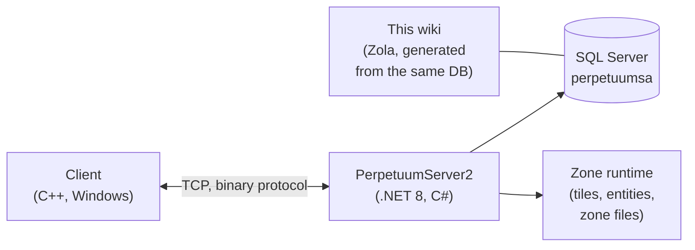

# Ontwikkelaarshub

Een overzicht van hoe het spel werkt, vanuit het perspectief van ontwikkelaars en devops.
Gedetailleerde diepte-pagina's zijn onderweg — voorlopig is dit de oriëntatie.

## De onderdelen

- **Client** — de Perpetuum-spelclient (Windows; zie [Client & PC
  setup](/nl/features/client-setup/) voor het draaien ervan, inclusief Linux). Hij
  communiceert met de server via een binaire TCP-protocol; elke speleractie is
  een benoemd *commando* (dezelfde namen die deze wiki gebruikt in de
  [actie-inventaris](/nl/features/#volledige-actielijst)).
- **Server (PerpetuumServer2)** — een C#/.NET 8 codebase. Eén proces draait de
  hele server: de verlaag, de spellogica (robots, zones, missies, markt,
  productie, onderzoek) en de zone-runtime die per zone de tegelwereld
  bijwerkt (terrein, entiteiten, teleporters).
- **Database** — SQL Server, database `perpetuumsa`. Statische spelinhoud
  (entiteitstandaardwaarden, recepten, extensies, techboom, winkel,
  teleportbeschrijvingen) en alle dynamische staat (karakters, robots,
  containers, markt, zone-status).
- **Zonebestanden** — zones zijn tegelrasters (hoogte- en bestuurlagen, 2
  bytes/tegel) die in `.gbf`-archieven worden geleverd en per zone bewerkbaar
  zijn; zie de [zonebestandsindeling](/nl/formats/zone-files/).
- **Referentiegegevens** — de client downloadt statistiektabellen van de server
  bij het opstarten (zie [Server & referentie](/nl/features/server/)).

## Het draaien

- De server draait in Docker Compose naast SQL Server
  (het `perpetuumserver2`-project); de DB-container is wat de generator van
  deze wiki leest.
- Statische inhoud wordt gevalideerd tegen **plantrules**-regelbestanden; de
  C#-generator van de wiki (`make generate`) draait in hetzelfde ecosysteem en
  leest dezelfde database, zodat elke gegenereerde tabel op deze site live
  serverdata weerspiegelt.
- De zone-teleportkaarten op deze wiki worden gerenderd vanuit dezelfde
  hoogtelagen die het spel zelf gebruikt.

## Volgende stappen

- **[Formats](/nl/formats/)** — ontwikkelaarsveldreferentie: hoe elk statistieveld
  wordt opgeslagen (DB-kolom, regelbestandskey, binaire laagbyte) en verbruikt,
  met uitgewerkte voorbeelden.
- **[Server & referentie](/nl/features/server/)** — de meta-systemen:
  serverinformatie, high scores, de referentiegegevens die de client downloadt
  en de in-game winkel.

> Meer ontwikkelaarspagina's (protocol, zonelevenscyclus, implementatie) zijn
> gepland — deze pagina is het startpunt daarvoor.