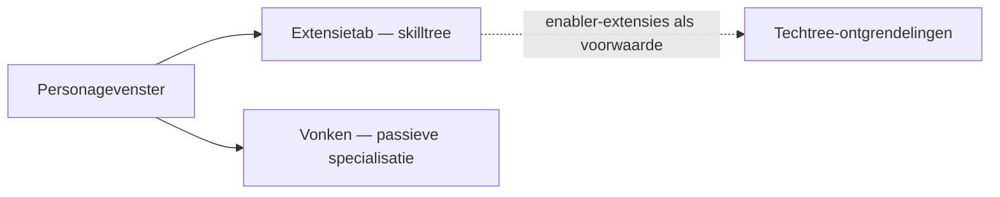

# Personage

Het **personagevenster** (balk bovenaan → **Personage**, linksboven) is waar de
voortgang van je personage zich bevindt: profiel, credits, de **extensies**
(vaardigheden) en instellingen. Alles op deze pagina is per personage — accounts
kunnen er meerdere bevatten, elk met een eigen boom. UI-locaties volgen het
[UI-overzicht van de client](/nl/features/ui/).

## Extensies

De **extensietab** is de skilltree van het personage: per-personage
vaardigheidsniveaus die gameplay ontgrendelen en attributen afstemmen — het
belangrijkste zijn de **enabler-extensies** die nodig zijn om een robotklasse te
besturen. Niveau 1 kost credits, elk verdere niveau kost Extension Points (EP),
en vereisten bepalen het pad.

- [Hoofdcategorieën](/content/extensions/#categories) — de 15 categorieën in één
  oogopslag: welke categorieën welke openen (klik op een vakje om naar de kaarten
  te springen)
- [Extensies per categorie](/content/extensions/#table) — elke extensie: rang,
  prijs, bonus, vereisten
- Hoe EP en de techtree werken: [Onderzoek](/nl/features/research/)

## Vonken

Je **vonk** is de nanobot-specialisatie die op het personage is geïnstalleerd —
zolang deze actief is, worden de bonussen toegepast op elke robot die je
bestuurt. Wisselen van vonk heeft een kost; autorisatie bepaalt de hogere lijnen.
Details in [Vonken](/nl/features/sparks/).