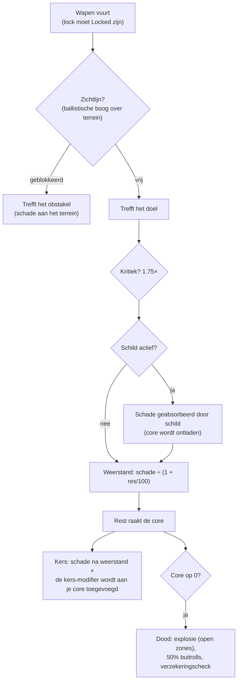

# Gevecht

Gevecht vindt plaats **in zones**, met je actieve robot. Je vecht tegen andere spelers (PvP),
NPC's en vijandige structuren. Deze pagina behandelt de mechanismen die aan de serverkant zijn bevestigd;
gedetailleerde interacties rond schade en fitting staan onder [robots & uitrusting](/nl/features/robots/).

> De UI-locaties volgen het [client-UI-overzicht](/nl/features/ui/): het **schild/panzer/hul en
> energie** van je robot worden weergegeven op het statuspaneel terwijl je niet gedockt bent.
> Doelkeuze en wapenbediening tijdens gevechten zijn nog niet gedetailleerd gedocumenteerd.

## Gevecht aangaan

- Je kunt alleen vechten terwijl je **niet gedockt** bent — je bent je actieve robot.
- Het afvuren van een offensief wapen op een andere speler in een open (PvP) zone zet de
  **PvP-vlag** op de aanvaller. Terugvuren, of een ondersteuningsmodule gebruiken op een
  al gemarkeerde speler, zet de vlag ook op jou. De vlag duurt **5 minuten**
  (de `effect_pvp`-definitie, 300.000 ms) en wordt vernieuwd bij elke nieuwe daad
  van agressie.
- Zolang de vlag actief is:
  - je kunt **geen teleporten** gebruiken (ook mobiele niet), en
  - je kunt **niet normaal doken** — de enige uitweg is **force dock**, die bewust
    niet wordt geblokkeerd door de vlag.

## Wat je kunt aanvallen

- **Robots van andere spelers** (PvP).
- **NPC's** — zone-NPC's zijn georganiseerd in **scharen** (groepen met gedeeld gedrag).
- **Vijandige structuren / deployables** in de zone.

## Wanneer je robot is vernietigd

Je robot is **vernietigd** en er verschijnt een **butse container** op de plek waar deze is gestorven.
De buit wordt per item geroold, met elke keer een kans van 50%:

| Wat | Lot |
|---|---|
| Elke geïnstalleerde **module** | 50% kans om **beschadigd** te vallen (herstelbaar); anders vernietigd |
| De geladen **munitie** van elke module | 50% kans om te vallen (alleen als de module is gevallen) |
| **Lading** (pakketten/dozen) | de inhoud valt als buit, het pakket zelf is vernietigd |
| Andere **stapelbare items** in de lading | 50% kans om te vallen, met een willekeurig verminderde hoeveelheid (de rest is vernietigd) |
| Je **verf/kleur** | 50% kans om te vallen als verfitem |
| De **robot zelf** | vernietigd — tenzij er actieve **verzekering** op stond, waarna de uitkering in credits aan jou wordt uitbetaald (de robot is nog steeds weg) |

**Verzekering** (gekocht bij het verzekeringskantoor van een basis, gedockt — zie
[productie → verzekering](/nl/features/production/)) dekt een robot gedurende **15 dagen** (plus
bonusdagen van een verlenging). Elke robot heeft een content-gedefinieerde **kosten** en **uitkering** (de
`insuranceprices`-tabel — 67 robotdefinities); de kosten kunnen worden verlaagd door een verlengingsbonus
en worden betaald uit je corp-wallet. Starter robots kunnen niet worden verzekerd. Je kunt
verzekeringen hebben op 1 + (verlengingsbonus) robots.

Na een kill heb je **geen actieve robot** meer. Om weer in het spel te komen kun je:

- **een andere robot selecteren** die je bezit en die de vereiste enabler-uitbreidingen heeft, of
- **een starter robot aanvragen** terwijl je gedockt bent — maar er is een korte lock na een kill:
  **3 minuten als je door een speler bent gedood, 1 minuut door een NPC**. Als een **NPC** je heeft
  gedood, geeft de basis je bij terugkeer automatisch ook een **gratis starter robot**.

## Ontsnappen

Als een gevecht slecht gaat:

- **Force dock** — de nooduitgang. Haalt je uit de zone en dockt je direct op de
  hoofdbasis (TMA), zelfs midden in een gevecht.
- **SOS** — een alternatieve uitweg: dockt je op de huidige basis na de normale
  (7-seconde) undock-vertraging.

Beide zijn je vangnetten; force dock is de "ik ga straks dood"-knop.

## Doelvergrendeling, bereik en treffers

- **Vergrendel eerst.** Wapens vuren alleen op *vergrendelde* doelen — en alleen zodra de vergrendeling
  is gevuld. Het vergrendelen van een doel kost de **vergrendelingstijd** van je robot (een stat in ms);
  vuren terwijl dit nog bezig is wordt afgewezen. Je kunt meerdere vergrendelingen tegelijk
  vasthouden (beperkt door de **max locked targets**-stat), maar slechts één is *primair*, en
  sommige wapens vuren alleen op het primaire doel.
- **Optimaal bereik + falloff.** Binnen het **optimale bereik** van een wapen richt je volledige
  schade aan. Daarboven daalt de schade geleidelijk over de **falloff**-afstand —
  ongeveer de helft van de schade op het midden van de falloff, nul aan de rand. Buiten
  optimaal + falloff richt je helemaal geen schade aan.
- **Explosieomvang vs. doelgrootte.** Geweren "missen" niet: de **accuratesse**-stat
  van een geweer werkt als een explosieradius, en een doel waarvan de **signature**
  kleiner is dan die radius, krijgt evenredig minder schade. Raketten *kunnen* volledig missen (de misskans
  komt uit de raket-accuratesse-stat van de robot), maar wanneer ze treffen, exploderen ze
  voor hun **explosieradius** — en, net als bij geweren, krijgt een klein doel minder van
  de explosie.
- **Kritische treffers.** Elk schot rolt je **kans op kritische treffer**; een crit
  vermenigvuldigt de hele treffer met 1.75×, en elke treffer varieert ook willekeurig met ±10%.
- **Zichtlijn.** Schoten reizen in een rechte lijn en terrein, obstakels en
  planten blokkeren ze. Raketten vliegen een boog en kunnen lage dekking overwinnen — maar de boog is
  beperkt, dus hoog terrein blokkeert nog steeds.
- **Je eigen schild blokkeert je eigen wapens.** Zolang je schild actief is, vuren
  je wapens niet.

### Schadestypen

Munitie draagt de schade: elke munitie heeft een waarde voor één of meer schadestypen —
meestal één dominant type plus een kleiner secundair type (raketmunitie is explosief
plus kinetisch of chemisch, laserkristallen thermisch plus chemisch, railgun-projectielen
kinetisch plus thermisch). De typen:

| Type | Opmerkingen |
|---|---|
| **Chemisch** | Het algemene component van munitie voor geweren en lasers |
| **Kinetisch** | Railgun-, projectiel- en raketmunitie |
| **Thermisch** | Lasers, sommige projectielmunitie |
| **Explosief** | Raketten |
| **Toxisch** | Sommige geweermunitie; richt alleen schade aan aan planten en terrein |
| **Elektrisch** | Speciale effecten (bijv. de scorcher) — **penetreert schilden** |

Inkomende schade wordt per type verminderd door de **weerstand** van het doel tegen dat type:
een weerstand van 50% verlaagt de schade met 50/(50+100) ≈ 33%. Weerstand geldt alleen voor wat
*door* het schild heen komt — het schild absorbeert eerst, en wordt betaald uit de
energie van het schild: hoe harder de treffer, hoe meer energie het kost. **Kers**-modules
laten een deel van een schadetype de energie van het schild direct verbranden, zelfs na
weerstand. [Adaptieve legering](/nl/features/modules/#de-modulefamilies)
herverdeelt je weerstanden naar wat je daadwerkelijk raakt.

## Detectie, maskering en snelheid

- **Detectie vs. maskering.** Je kunt een eenheid zien binnen een bereik dat groeit met
  je **detectie**-stat en krimpt met de **maskering**-stat van het doel —
  ongeveer 100 m × detectie ÷ maskering. Een eenheid die je heeft vergrendeld, is altijd
  voor jou zichtbaar, ongeacht de maskering ervan. Stealth-modules verhogen tijdelijk
  je eigen maskering (zie [modules](/nl/features/modules/)); mijnen gebruiken in plaats daarvan een eigen
  detectiebereik.
- **Blob.** Sommige eenheden en structuren stralen een *blob*-veld uit. Zolang je binnen
  de radius van een emitter staat, stijgt het blob-niveau op je eenheid; tussen je twee blob
  drempelstats **verhoogt het je vergrendelingstijd** (tot 6× de basiswaarde)
  en **verlaagt het je vergrendelingsbereik en sensorsterkte** (tot de helft).
- **Snelheid.** Topsnelheid daalt met massa: snelheid = basis × (ontwerpmassa ÷ werkelijke
  massa) — elke ton aan extra modules, pantser en lading die je installeert maakt je langzamer.
- **Demobilisatie ("demob").** Het webber-effect verlaagt de topsnelheid van een doel.
  Hoe hard het inslaat, schaalt met de **massiveness** van het doel — zwaardere eenheden
  worden harder gedemobd, dus grote, langzame doelen voelen het het meest.

## Alarmen

Een **alarm** wordt in een zone geactiveerd door een **alarm-schakelaar** (een missierelateerde
structuur). Wanneer gestart:

- Het loopt gedurende een vaste **alarmperiode** (ingesteld door de missie; kort als standaard).
- Je moet **binnen het bereik van de schakelaar** blijven gedurende de hele periode — dit wordt
  elke paar seconden gecontroleerd, en wegdriften annuleert het alarm.
- Je kunt alleen **één alarm tegelijk actief** hebben.

Alarmen zijn gekoppeld aan missie-inhoud — zie [missies](/nl/features/missions/).

## Dode-rapporten

Je gevechtsgeschiedenis is beschikbaar als **dode-rapporten**:

- Filter op **tijdvenster**.
- Filter op **rol**: als **slachtoffer**, **aanvaller** of **dader**.

Gebruik ze om te zien hoe je bent gestorven of wie je hebt vernietigd.

## Hoogste scores

- **Serverhoogscores** — topresultaten over de hele server.
- **Mijn hoogscores** — je persoonlijke records.

## Praktische tips

- **Sterf niet onzorgvuldig** — een vernietigde robot betekent downtime terwijl je opnieuw uitrust of
  opnieuw aanvraagt.
- **Force dock is direct** — als je overtroffen bent, ga dan nu naar TMA; je kunt later opnieuw uitrusten.
- **PvP blokkeert teleporten** — plan je ontsnapping; je kunt niet uit een gevecht teleporteren.
- **Alarmen zijn een signaal** — een actief alarm betekent dat er een missie-gebeurtenis actief is in dat gebied.

<!--
Ontwikkelaarsnotities: in 2026 herschreven vanuit backend-bronnen; geen community-wikitext hergebruikt.
Geverifieerd tegen:
- Vergrendeling: Zones/Locking/LockHandler.cs (vergrendelingstijd in ms van
  AggregateField.locking_time; MaxLockedTargetsProperty; één primaire vergrendeling;
  vergrendelingsstaten Inprogress -> Locked), Zones/Locking/Locks/Lock.cs,
  Zones/Locking/LockValidator.cs (validatie dood/niet-vergrendelbaar/buiten bereik);
  ZoneSession.cs (wapens nemen een bestaande lock-id; een wapen afvuren waarvan de lock
  niet volledig Locked is, geeft LockIsInProgress — er is GEEN auto-lock bij afvuren).
- Schade: Modules/Weapons/Damage.cs (CalculateDamages: crit = attacker.
  CriticalHitChance, CRITICALHIT_MOD 1.75, willekeurig 0.9-1.1; falloff =
  cos(x*PI)/2+0.5 met x=(distance-optimal)/falloff; nul buiten optimal+falloff;
  explosiemodifier = target.SignatureRadius/explosionRadius geklemd 0..1;
  toxisch uitgesloten van eenheidsschade), Modules/Weapons/WeaponAmmo.cs (schadewarden
  per type staan op de munitie: damage_chemical/thermal/kinetic/explosive/toxic;
  vuurwapen voegt damage_toxic toe aan planten).
- Wapens: Modules/Weapons/FirearmWeaponModule.cs (CheckAccuracy altijd false —
  vuurwapens missen nooit; WithExplosionRadius(Accuracy) — accuratesse IS de
  explosieradius), Modules/Weapons/MissileWeaponModule.cs (missen wanneer rnd >
  robot.MissileHitChance; missile_miss-eigenschap), WeaponModule.cs (schild actief
  => ShieldIsActive-fout; LOS-check vóór afvuren).
- Weerstand: Units/Unit.cs GetResistByDamageType = resist/(resist+100);
  Zones/DamageProcessors/DamageProcessor.cs (schild absorbeert eerst, betaald uit
  core: coreDamage = damage * AbsorbtionModifier; Elektrische schade penetreert als
  coreDamage; kers = damage * type kers modifier, geschaald met
  (sin(core/coreMax*PI)/2)+0.5, toegevoegd aan doelcore);
  EffectModules/ShieldGeneratorModule.cs (AbsorbtionModifier =
  max(SigRadius/shieldRadius,1)/shieldAbsorbtion).
- Schadestypen: Modules/Weapons/DamageType.cs — Chemisch, Kinetisch, Thermisch,
  Explosief, Toxisch, Elektrisch (geen "seismic"; rakettschade is Explosief).
  Elektrisch wordt in deze backend alleen gegenereerd door ScorcherModule.cs.
- Detectie: Units/Unit.Visibility.cs (IsDetected: range = 100/max(1,
  target.StealthStrength)*max(1, DetectionStrength); lock op jou altijd
  zichtbaar; mijnendetectiebereik apart); stealth_strength-eigenschap bevat
  effect_stealth_strength_modifier (stealth-modules verhogen maskering).
- Snelheid: Units/UnitProperties/SpeedMaxProperty.cs (speed_max * Mass/ActualMass;
  dreadnought => 0.05; massiveness/drone/highway-effectmodifiers).
- Demob: Modules/EffectModules/WebberModule.cs (effect_demobilizer; effect
  eigenschap = modulewaarde + target.Massiveness, geklemd op 1.0 — zwaardere doelen
  krijgen het volledige effect; longrange webbers vereisen daarnaast LOS; accuratesse
  check via optimal-range-modifier).
- Blob: Zones/Blobs/BlobHandler.cs (emitters verhogen blobniveau binnen
  BlobEmissionRadius; tussen blob_level_low/high schaalt de multiplier:
  locking_time-modifier -5, d.w.z. locktijd x(1+5*m) — tot 6x basis bij volledige blob, max_targeting_range *0.5,
  sensor_strength *0.5).
- LOS: Zones/LineOfSight.cs (raycast tegen terreinblokkers incl. Plant-vlag;
  ballistische boog voor raketten: maximale amplitude 16 m over 40 m);
  Zones/Terrains/BlockingFlags.cs (Obstacle/Plant/Decor/Island blokkeren).
Correcties t.o.v. ingevoerde pagina: schadetype "seismic" bestaat niet (explosief
wel); "vuurwapens verliezen schade in plaats van missen" geverifieerd (accuratesse = explosieradius);
auto-lock bij afvuren NIET in backend (lock moet eerst worden aangemaakt en voltooid);
"interference" (emission/minimum/peak, emitters, anomaliedegradering)
heeft GEEN equivalent in deze backend — alleen een commentaar in Services/RiftSystem/Rift.cs
— sectie verwijderd; schild "absorbeert" is core-energie gebaseerd, en Elektrische schade
penetreert dit.
Ontwikkelaarbestanden: Zones/Locking/*; Zones/Locks via Zones/Locking/Locks/*;
Modules/Weapons/*.cs; Zones/DamageProcessors/*.cs; Units/Unit.Visibility.cs;
Units/Unit.cs; Units/UnitProperties/SpeedMaxProperty.cs;
Modules/EffectModules/ShieldGeneratorModule.cs, WebberModule.cs,
StealthModule.cs; Modules/ScorcherModule.cs; Zones/Blobs/*.cs;
Zones/LineOfSight.cs; Zones/ZoneSession.cs (lock/fire-pakketverwerking).
Vroeger geverifieerd (zoals behouden): PvP-vlag = effect_pvp 300000 ms
(effect_pvp-definitie), verhoogd door attack/aggro/support (Player.cs
ApplyPvPEffect); blokkeert teleport + normaal doken (CantDockThisState), ForceDock.cs
heeft geen PvP-check; doodsbuit 50% rolls (Player.cs OnUnitDeath,
Services/Looting/LootHelper.cs DROP_CHANCE 0.5); verzekering (InsuraceFacility.cs,
InsuranceHelper.cs, insuranceprices 67 defs); starter-robot-lock 3 min PvP /
1 min NPC; alarmen (Zone/AlarmStart.cs, AlarmSwitch.cs); dode-rapporten
(GetMyKillReports.cs); hoogscores (GetHighScores.cs / GetMyHighScores.cs).
-->