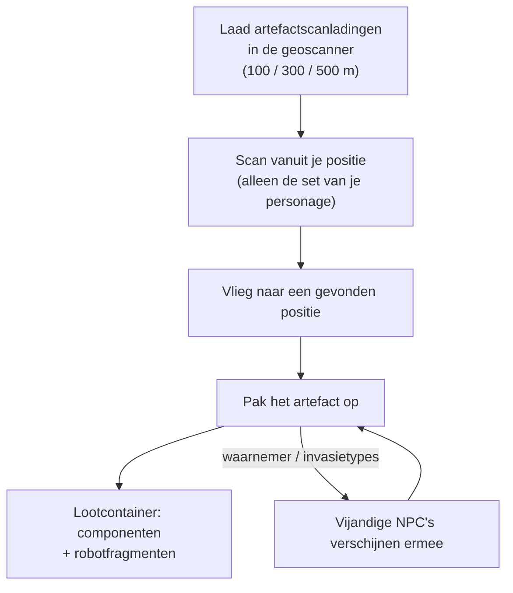

# Verkenning (artefacten & relikwieën)

Verkenning is het vinden van verborgen waarde in het terrein — een sterke solo-activiteit op elk niveau. Het komt in twee vormen: **artefacten**, die persoonlijk en verborgen zijn, en **relikwieën**, die open en omstreden zijn.

## Artefactjacht

Artefacten zijn punten die **per personage** bestaan: de server bewaart een aparte artefactset voor elk personage op elk eiland, dus wat je vindt is alleen van jou. Ze zijn onzichtbaar totdat je ernaar scant.

1. Laad **artefactscanladingen** in een geoscannermodule. Er zijn drie ladingniveaus met verschillende scanbereiken (100 / 300 / 500 m).
2. Scan vanuit de positie van je robot — de scanner geeft de artefactposities binnen bereik terug (de nauwkeurigheidsstat van de geoscanner verkleint de onzekerheid van de gemelde positie).
3. Vlieg naar een gevonden positie en pak het artefact op; er verschijnt een **lootcontainer** op die plek.

Twee dingen maken van artefactjacht zowel een gevechts- als een verzamelactiviteit:

- Sommige artefacttypes **spawnen NPC's met jou** — de "waarnemer"- en "invasie"-varianten trekken vijanden aan zodra het artefact is gevonden, dus bestuur iets dat kan vechten.
- Loot is willekeurig per artefacttype: modulecomponenten (pantserplaten, versterkers, generatoren, reparatoren…) en **robotfragmenten** — de faction-specifieke onderzoeks- en productie-ingrediënten, wat artefactjacht tot een centrale industriële carrière maakt.

Artefacttypes zijn in niveaus onderverdeeld (niveau 1–3, meer loot op hogere niveaus) en bestaan in neutrale en per-faction-varianten.

## Relikwiejacht

Relikwieën zijn **openwereld**-objecten: de zone genereert ze op willekeurige posities (op een respawn-cyclus van ongeveer 90 minuten met willekeurige spreiding), ze zijn zichtbare objecten met een straal, en wie er als eerste een oppakt krijgt de loot. Loot is een roll van NIC plus **robotfragmenten**, geschaald op het niveau van de relikwie en het waardeniveau van het eiland — dezelfde fragmenten die artefactjacht oplevert.

Relikwietypes zijn per eiland in niveaus onderverdeeld (niveaus 1–3, met verschillende EP-waarden per niveau) en komen in neutrale, per-faction- en industriële varianten voor. Sommige relikwieën zijn gekoppeld aan [uitposten](/nl/features/outposts/) — de SAP-activiteit genereert zijn eigen relikwieën, die tot 12 uur leven — en op open-PvP-eilanden liggen de spawnpunten in omstreden terrein, dus verwacht andere jagers tegen te komen.

## Missies betalen het ook

[Missies](/nl/features/missions/) kunnen ook artefactwerk aan je geven, waarbij je direct betaald wordt en de goederen naar de opdrachtgever gaan in plaats van naar je inventaris.

<!--
Geschreven vanaf nul op basis van de serverbackend, 2026-09-27:
Zones/Artifacts/Repositories/ZoneArtifactRepository.cs (artefactrijen per personage), Zones/Scanning/Scanners/Scanner.Artifact.cs (scanbereik + nauwkeurigheid),
Zones/Artifacts/Generators/Loot/ (willekeurige loot per type),
Services/Relics/RelicManagers/ZoneRelicManager.cs (~1,5 uur respawn + willekeurig venster) en SAPRelic.cs (levensduur 12 uur),
artifacttypes/artifactloot/relictypes/relicloot-tabellen,
ammo_artifact_scan_a/b/c (scanbereiken 100/300/500).
Eerdere versie van deze pagina was aangepast van de Open Perpetuum
community wiki (perpetuum.miraheze.org) en is volledig herschreven vanuit
backendbronnen; er is geen tekst hergebruikt.
-->