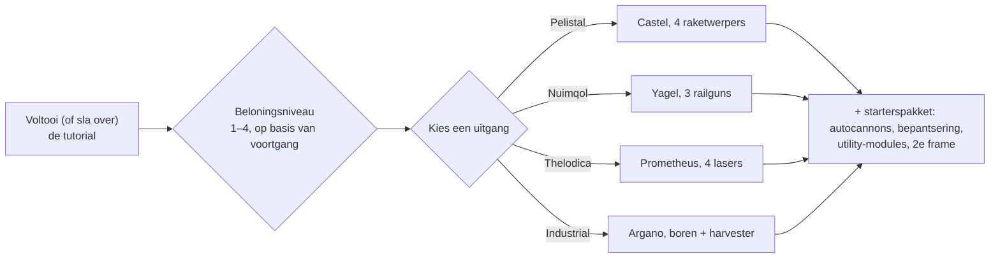

# FAQ

## Kan ik de tutorial overslaan?

Je kunt de trainingszone vroegtijdig verlaten, maar dan loop je de beloning mis die
het voltooien ervan oplevert. Wanneer een personage de tutorial verlaat, doet de server het volgende:

- keert de **start-NIC** uit plus een bonus **per beloningsniveau** dat je hebt behaald in de
  tutorial (er zijn vier beloningsniveaus),
- plaatst je in de **standaardcorporation** voor het ras en de school die je hebt gekozen,
- kent je **start-extensies** (vaardigheden) en je **vonk** toe,
- maakt je **starterrobot** aan, dockt je bij de New Virginia-dockingbasis en
  stelt deze in als je **thuisbasis** — de plek waar je respawnt wanneer je robot wordt
  vernietigd,
- plaatst je **beloningsitems** in een openbare container op die dockingbasis en
  stuurt je een welkomstmail.

## Hoe voltooi ik de tutorial?

Werk de doelen in volgorde af; de **Rookie Checklist** van de client (Help-menu
in de bovenbalk) houdt ze bij en kan aan de onderbalk worden vastgepind. Hoe ver
je komt, bepaalt je beloningsniveau, wat beslist welke beloningstiers je ontvangt
bij vertrek — een vertrek op niveau 1 krijgt alleen de eerste tier, een volledige voltooiing
krijgt ze alle vier.

## Wat levert elke uitgang mij op?

Je keuze bepaalt drie dingen: de **starterrobot** die je bestuurt, de **beloningsitems**
die je ontvangt, en de **standaardcorporation en startvaardigheden** die je krijgt.
Al het andere — elke vaardigheid, elke robot, de uitrusting van elke factie — kan later worden
getraind en gekocht met EP en NIC, dus de keuze is een starterspakket, geen definitieve vastlegging.

| Uitgang | Starterrobot (uitgerust) | Beloningsthema |
|---|---|---|
| **Pelistal** | Castel — vier raketwerpers | raketten + autocannons |
| **Nuimqol** | Yagel — drie railguns | railgunmunitie + autocannons |
| **Thelodica** | Prometheus — vier lasers | laserkristallen + autocannons |
| **Industrial** | Argano — twee boren, een harvester, een mijnbouwsonde | munitie voor mijnbouw, oogsten en artefactscans |

Elke uitgang bevat ook een set kleine autocannons met munitie, bepantsering en
utility-modules (reparatierobot voor bepantsering, sensorbooster of massareductor, core
recharger, schademodifiers), een tweede (leeg) frame en een wall-bomb-capsule op de
hoogste beloningsniveaus.

## Wat doe ik als ik eenmaal buiten ben?

Vrijwel elke activiteit levert EP op voor vaardigheden en NIC voor uitrusting:

- Mijn, oogst, zoek artefacten — en verkoop de opbrengst op de [markten](/nl/features/market/).
- Schiet NPC's neer en verkoop de [buit](/nl/features/npcs/).
- Verzamel of koop materialen en [bouw](/nl/features/production/) spullen.
- Voer [missies](/nl/features/missions/) uit — alles wat bij een terminal of
  uitpost wordt aangeboden kan door jou alleen in de wereld worden voltooid.

Nieuw bij open-wereld PvP? Lees eerst de [overlevingsnotities in Snel starten](/nl/features/getting-started/#survival).

## Kan ik terugkeren naar de trainingszone?

Nee. De trainingszone is bedoeld voor nieuwe personages en je kunt niet meer terugkeren
nadat je deze hebt verlaten. De Rookie Checklist blijft beschikbaar in het Help-menu als je
de doelen nog eens wilt nalezen, en je kunt altijd een ander personage aanmaken en dat in
de tutorial laten als testsandbox.

## Afkortingen

Veelvoorkomend jargon in chat, marktnoteringen en fittings. De meeste termen hebben een
eigen pagina (gelinkt waar nuttig) — itemnamen zijn te vinden via de zoekfunctie van de site.

| Term | Betekenis |
|---|---|
| **EP** | [Extension Points](/nl/features/research/#ep-sources) — de vaardigheidsvaluta op accountniveau die wordt gebruikt om [extensies](/nl/features/character/#extensions) te upgraden (de verdienregels staan op de [onderzoekspagina](/nl/features/research/#ep-sources)). |
| **NIC** | Nian Credit — de valuta in het spel (het `credit`-saldo van je personage). |
| **CT** | [CPRG — Kalibratieprogramma](/nl/features/production/#cprg-calibration-programs) — het programma waarmee een productielijn wordt gekalibreerd voordat deze produceert (één per item, met materiaal-/tijdefficiënties). |
| **Proto** | Een prototype-item — de variant van een hogere tier van een module/robot, gemaakt in de [prototypefaciliteit](/nl/features/production/#the-item-lifecycle-the-circular-process) (verbruikt een exemplaar van de vorige tier; zie [tier-progressie](/nl/features/production/#tier-progression)). |
| **LWF** | Lightweight frame — een massaverminderende bepantseringsmodule (de client noemt ze "… lightweight frame", bijv. *Niani lightweight frame*). Maakt een robot lichter, ten koste van bepantsering. |
| **TP / tele** | [Teleport](/nl/features/movement/) — snel reizen tussen vaste punten, of naar een geplaatst mobiel teleportapparaat. |
| **SAP** | Service Access Point — de [stabiliteitsactiviteit](/nl/features/outposts/) van uitposten. |
| **Stab** | Weapon Stabilizer — verhoogt de raakprecisie van een wapen. |
| **Demob** | Demobilizer — een module die een andere robot (en zijn modules) vertraagt. |
| **EWar** | Electronic Warfare-modules (verstoring, sensoronderdrukking, stealth). |
| **EnWar** | Energy Warfare-modules (core-injectors, drainers, neutralizers, transfers). |
| **Tuning** | De benaming in de client voor de upgrademodules die andere modules verbeteren — schademodifiers voor wapens, *industriële tuning* voor miners en harvesters, bepantseringsreparatietuning, enzovoort. |
| **MK2** | Een verbeterde variant van een robot (`_mk2`-frames) — grotere capaciteiten, een eigen onderzoekslijn. |

Robotklassen volgen de groeperingen in de client — zie de opmerking onder
[Robotklassen](/nl/content/robots/#robot-classes).

<!--
Written from scratch against the server backend, 2026-09-27:
Zones/Teleporting/Strategies/TrainingExitStrategy.cs (exit rewards, NIC,
corporation, extensions, spark, starter robot, home base, reward items),
Zones/Training/Reward/TrainingReward*.cs + trainingrewards/robottemplates
(reward levels 1-4, per-race starter packs and items),
Robots/Robot.Properties.cs (race ids 1=Pelistal, 2=Nuimqol, 3=Thelodica, 5=industrial).
An earlier version of this page was adapted from the Open Perpetuum
community wiki (perpetuum.miraheze.org) and has been fully rewritten from
backend sources; no text was reused.
-->
