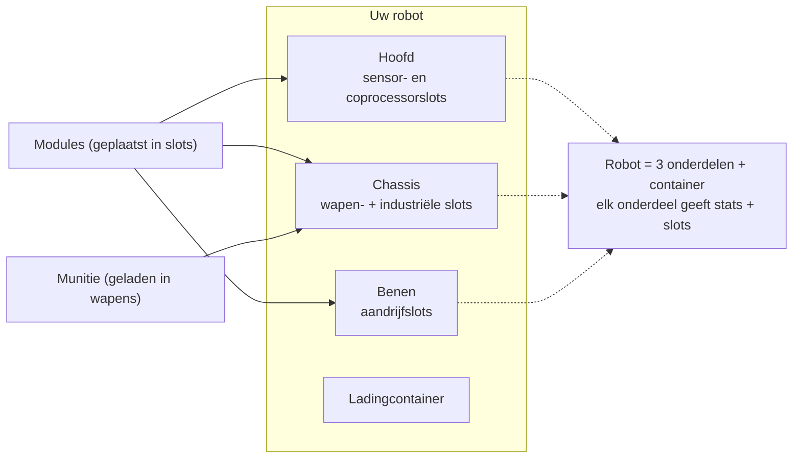

# Uitrusting

Uitrusting betekent het laden van **modules** in de componentslots van de robot en van **munitie** in je
wapens. Alle uitrusting is **uitsluitend gedockt** — je kunt niet uitrusten in een zone.

> De UI-locaties volgen het [client-UI-overzicht](/nl/features/ui/) (de **Uitrusten**-categorie in
> de bovenbalk). De onderstaande mechanismen zijn geverifieerd tegen de server.

## Modules uitrusten

Een robot heeft verschillende **componenten** (wapen, schild, pantser, aandrijving, sensor, enz.), elk
met een set **slots**.

- **Module uitrusten** — neem een module uit een container en laad deze in een specifiek
  componentslot. Het moduletype moet geldig zijn voor dat slot op die robotklasse.
  Als het slot bezet is, wordt de bestaande module teruggegeven naar de container.
- **Modules wisselen** — verplaats een module tussen twee slots van dezelfde component.
- **Module verwijderen** — haal een module uit een slot terug naar een container.

De server herleidt de stats van de robot na elke wijziging (modules beïnvloeden de waarden
die worden weergegeven op het statuspaneel in niet-gedockte staat — zie [gevecht](/nl/features/combat/)).

## Munitie uitrusten

- **Munitie uitrusten** — laad een compatibel munitie-item in een actieve (wapen)module. De module
  moet **dat munitietype accepteren**, en de munitie wordt geladen tot de **munitiecapaciteit**
  van de module. Eventueel eerder geladen munitie wordt eerst teruggegeven naar de container.
- **Munitie wijzigen** — wissel de geladen munitie voor een ander compatibel type.
- **Munitie verwijderen** — geef de geladen munitie terug naar een container.

## Uitrustingspresets

Een **preset** is een opgeslagen uitrusting die je snel opnieuw kunt toepassen:

- **Opslaan** — sla de huidige uitrusting van een robot op onder een naam.
- **Lijst** — bekijk je opgeslagen presets.
- **Toepassen** — laad een preset op een (andere) robot vanuit een container.
- **Verwijderen** — verwijder een opgeslagen preset.

Presets zijn handig om snel opnieuw uit te rusten na een gevecht of bij het wisselen tussen rollen.

## Praktische opmerkingen

- **Je kunt niet uitrusten in een zone** — alles hier vereist dat je gedockt bent.
- **Eerst enabler-extension** — zonder onderzochte robotklasse kun je deze niet selecteren of besturen.
- **Munitie moet bij het wapen passen** — een incompatibele munitiedefinitie wordt geweigerd.
- **Herpakte robots kunnen niet worden gebruikt** — pak een robot uit voordat je deze selecteert of uitrustt.
- **Gebruik presets om snel opnieuw uit te rusten** — sla een bekend werkende loadout op en pas deze toe na verlies.

## Slotcategorieën

De componenten van een robot (hoofd, chassis, benen) bieden **slots**, en elk slot heeft een set
categorievlaggen. Een module past in een slot alleen als de eigen vlaggen van de module een **subset** zijn
van de vlaggen van het slot. De vlagcategorieën zijn:

`small`, `medium`, `large`, `turret`, `missile`, `melee`, `industrial`,
`ew_and_engineering`, `specialized` (een gespecialiseerd slot accepteert alleen gespecialiseerde
modules), en de structurele `head` / `chassis` / `leg` slots.

Modules kunnen ook beperkt zijn tot specifieke robots, en sommige hebben een **unique**-vlag, zodat
er op hetzelfde moment maar één van dat type uitgerust kan worden. Stat-effecten per module staan in de
gegenereerde [robotstabel](/content/robots/).