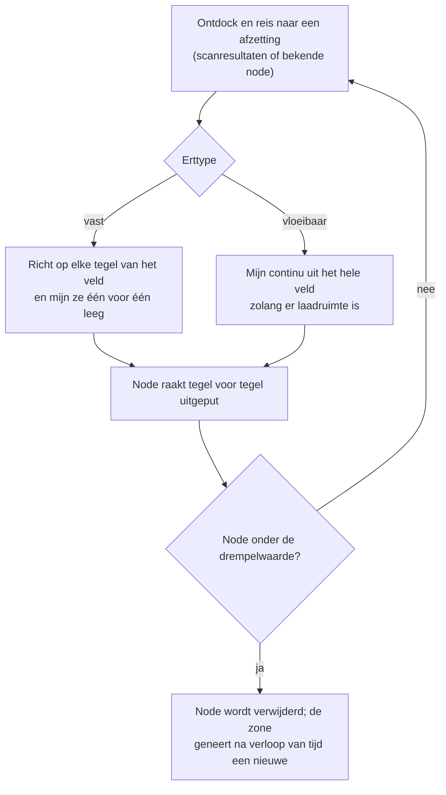
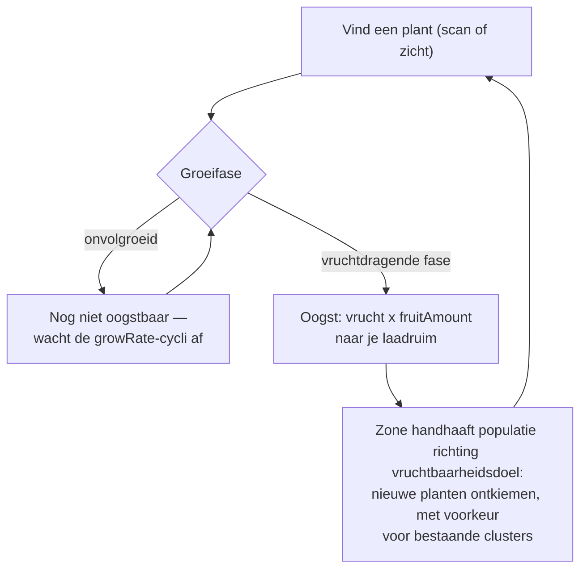
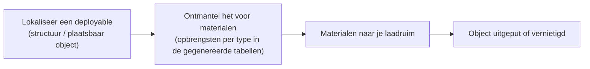

# Verzamelen & scannen

Grondstoffen in het spel komen uit drie bronnen in een zone: **ertsafzettingen**, **planten**
en **deployables** (plaatsbare structuren). Deze pagina legt uit hoe elk werkt en hoe de verzamelcyclus verloopt.

> UI-locaties volgen het [client UI-overzicht](/nl/features/ui/): scan- en oogstacties staan in
> de lijst van **ontdockte acties** (rechtsboven in een zone). Opbrengstcijfers per grondstoftype
> staan in de gegenereerde tabellen: [Content → Ores](/content/ores/) en
> [Content → Plants](/content/plants/). De onderstaande mechanismen zijn geverifieerd aan de hand van
> de serverimplementatie.

## De basiscyclus

1. **Ontdock** en vlieg een zone in (zie [beweging](/nl/features/movement/)).
2. **Scan** het gebied met de scannermodule van je robot.
3. **Verzamel** — ontgin erts, pluk plantenvruchten of ontmantel deployables.
4. **Dock** en lever je lading af in een container op een basis.

## Ertsafzettingen

- Erts bevindt zich in de grond als **afzettingen (nodes)** verspreid over de zone.
- Om ze te vinden en vast te leggen heb je een **geo-scannermodule** nodig die op je actieve robot is uitgerust.
  Een scan levert een **scanresultaat** op; je **uploadt** dit vervolgens, waardoor het wordt opgeslagen in je
  persoonlijke mineraalscanlijst.
- Je opgeslagen scanresultaten kunnen worden **weergegeven, verplaatst, verwijderd of omgezet in items**
  (de "mineraalscan"-items die worden gebruikt voor verwerking/productie).

- Afzettingen zijn **eindig**: elke node bevat een beperkte totale hoeveelheid. Wanneer een node
  tot onder de drempelwaarde is ontgonnen, wordt deze verwijderd en de zone **genereert nieuwe nodes**
  in de loop van de tijd tot het geconfigureerde maximum. Hoe nodes worden geplaatst en hoe plantenpopulaties
  worden onderhouden — met echte zones als uitgewerkte voorbeelden — staat in
  [Zones → Generatie](/zones/generation/).
- **Vaste vs. vloeibare ertsen.** Vaste ertsen raken tegel voor tegel uitgeput — je richt op elke
  tegel van het veld en ontgint deze tot hij leeg is. Vloeibare ertsen putten uit het hele veld, zodat
  je ontginner continu kan draaien zolang je laadruimte hebt. Dat gemak is precies de reden waarom
  vloeibare ertsen doorgaans minder waard zijn: er is minder vaardigheid en aandacht nodig om ze te ontginnen.

### Planten- & ertsstatistieken in één oogopslag

Het gedrag van ertsen en planten wordt gestuurd door regelgegevens per type. De velden die voor een
speler van belang zijn:

| Veld | Wat het betekent in het spel |
|---|---|
| `fertility` | Hoe algemeen het type is — hogere waarde = de zone probeert er meer van in stand te houden |
| `growRate` | Hoeveel groeicycli een plant in elke fase moet doorbrengen alvorens door te groeien (hoger = langzamer) |
| `spreading` | Of het type in clusters (groepen) groeit of verspreid |
| `killDistance` | Minimale tussenruimte tussen twee planten van hetzelfde type |
| `slope` / `minSlope` | De terreinhelling waarop de plant kan groeien |
| `allowedAltitudeLow/High` | De hoogteband waarin de plant kan groeien |
| `allowedWaterLevelLow/High` | Afstand-tot-kust-band (creëert kustvegetatie) |
| `fruitingState` | Welke groeifase de plant moet bereiken voordat hij vruchten draagt (oogstbaar is) |
| `fruitDefinition` / `fruitAmount` | Wat de plant oplevert en de basishoeveelheid |
| `maxAmount` | Maximum aantal van dit type in een verwerkingsgebied |
| `health` | Levenspunten (hit points) per groeifase (latere fasen kunnen taaier zijn) |
| `damageScale` | Schaderesistentie van de plant |
| `playerSeeded` | De plant bestaat alleen waar een speler hem heeft geplant |
| `onlyOnUnprotectedZone` | Groeit alleen in onbeschermde zones (bèta-/gammastatus) |

De volledige veld-voor-veld referentie (typen, standaardwaarden, opslag en hoe de zonetick
ze gebruikt) staat in [Formaten → Plantenvelden](/nl/formats/plant-fields/).

## Planten

- Planten **groeien in de loop van de tijd** door een reeks fasen. Elke fase vereist een aantal
  groeicycli (`growRate`) voordat de plant willekeurig doorgroeit naar de volgende fase.
- Een plant **draagt pas vrucht als hij de vruchtdragende fase bereikt** — onvolgroeide planten
  kunnen niet worden geoogst.
- De zone handhaaft plantenpopulaties in de richting van een **vruchtbaarheidsdoel (fertility target)**:
  als een stuk grond onderbeplant is voor zijn vruchtbaarheidsniveau, ontkiemen er nieuwe planten;
  het gekozen type weegt de `fertility` van elke soort mee, en `spreading` stuurt nieuwe groei
  bij voorkeur naar bestaande clusters.

- Sommige planten zijn **door spelers gezaaid** (ze bestaan alleen in tuinen van spelers) en sommige
  groeien **alleen in onbeschermde zones**.
- Planten kunnen worden **beschadigd en vernietigd**; hun `health` en `damageScale` bepalen hoe
  moeilijk dat is.

## Deployables (plaatsbare objecten)

Deployables zijn geplaatste objecten in een zone (zie [Krachtbasisstations](/nl/features/pbs/) voor
de structuurzijde). Sommige kunnen worden **ontmanteld (gestript)** voor materialen. Ontmantelingsregels
en opbrengsten per type staan in de gegenereerde tabellen: [Content → Ores](/content/ores/) en [Content → Plants](/content/plants/).

## Kiosken

Een **kiosk** is een missie-gerelateerde structuur: je **dient items in** (binnen bereik) als
onderdeel van een missie. Het is op zichzelf geen bron van grondstoffen — zie [missies](/nl/features/missions/).

## Praktische opmerkingen

- **Scannen vereist de module** — geen geo-scanner uitgerust, geen scanresultaten.
- **Scanresultaten zijn persoonlijk** — ze worden per personage opgeslagen en worden niet gedeeld.
- **Ertsnodes respawnen, maar langzaam** — als een gebied leeg is, is de afzetting verdwenen, niet
  verborgen. Regeneratie herstelt het aantal nodes in de loop van de tijd, niet direct.
- **Oogst wat rijp is** — planten in de vruchtdragende fase geven de volledige opbrengst; jongere fasen
  leveren niets op.

<!-- TODO: only the client UI flow remains (scan screen, harvest interaction, cargo UI) —
     needs a running client. Per-type ore yields are at /content/ores/ and plant fruit
     definitions at /content/plants/ (generated from the live DB).
     Developer notes: Zone/ZoneUploadScanResult.cs (GeoScannerModule required);
     MineralScanResult*.cs (per-character repository);
     Zones/Terrains/Materials/Plants/PlantRule.cs (all plant rule fields);
     Zones/Terrains/NatureCube.cs (GrowPlants, fertility/spreading/killDistance logic);
     Zones/Terrains/Materials/Minerals/MineralLayer.cs (ore node lifecycle);
     Zone/UseItem.cs + UseItemVisitor.cs (IUsableItem harvest path);
     Zone/KioskSubmitItem.cs (mission item submission, range-limited). -->
