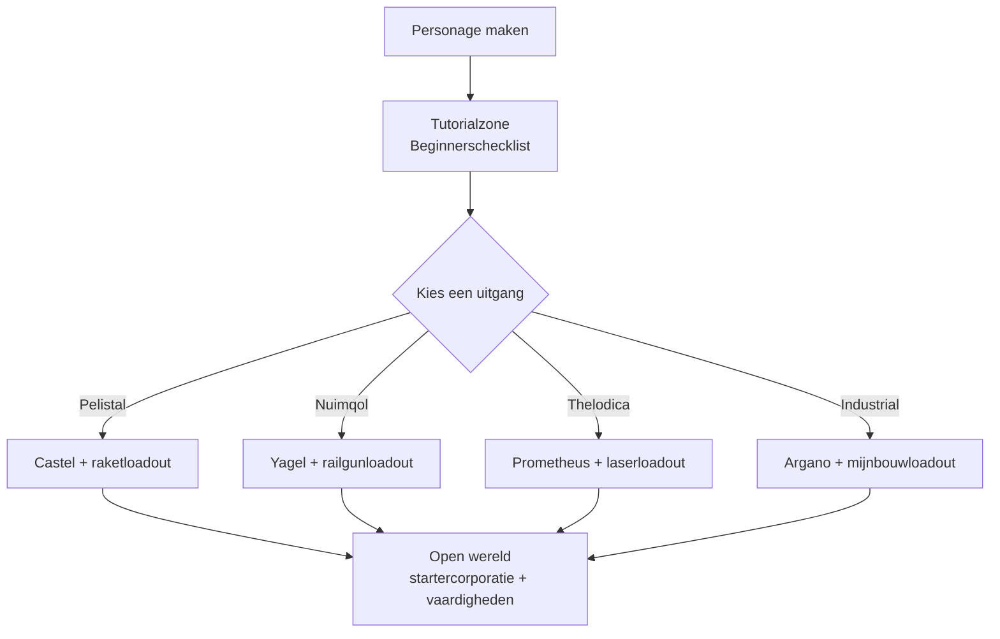

# Snel starten

Deze pagina behandelt de eerste stappen: een personage maken, je eerste robot krijgen
en de personageniveau-instellingen die je vroeg zult gebruiken.

> De UI-locaties volgen het [client-UI-overzicht](/nl/features/ui/). De mechanismen hieronder zijn bevestigd
> op basis van de serverimplementatie.

## Het spel downloaden

Perpetuum is gratis op [Steam](https://store.steampowered.com/app/223410/Perpetuum/).

  <a class="steam-card-link" href="https://store.steampowered.com/app/223410/Perpetuum/" target="_blank" rel="noopener">
    
    Perpetuum op Steam — gratis te spelen
  </a>

## Eerst kijken

Handleidingen van het Open Perpetuum Project. Klik op een kaart om deze hier af te spelen.

  

    
    &#9654;
    
Perpetuum Online tutorial-walkthrough. + Advies over extensies en veel meer.

  

  

    
    &#9654;
    
Hulp bij syndicaatscarrières — Artifacting

  

  

    
    &#9654;
    
Open Perpetuum tutorial — Hoe je meerdere clients draait

  

## Een personage maken

- Je kunt **controleren of een naam vrij is** vóór het aanmaken (`characterCheckNick`).
- **Maak het personage** — het is gekoppeld aan je account. Een account kan meerdere
  personages bevatten; je speelt er tegelijk één.
- **Selecteer een personage** om ermee te spelen. Als je van personage wisselt, wordt
  het huidige personage niet meer geselecteerd.
- Je kunt een personage later **hernoemen** (de naam moet beschikbaar zijn).
- Je kunt een personage **verwijderen** dat je niet meer gebruikt.

## Je eerste robot

- Terwijl je **gedockt bent bij een basis**, kun je **de starterobot aanvragen**
  (basisvoorzieningen — zie het [client-UI-overzicht](/nl/features/ui/) voor de locatie van basisacties).
  - De basis moet nog starterobots op voorraad hebben — bij populaire bases kan dit op zijn,
    waarna de aanvraag mislukt.
  - Er is een **afkoeltijd van 5 minuten** tussen aanvragen van een starterobot per personage.
  - De nieuwe robot wordt geleverd in de openbare container van de basis.

- Terwijl je gedockt bent, kun je ook een **"infinite box" aanvragen**: een speciale container die aan
  je inventaris wordt toegevoegd voor een **kostenpost van 5.000 credits**. Dit is een handige container,
  geen bron van gratis resources.

## Personage-instellingen

- **Avatar** — hoe je personage eruitziet.
- **Stemmingbericht** — een korte regel die aan andere spelers wordt getoond.
- **Privénotitie** — een notitie die alleen jij ziet op een van je eigen personages.
- **Thuisbasis** — stel je thuisbasis in of wis deze; dit is je standaarddock wanneer het spel
  je ergens veilig moet plaatsen.
- **Instellingen** — voorkeuren per personage (ophalen/instellen).
- **Handel blokkeren** — schakel handel aan of uit voor een personage.
- **Credits** — verplaats credits tussen je eigen personages; bekijk de transactiegeschiedenis.
- **Accountniveau** — wijzig e-mailadres/wachtwoord van de sessie, bekijk de transactiegeschiedenis
  van het account en de EP-geschiedenis voor activiteit.

## Afmelden / opnieuw inloggen

- **Afmelden** beëindigt de sessie; **personage selecteren** start deze opnieuw.
- Als de server je wegstuurt (bijv. gedwongen naar een basis), verschijn je weer gedockt —
  zie [beweging](/nl/features/movement/).

## De tutorial

Nieuwe personages starten in de trainingszone met een **Beginnerschecklist** — voltooi deze:
deze behandelt de basis en geeft meerdere robots met modules en munitie. Je kunt
deze overslaan (dock los en loop naar een factie-uitgang), maar dan mis je de beloningen
en kun je later niet meer terug naar de trainingszone. Wat de vier factie-uitgangen je
opleveren, staat in de [FAQ](/nl/features/faq/).

## Overleven

Perpetuum is een risk-and-reward-sandbox, en als je robot omkomt, verlies je hem —
gedockt of niet, gedood door een speler of een NPC — en verschijn je weer op je [thuisbasis](#personage-instellingen)
(als je met lege handen aankomt, kun je daar een gratis starterobot aanvragen). Een paar
regels die de verliezen overleefbaar houden:

- **Zet alleen in wat je kunt vervangen.** Ondocken is een gok: als de robot neergaat,
  is hij en zijn gemonteerde modules weg (of buit). Voordat je lanceert, zorg dat dit
  verlies overleefbaar is.
- **Ken de zones.** De beschermde (PvE)-eilanden zijn veilig voor spelers; de
  open-PvP-eilanden zijn vrij gevecht zonder strafstelsel. Zie
  [zones](/zones/) voor de kaart.
- **Ken de NPCs.** Oranje markers agresseren alleen wanneer geprovoceerd; rode markers
  agresseren bij nadering. Loop weg en breek de zichtlijn om aggro te verliezen. Zie
  [NPC's & PvE-jacht](/nl/features/npcs/).
- **Mitigeer risico, accepteer het niet alleen.** Naar een open-PvP-eiland gaan in je beste
  T4-uitgeruste mech is hoe mechs sterven. Goedkopere, vervangbare uitrusting die zich
  in een paar reizen terugverdiemt, is beter dan de dure bot die twintig reizen kost.
- **Bouw een duurzame cyclus.** Wat je ook doet — missies, verzamelen, jagen,
  productie, vervoer — iemand betaalt NIC ervoor. Houd reservegoederen aan zodat één slechte dag
  je inkomsten niet tot nul verlaagt.

## Wat je als volgende kunt doen

1. Selecteer je starterobot en leer het [hangar- en fitting-scherm](/nl/features/robots/).
2. Dock los en beweeg de zone in — zie [beweging](/nl/features/movement/).
3. Scan de grond en begin met het verzamelen van resources — zie [verzamelen](/nl/features/gathering/).
4. Onderzoek je eerste extensies — zie [onderzoek](/nl/features/research/).
5. Kies een carrière — de [FAQ](/nl/features/faq/) heeft het menu.

<!-- TODO(fase 1): controleer de client-UI-flow (accountaanmaakscherm, personage-wizard).
     UI-model: zie features/ui.md (EVE-stijl, door het project verstrekt).
     Ontwikkelaarsnotities: Perpetuum.RequestHandlers.Characters/* (CharacterCreate,
     CharacterSelect, CharacterRename, CharacterSetHomeBase, ...);
     RequestStarterRobot (afkoeltijd van 5 minuten, basisvoorraad), RequestInfiniteBox
     (5000 credits, alleen gedockt). -->