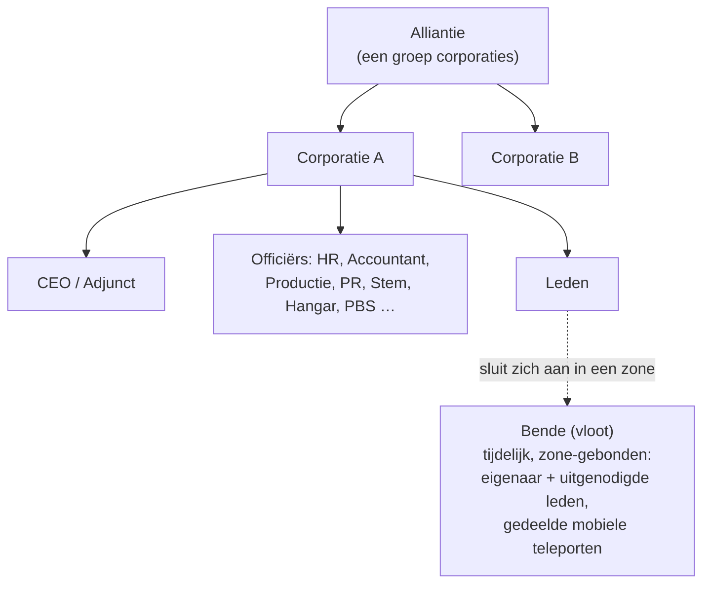

# Groepen

Er zijn drie types groeperingen: **corporaties** (je hoofdorganisatie), **allianties** (groepen van
corporaties) en **benden** (tijdelijke vloten voor zone-gevechten).

> De UI-locaties volgen de [UI-overzicht van de client](/nl/features/ui/) (de **Corporation**-knop linksboven;
> de **Corp Storage**-categorie; benden hebben een eigen venster). De mechanismen hieronder zijn
> geverifieerd tegen de server.

## Corporaties

### Toetreden & vertrekken
- **Sticht** een corporatie — vereist de basis extensie voor corporatiebeheer
  (niveau 1) en een oprichtingskosten van **250.000 NIC**. Je kiest de officiële naam,
  een **korte ID** (max. 6 tekens, weergegeven op het terrein om je leden te identificeren)
  en het **belastingtarief** — een aandeel van de inkomsten van leden (met name missiebeloningen)
  dat automatisch naar het corporatieaccount gaat.
- **Solliciteer** bij een corporatie, of **nodig** een personage uit.
- **Accepteer een sollicitatie** / **bekijk sollicitaties** (officiërs).
- **Beantwoord** een uitnodiging die je hebt ontvangen.
- **Verlaat** de corporatie, of **annuleer** een hangend vertrek.
- **Verwijder een lid**, **stel de rol van een lid in**, **verwijder je eigen rollen**, of stel leden
  neutraal in.

### Rollen
Corporaties hebben een hiërarchie van rollen. Rollen bepalen wat je kunt doen — bijv. het
ontgrendelen van knopen in de corporatietechnologieboom, het beheren van de hangar, of het
bewerken van de PBS (zie [pbs](/nl/features/pbs/)). De rollen die door de server gedefinieerd zijn (`CorporationRole`):

- **CEO** — volledige controle.
- **Adjunct-CEO** — nummer twee.
- **HR Manager** — lidmaatschap (solliciteren/uitnodigen/verwijderen).
- **Corporatie-gevolmachtigde** / **Alliantie-gevolmachtigde** — handelen namens de organisatie.
- **Accountant** — corporatiegeld.
- **Productiemanager** — corporatieproductie.
- **Stembeheerder** — stemmen.
- **PR Manager** — publieke relaties / prikbord.
- **Hangartoegang (laag / middel / hoog / beveiligd)** — gestructureerde hangarpermissies, met
  bijbehorende **hangar-verwijder**-niveaus en een **hangaroperator**-rol.
- **PBS bekijken / PBS bewerken** — de PBS-structuren van de corporatie bekijken of wijzigen.
- **Technologieboom bekijken / ontgrendelen** — de technologieboom van de corporatie bekijken of ontgrendelen.

Enkele typische drempels: lidmaatschapsacties (solliciteren/uitnodigen/verwijderen, rollen instellen)
vereisen **CEO / adjunct / HR manager**; het prikbord en PR vereisen **CEO / adjunct / PR manager**;
corporatiegeld en faciliteitsupgrades vereisen **CEO / adjunct / accountant** (productie voegt de
**productiemanager** toe); PBS-uitrol vereist **CEO / adjunct / PBS-bewerken**.

Je kunt de **rolgeschiedenis** voor jezelf en leden bekijken. Hangarruimte wordt gehuurd (standaard
serverconfiguratie: 50.000 credits per periode van 7 dagen).

### Informatie & zoeken
- **Corporatie-informatie / mijn informatie** — details en je lidmaatschap.
- **Zoek** corporaties.
- **Standing / reputatie** — de standing en reputatie van je corporatie.
- **Gevolmachtigden** — personages die namens de corporatie handelen.

### Geld
- **Doneer** aan de corporatieportemonnee.
- **Betaal uit** vanuit de portemonnee.
- **Overboek** tussen portemonnees.

### Uiterlijk & profiel
- **Hernoem**, **stel kleur in**, **stel informatie in** (openbaar profiel).
- **Logo** — tot 5 symbolen uit een vaste set, elk bewerkbaar (grootte, transparantie,
  laagindeling); alleen bevoegde leden mogen het aanmaken of wijzigen.
- **Naamgeschiedenis** — eerdere namen.

### CEO
- **Stel je kandidaat voor als CEO**, of controleer de **CEO-overnamestatus**.
- **Overname in de praktijk**: zodra een CEO **30 dagen** offline is, kan een Adjunct
  een overname initiëren — een **aftelling van 48 uur** start, aangekondigd in het
  corporatievenster. De CEO of een andere Adjunct kan dit direct **vetteren** (een veto
  stopt niet de volgende poging als de CEO nog steeds niet inlogt). Als de aftelling
  nul bereikt, wordt de Adjunct CEO met volledige bevoegdheden.

### Stemmen
Corporaties kunnen **stemmen** houden:
- **Start** een stemming, **stel het onderwerp in**, **bekijk** stemmen, **stem**, **verwijder** een stemming.

## Het prikbord
Een door de corporatie beheerd prikbord:
- **Start** het, **bekijk** items, zie **nieuwe items**, **plaats** een item, **modereer**
  (items van anderen bewerken/verwijderen), en bekijk **details**.

## Corporatiehangar (opslag)
Een gedeelde corporatieopslagruimte op bases:
- **Huur** een hangarsectie, **betaal huur**, controleer **huurprijs**, **sluit** het.
- **Bekijk** de inhoud (alles, of op een specifieke base).
- **Mappen** — submappen aanmaken/verwijderen.
- **Stel toegang in** (wie het mag gebruiken) en **stel een naam in**.
- **Logboeken** — het toegangslogboek van de hangar bekijken, instellen en wissen.

Let op: je kunt **geen robot uit de corporatiehangar** als actieve robot selecteren
(zie [robots](/nl/features/robots/)).

## Corporatiedocumenten
Een gedeeld, versiebeheerd tekstdocumentensysteem voor de corporatie. Er zijn twee
documenttypes:

- **PBS-plan** — een plan/betekenis voor het PBS-netwerk van de corporatie.
- **Terraform-project** — een projectrecord voor terreinwijziging.

Bewerkingen: **aanmaken**, **lijst**, **openen**, **inhoud bijwerken** (versiebeheerd), **verwijderen**,
**eigendom overdragen**, **huur verlengen** (de geldigheidsperiode verlengen), **monitoren** / **niet meer monitoren**
(melding bij wijzigingen), en een **registratielijst** (max. 25 leden) die bepaalt wie
aan het document kan werken.

## Allianties

Een alliantie groepeert corporaties:
- **Mijn alliantie-informatie**, **standaardallianties** en **alliantierolgeschiedenis**.
- Standing kan allianties als doel hebben (zie [social](/nl/features/social/)).

## Benden (vloten)

Een **bende** is een tijdelijke groep voor zone-gevechten (bijv. om een mobiele teleport te delen of
samen te vechten):
- **Aanmaken**, **verwijderen**, **informatie**.
- **Uitnodigen**, **beantwoorden** van een uitnodiging, **uitschakelen**, **verlaten**.
- **Stel leider in**, **stel rol in**.

Bendelidmaatschap is belangrijk voor **mobiele teleporten** — alleen de eigenaar of een
bendelid mag er gebruik van maken (zie [movement](/nl/features/movement/)).

## Praktische notities

- **Rollen bepalen macht** — de meeste officieracties (sollicitaties, hangar, PBS, stemmen)
  vereisen de juiste rol.
- **Corporatietechnologie is gedeeld** — ontgrendelen voor de corporatie gebruikt gedeelde punten
  en een vermenigvuldiger (zie [research](/nl/features/research/)).
- **De hangar is opslag, geen startplatform** — je kunt er niet vanuit in een robot ontdocken.
- **Benden zijn tijdelijk** — gebruik ze voor een zonesessie, niet als permanente organisatie.
- **Standing volgt je corporatie** — de standing van je corporatie beïnvloedt hoe het universum
  je behandelt (zie [social](/nl/features/social/)).

<!-- TODO: only the corp UI remains (window layout, role picker).
     Confirmed: CorporationRole enum (21 roles incl. hangar access/remove tiers
     low/medium/high/secure, viewPBS/editPBS, TechTreeList/TechTreeUnlock, delegates);
     permission gates sampled from handlers (membership CEO/Deputy/HRManager;
     bulletin CEO/Deputy/PRManager; money+facility upgrades CEO/Deputy/Accountant;
     production +ProductionManager; PBS CEO/Deputy/editPBS); documents = pbsPlan(1) +
     terraformProject(2) (CorporationDocumentType.cs), versioned, rent extends validity,
     monitor for change notifications, register list max 25 (MAX_REGISTERED_MEMBERS).
     Developer notes: Corporations/* (apply/invite/accept, roles, leave, info, money,
     votes, bulletin, hangar, documents, histories, CEO); AllianceGetMyInfo.cs /
     AllianceGetDefaults.cs / AllianceRoleHistory.cs; Gangs/* (create/invite/kick/leave,
     leader/role). SelectActiveRobot.cs forbids corp-hangar robots. -->