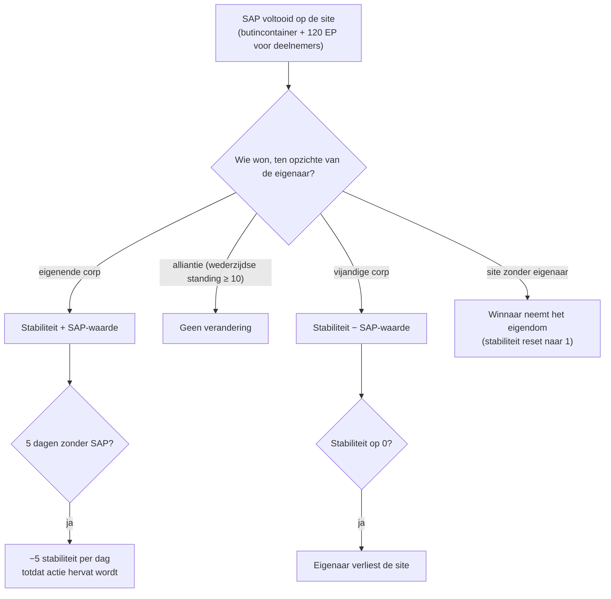

# Intrusie

**Intrusie** is een modus gebouwd rond **NPC-sites** — door spelers beheerde of bestreden sites met
**stabiliteit**, **verdediging** en **faciliteiten**. Je investeert items, verhoogt de verdediging en
upgradet faciliteiten om een site te controleren en er profijt uit te halen.

> De naam in de client voor "intrusie" moet nog worden bevestigd. De UI-locaties volgen het
> [client-UI-overzicht](/nl/features/ui/). De mechanismen hieronder zijn bevestigd op basis van de server.

## Sites en stabiliteit

- **Site-informatie** — details van een intrusiesite.
- **Stabiliteit** — de kernstat van de site, een waarde van **0 tot 150**. Een nieuwe eigenaar begint op
  **1**. Stabiliteit stuurt alles:
  - **Bonusdrempels** (content, `intrusionsitestabilitythreshold`): faciliteitenbonussen
    worden ontgrendeld bij stabiliteit **20 / 60 / 80**; een stapel aura-effecten (intrusiekern,
    detectie, geoscan, harvester, industrieel, maskering, mijnbouw, reparatie, signalen — elk
    lvl1–3, plus gecombineerde lvl4-effecten) wordt in tranches ontgrendeld bij **10, 20, 40, 50, 70, 80 en
    100**; **aanlegrechten** worden ontgrendeld bij **50**; de limiet voor verdedigingsnodes stijgt bij **40**.
  - **Productiepunten** = `stabiliteit / 10` (max 15) — de valuta voor het upgraden van
    faciliteiten (één punt per niveau).
  - **Verval**: als er geen geslaagde SAP plaatsvindt gedurende **5 dagen**, begint de site
    **5 stabiliteit per dag** te verliezen totdat er weer actie wordt ondernomen.
  - **Verlies**: als stabiliteit **0** bereikt, verliest de eigenaar de site (die wordt
    zonder eigenaar).
- **Stabiliteitslog** — bekijk veranderingen in de stabiliteit van een site.

### Wie beïnvloedt stabiliteit

Stabiliteitsveranderingen komen van voltooide **SAP's** (hieronder) en het systeemverval. Het effect
hangt af van *wie* de SAP wint ten opzichte van de huidige eigenaar:

- **Eigenaar wint** → stabiliteit **wint** de waarde van de SAP.
- **Een alliantie wint** (wederzijdse standing ≥ 10) → **geen verandering**.
- **Een vijandige corp wint** → stabiliteit **verliest** de waarde van de SAP.
- **Site zonder eigenaar** → de eerste winnaar uit een speler-corp **neemt het eigendom** (stabiliteit
  reset naar 1).

## SAP's (site-aanvalspunten)

Een **SAP** is een tijdelijk doel dat op een site ontstaat. Bij voltooiing verschijnt er een **butincontainer**
op de positie van de SAP, verandert de stabiliteit en krijgt elk deelnemend personage **120 EP**.
**NPC-kultisten bestrijden de SAP's ook** — als zij de score eerst vullen, telt de SAP tegen jouw kant. Er zijn vier SAP-types:

| SAP | Hoe te voltooien | Stabiliteitswaarde |
|---|---|---|
| **Actief hacken** | gebruik een hackingmodule op de SAP (maximaal 120 modulegebruiken) | +15 |
| **Passief hacken** | blijf binnen bereik 5 van de SAP voor **8 minuten** | +10 |
| **Verwoesting** | beschadig de SAP tot dood (ook NPC-schade telt) | +15 |
| **Specimenverwerking** | dien **5–6 SAP-specimens** in (in partijen van 2–3, 1,5 min afkoeltijd, bereik 7) | +15 |

- **SAP-item indienen** — dien in een zone een specimen in bij een specimenverwerkings-SAP.
- **SAP-iteminformatie** — bekijk SAP-itemdata (jouw en algemene).

SAP-specimens zijn de consumpties van de modus; ze hebben ook een grote kernwaarde, dus
ze dienen ook als [PBS-reactorbrandstof](/nl/features/pbs/).

## Verdediging en effecten

- **Verdedigingdrempel instellen** — stel de verdedigingdrempel van de site in (wanneer de geautomatiseerde
  verdediging van de site ingrijpt).
- **Effectbonus instellen** — stel de aura/effectbonusconfiguratie van een site in (uit de
  door stabiliteit ontgrendelde auraset).
- **Faciliteit upgraden** — verbeter een sitefaciliteit: kost **1 productiepunt**
  (d.w.z. 10 stabiliteit), alleen CEO / plaatsvervanger / accountant, beperkt tot een maximumniveau.
- **Sitebericht instellen** — stel een openbaar bericht voor de site in.

## Logs

- **Mijn intrusielog** — jouw intrusieactiviteit.
- **Openbare log** — de openbare intrusiefeed.
- **Mijn sites-log** — activiteit op jouw sites.
- **Stabiliteitslog** — stabiliteitsveranderingen (zie hierboven).

## Praktische notities

- **Stabiliteit is de kernstat** — deze bepaalt de bonustranches, levert de upgradevaluta
  op en is wat vijandige SAP's wegnemen.
- **SAP's worden bestreden** — de NPC-kultisten racen je; een verloren SAP kost je stabiliteit.
- **Laat een site niet inactief staan** — 5 dagen zonder een geslaagde SAP start het dagelijkse
  verval.
- **Logs vertellen het verhaal** — gebruik de mijn/openbare/stabiliteitslogs om te volgen wat er op jouw sites gebeurt.

<!-- TODO: alleen de naam in de client voor "intrusie" en de UI blijven over.
     Bevestigd: stabiliteit 0-150, start 1 (Outpost.cs constanten); bonusdrempels uit
     intrusionsitestabilitythreshold (faciliteiten 20/60/80; aura-effecten 50-74 in tranches
     10/20/40/50/70/80/100; aanlegrechten 50; verdedigingsnodes 40); productiepunten =
     stabiliteit/10, faciliteitsupgrades kosten 1 punt, CEO/plaatsvervanger/accountant; verval -5/dag
     na 5 dagen inactief (OutpostDecay.cs); eigenaar wint +, alliantie (standing>=10) 0,
     vijandig -; zonder eigenaar -> winnaar neemt het; stabiliteit 0 -> eigendom verloren; 120 EP per
     SAP-deelnemer (EP_WINNER, EpForActivityType.Intrusion); 4 SAP-types: actief
     hacken (120 modulegebruiken, +15), passief (8 min in bereik 5, +10), verwoesting
     (dood het, +15), specimenverwerking (5-6 specimens in 2-3 partijen, 1,5 min cd,
     bereik 7, +15; siegeitems tabel: def_specimen_sap_item 2-3); SAP-verhogingswaarden
     uit entitydefaults #increase optie; NPC sap guard/invade units bestrijden SAP's.
     Ontwikkelaarsnotities: Intrusion/IntrusionSAPSubmitItem.cs (SpecimenProcessingSAP,
     zone-indienen), IntrusionSAPGetItemInfo.cs / IntrusionSapItemInfo.cs,
     IntrusionSetDefenseThreshold.cs, IntrusionSiteSetEffectBonus.cs,
     IntrusionUpgradeFacility.cs, SetIntrusionSiteMessage.cs; GetIntrusionSiteInfo.cs,
     GetIntrusionLog.cs / GetIntrusionPublicLog.cs / GetIntrusionMySitesLog.cs /
     GetIntrusionStabilityLog.cs, GetStabilityBonusThresholds.cs;
     EventProcessors/AffectOutpostStability.cs; Zones/Intrusion/Outpost.cs,
     OutpostDecay.cs, SAP.cs + *SAP.cs subklassen. -->