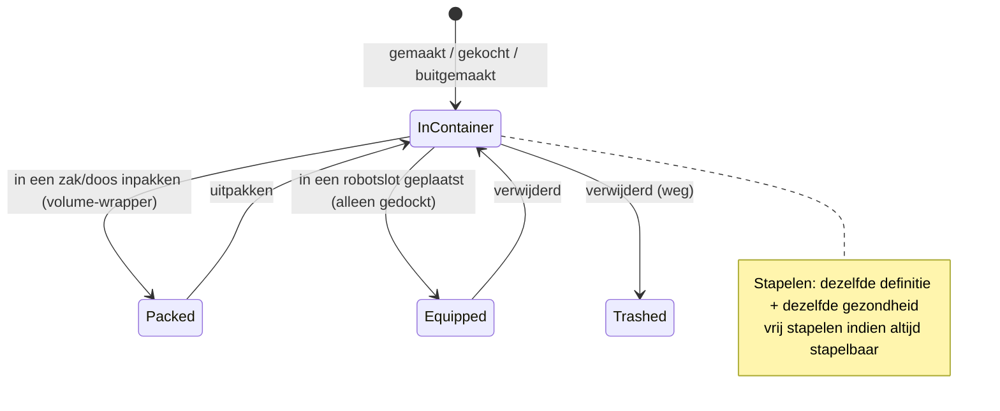

# Items & inventaris

Je **inventaris** is een set **containers** (de openbare container van de basis, de container van je
robot, zakken/dozen, enz.). Deze pagina behandelt het beheren van items in deze containers.

> De UI-locaties volgen het [client UI-overzicht](/nl/features/ui/). De onderstaande mechanismen zijn geverifieerd tegen
> de server.

## Containers

- **Een container weergeven** — bekijk de inhoud.
- **Items verplaatsen** — verplaats items tussen containers die je kunt benaderen.

Toegangsregels gelden: sommige containers (corphangar, robotinventaris, systeemcontainers) zijn
beperkt toegankelijk — zie [robots](/nl/features/robots/) en [groepen](/nl/features/groups/).

## Inpakken & uitpakken

- **Items inpakken** — leg items in een zak/doos (een "volume-wrapper"-container) om ze compact
  te vervoeren.
- **Items uitpakken** — haal items weer uit een zak/doos.

Inpakken is ook de manier waarop een **robot** compact wordt gemaakt voor opslag/transport: de server verwijdert de
dynamische status en componenten en markeert deze als *opnieuw ingepakt*. Een robot kan alleen worden ingepakt als
deze **onbeschadigd** is, **niet geselecteerd** is, **niet verzekerd** is en een **lege inventaris** heeft.
Uitpakken herbouwt de robot en repareert deze. Alleen items die in de content als *opnieuw inpakbaar* zijn gemarkeerd,
kunnen worden ingepakt; een opnieuw ingepakte robot kan niet worden geselecteerd of uitgerust totdat deze is uitgepakt
(zie [robots](/nl/features/robots/)).

## Stapelen

Veel items kunnen worden gestapeld. Stapelbewerkingen:

- **Items stapelen** / **stapel naar** / **selectie stapelen** — combineer items van hetzelfde type
  tot een stapel (of verplaats een stapel naar een andere).
- **Een hoeveelheid uitstapelen** — splits een specifieke hoeveelheid van een stapel af.

De server voegt alleen items samen die de **zelfde definitie en dezelfde gezondheid** hebben.
Items die als *altijd stapelbaar* zijn gemarkeerd (erzen, munitie, de meeste grondstoffen) stapelen vrij; items
die als *niet stapelbaar* zijn gemarkeerd, stapelen nooit; alles andere mag alleen gestapeld worden **als het opnieuw ingepakt**
(ingepakt) is — dus uitgepakte, beschadigde uitrusting blijft individueel.

## Hernoemen & gebruiken

- **Een item hernoemen** — geef een item een aangepaste naam.
- **Een item gebruiken** — activeer een bruikbaar item (contextafhankelijk; in een zone kan dit ook
  interageren met zoneobjecten — zie [verzamelen](/nl/features/gathering/)).
- **Een loterijitem gebruiken** — open/activeer een item in loterijstijl.

## Verwijderen & vergoeding

- **Items verwijderen** — verwerp items (verwijdert ze).
- **Een item vergoeden** — een staff/admin-vergoedingsproces: maakt het item aan en geeft
  het aan een personage, geregistreerd in het transactielogboek. Spelers roepen dit niet direct aan.

## Speciale items

- **Inwisselbare items** — lijst op, **inwissel** of **activeer** inwisselbare items (codes/toekenningen).
- **Goodie packs** — lijst op en **inwissel** goodie packs (bundels van items).
- **Een cadeau openen** — een cadeau bevat één **willekeurig** item dat uit een serverbrede buitpool
  wordt getrokken (munitie, ruwe erzen, plasma, onderzoekskits, modules, capsules, verf, boosters —
  221 mogelijke definities, elk met een eigen hoeveelheidsbereik).

## Praktische notities

- **Toegang is per container** — je kunt alleen containers aanraken die je bezit of waarvoor je toegang hebt.
- **Pak in om meer mee te nemen** — zakken/dozen laten je bulkitems compact verplaatsen.
- **Stapelen bespaart ruimte** — combineer vergelijkbare items; stapel uit om precies de benodigde hoeveelheid te nemen.
- **Verwijderen is permanent** — verwijderde items zijn weg.
- **Inwisselbare items/goodie packs zijn eenmalig** — inwisselen verbruikt de code/item.
- **Ingepakte robots zijn inactief** — pak ze uit voordat je ze selecteert of uitrust.
- **Alleen ingepakte items kunnen stapelen** — als vergelijkbare items niet samenvoegen, pak ze eerst in (of repareer ze).

<!-- TODO: alleen de inventaris-UI blijft over.
     Bevestigd: stapelregels (Item.cs CanStackTo: zelfde ED + zelfde gezondheid; AttributeFlags
     alwaysStackable/nonStackable; anderen moeten opnieuw ingepakt zijn); inpakregels (ItemPacker.cs:
     robot moet onbeschadigd zijn, niet geselecteerd, niet verzekerd, lege inventaris; repackable
     vlag); uitpakken herbouwt + repareert (ItemUnpacker.cs); cadeaus = willekeurige trekking uit
     giftloots (221 definities: munitie x1500-2000, epriton/fluxore x600-1000, reactor plasma
     x10-20k, onderzoekskits, verfen, capsules, named3 modules, boosters, respec tokens);
     goodie packs zijn campagne-gebaseerd (GoodiePackRedeem: campaignID + indy-selectie);
     ReimburseItem = admin-tool (opp_reimburselog). AttributeFlags bitposities:
     nonStackable=10, alwaysStackable=11, repackable, consumable=24, deployable=23.
     Ontwikkelaarsnotities: ListContainer.cs; RelocateItems.cs; PackItems.cs / UnpackItems.cs;
     StackTo.cs / StackSelection.cs / UnstackAmount.cs; SetItemName.cs; UseItem.cs /
     UseLotteryItem.cs; TrashItems.cs; ReimburseItem.cs (PbsReimburseRequestHander.cs);
     RedeemableItemList.cs / RedeemableItemRedeem.cs / RedeemableItemActivate.cs;
     GoodiePackList.cs / GoodiePackRedeem.cs; GiftOpen.cs. Containertoegang:
     ContainerAccess / ContainerAccessChecker.cs. -->