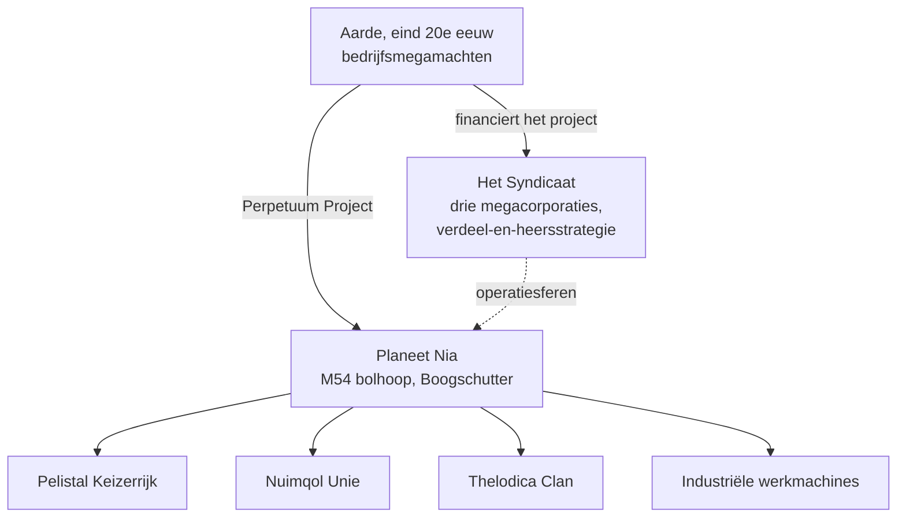

# Lore

## De ontdekking van Nia

De technologische bloei van de Aarde aan het eind van de 20e eeuw — internet, medische IT-fusie, ruimtevaartonderzoek — doorbrak de oude fysieke en mentale grenzen. Communicatie en handel werden sneller en goedkoper, en de grote corporaties groeiden uit tot de de facto regeringen van hun regio's.

In die wereld vond de ontdekking plaats van **planeet Nia**, in de M54-bolhoop van het sterrenbeeld Boogschutter (de bron van het projectlogo). Nia draait om een van een paar sterren — de vierde planeet van dat paar — en vertoont opvallende overeenkomsten met de Aarde: een gemiddelde oppervlaktetemperatuur van rond de 19 °C en een atmosferische dichtheid die dicht bij die van de Aarde ligt. Twee eigenaardigheden maken de planeet uniek. De oceanen vormen een ondoordringbare barrière voor alles wat elektrisch wordt aangedreven — de dichte kern van de planeet en de snelle rotatie houden ze voortdurend geladen — en slechts ongeveer 17% van het oppervlak bestaat uit land, dat door snelle platentektoniek voortdurend in eilanden wordt versnipperd. Op dat land floreert het leven.

## De Nians

De bewoners van Nia doorbreken de gebruikelijke betekenis van "levensvorm": een synthetische soort, qua vorm niet ongelijk aan onze robots, maar georganiseerd in afzonderlijke, technologisch geavanceerde **samenlevingen** — elk met een eigen industrie, leger en cultuur. De prestatie die het zwaarst weegt voor een energiehongerige Aarde is hun **energieproductietechnologie**.

Drie buitenaardse rassen strijden om de uiteindelijke overwinning over de eilandketens van hun territoria — het **Pelistal Keizerrijk**, de **Nuimqol Unie** en de **Thelodica Clan** — met daartussen een verspreide **Industriële** populatie van werkmachines (dit zijn dezelfde vier groepen die je tegenkomt als [NPC's](/nl/features/npcs/)).

## Het Syndicaat

De belangrijkste investeerder van het Perpetuum Project is het **Syndicaat** — een alliantie van de drie machtigste megacorporaties van de Aarde, die elk hun eigen operatiesfeer op het oppervlak beheren:

| Corporatie | Territorium |
|---|---|
| **Truhold-Markson** | Noord-Amerikaanse gigant in consumentenindustrie; rukt op in het vervallende domein van de **Pelistal**. |
| **ICS — Institute of Corporate Security** | Europees-Russische associatie; actief binnen het opstandige gebied van de **Nuimqol**. |
| **Asintec** | Aziatische industriële hegemon met zijn hightech-buren; voert een grootschalig offensief tegen de **Thelodica Clan**. |

De strategie is het aloude *verdeel en heers*: het tegen elkaar in evenwicht houden van de drie sferen zorgt ervoor dat de buitenaardse mogendheden elkaar blijven bevechten in plaats van zich te verenigen. Menselijke "Agenten" werken op het oppervlak — ze delven de energiebronnen van de Nians, bestuderen hun technologie en handhaven de vrede die het Syndicaat voor ogen heeft.

Dat is waar jij in beeld komt.

<!--
Ontwikkelaarsnotities: herschreven in 2026 in origineel proza vanuit de canonieke setting.
Een eerdere versie was aangepast van de Open Perpetuum community-wiki
(perpetuum.miraheze.org: Discovery of Nia, Nia, Syndicate); die tekst is volledig
vervangen, niet hergebruikt.
Consistentie met backend: de drie buitenaardse rassen + Industrial komen overeen met de NPC-rassen
(zie /nl/features/npcs/); de corporatienamen komen overeen met de zone-afkortingen
(zone_ICS, zone_ASI, zone_TM — de bèta-tier zones in /zones/ zijn vernoemd naar hun megacorporaties).
-->
