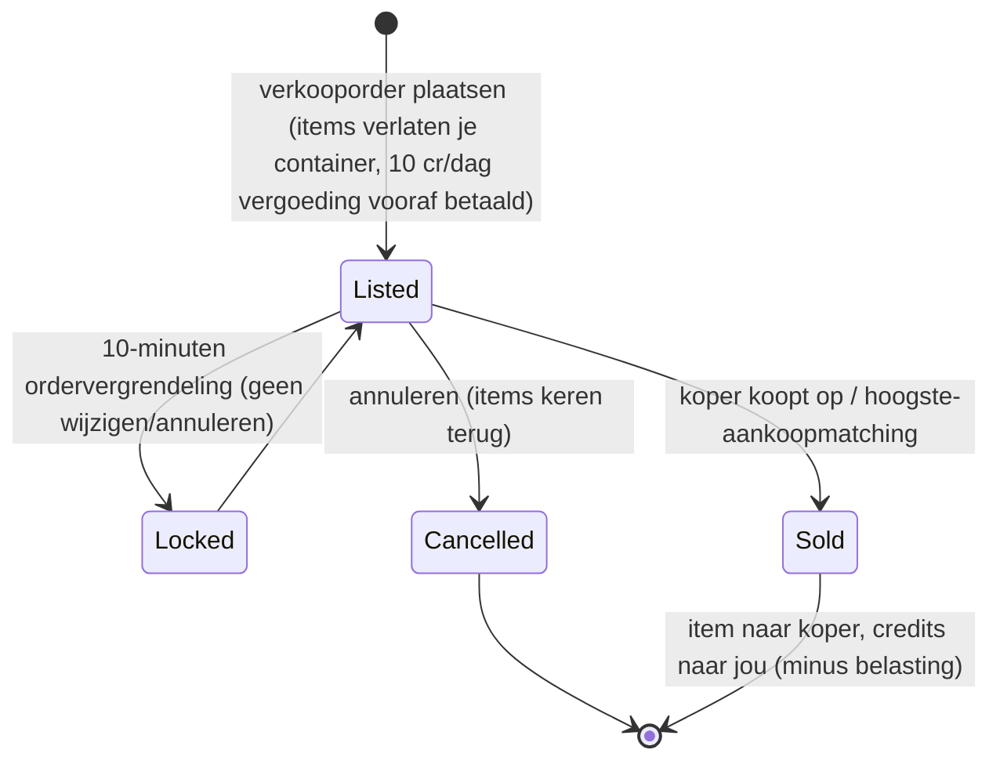

# Markt & handel

De **markt** is de plek waar je items koopt en verkoopt op een basis. Alle marktacties zijn
**uitsluitend aangedockt** (je handelt op de basis waaraan je aangedockt bent).

> De UI-locaties volgen de [UI-overzicht van de client](/nl/features/ui/) (de **Markt**-categorie op de
> bovenbalk). De mechanismen hieronder zijn bevestigd tegen de server.

## Marktbestellingen

Je plaatst twee soorten bestellingen op de markt van je huidige basis:

### Verkooporders
Stel items te koop.
- Kies het **item**, de **hoeveelheid**, de **prijs per stuk** en de **duur** in dagen
  (minimum 1).
- Het item wordt uit je container gehaald (uit de stapel gehaald als je een deel van een stapel verkoopt).
- **Inschrijvingsvergoeding** — je betaalt `10 credits × duur` vooraf (verlaagbaar door de
  *markttransactievergoeding*-extensie); de vergoeding gaat naar de centrale bank van de basis (zone
  winstpot).
- **Prijsbewaking** — wanneer ingeschakeld, moet je prijs binnen **±30%** van de
  **14-daagse gemiddelde prijs** van het item vallen; prijzen buiten het bereik worden geweigerd. *(Deze bewaking is
  momenteel **uitgeschakeld** op deze server.)*
- **Ordervergrendeling** — een order kan niet gewijzigd of geannuleerd worden gedurende **10 minuten** na
  plaatsing.
- **Aantal orders** — je kunt 1 + (*marktverkooporder expert*-extensie) open verkooporders
  houden (aankooporders hebben hun eigen teller).
- **Voor mijn corporatie** — je kunt een verkooporder beperken tot leden van je eigen corp
  (alleen voor niet-standaard corporaties).
- Betaal uit je **persoonlijke** of **corporatie**-portemonnee, zoals van toepassing.

### Aankooporders
Plaats een lopende order om een item tegen een bepaalde prijs te kopen.
- De markt vult deze in wanneer een overeenkomende verkooporder verschijnt.

### Orders beheren
- **Order wijzigen** — prijs/hoeveelheid/duur aanpassen.
- **Item / order annuleren** — intrekken (item keert terug naar je container).
- **Mijn items** — bekijk je open orders.
- **Hoogste-aankoopmatching** — een verkooporder kan worden gerouteerd naar een bestaande aankooporder.

## Directe aankoop

- **Item kopen** — koop direct een item dat op de markt staat (geen lopende order).

## De markt doorzoeken

- **Itemlijst / beschikbare items / items in bereik** — bekijk wat er te koop staat.
- **Marktinfo** — details over de markt van de basis.
- **Gemiddelde prijzen** — marktgemiddelde, gemiddelde per definitie en **globaal** gemiddelde.
  Dit is waar de prijsbewaking op is gebaseerd.

## Marktbelasting

- **Marktbelasting wijzigen** — stel het belastingtarief op de markt in. Alleen **PBS-basismarkten**
  zijn spelersbestuurd; overal anders geldt het vaste standaardtarief.
- **Belastinglog** — bekijk belastingwijzigingen.

De belasting wordt afgetrokken van wat de **verkoper** ontvangt bij een marktverkoop. Het standaardtarief is
**12%** (de verkoper krijgt 88% van de verkoopprijs); het tarief kan worden verlaagd door de *markt
transactiebelasting*-extensie en, op spelersbestuurde markten, door de PBS-eigenaar een
aangepast tarief in te stellen.

## Directe spelershandel

Een **handel** is een peer-to-peer-uitwisseling tussen twee aangedockte personages:

- **Handel starten** — start een sessie met een andere speler.
- **Mijn aanbod instellen / intrekken** — leg items/credits aan je kant.
- **Accepteren** — beide kanten accepteren om de uitwisseling atomaal te voltooien.
- **Annuleren** — de handel afbreken.
- **Handel voltooid / status** — voltooiing en huidige status.

Een personage kan **handel blokkeren** op zichzelf (zie [snel starten](/nl/features/getting-started/)).

## De itemshop

De **itemshop** is een vaste-prijsverkoper op een basis (niet spelersbestuurd). De volledige
catalogus (elk item, hoeveelheid, prijs per valuta, standing-vereiste) wordt gegenereerd in
[Itemshop](/content/shop/).

- **Lijst** — bekijk wat de shop verkoopt.
- **Kopen** — koop een item voor credits.

## Credits overmaken

- **Credits overmaken** tussen je eigen personages (zie [snel starten](/nl/features/getting-started/)).

## Praktische opmerkingen

- **Alles is uitsluitend aangedockt** — je kunt niet handelen in een zone.
- **Reken de 12% belasting in op je prijsstelling** — verkopers ontvangen standaard 88% van de
  vermelde prijs (minder op PBS-markten met hoge belasting).
- **De inschrijvingsvergoeding is vooraf** — een inschrijving met lange duur kost meer, zelfs als het
  op dag één verkoopt.
- **Corp-only orders** zijn een manier om goederen binnen je corp te verplaatsen zonder publieke blootstelling.
- **Handels zijn atomaal** — beide kanten moeten accepteren, anders verplaatst er niets.
- **Belastingwijzigingen beïnvloeden de effectieve kosten** — reken de marktbelasting in op je prijsstelling.

<!-- TODO: alleen de client UI resteert (markt- en handelschermflows).
     Bevestigd: MarketInfoService(0.3, 10, false) geregistreerd in
     PerpetuumBootstrapper.cs -> marge +-30% t.o.v. 14-daags gemiddelde (MARKET_AVERAGE_DAYSBACK
     14), vergoeding 10 credits/dag (Market.MARKET_FEE), CheckAveragePrice=false op deze
     server; DEFAULT_MARKET_TAX = 0.12 (verkoper krijgt 88%), spelersbestuurde belasting alleen op
     PBSDockingBase-markten (MarketTaxHelper); order wijzigen/annuleren vergrendeld 10 min na
     indienen (MARKET_CANCEL_TIME); aantal orders = 1 + expert-extensie bonus;
     vergoeding vooraf betaald aan de centrale bank van de basis. -->
     Ontwikkelaarsnotities: Markets/MarketCreateSellOrder.cs (aangedockt, prijsbewaking t.o.v. gemiddelde
     prijs, corp-only, uit stapel halen, corp-portemonnee), MarketCreateBuyOrder.cs,
     MarketModifyOrder.cs, MarketCancelItem.cs, MarketBuyItem.cs, MarketItemList.cs,
     MarketAvailableItems.cs, MarketItemsInRange.cs, MarketGetMyItems.cs,
     MarketGetAveragePrices.cs / MarketGetDefinitionAveragePrice.cs /
     MarketGlobalAveragePrices.cs, MarketTaxChange.cs / MarketTaxLogList.cs;
     Trade*.cs (starten/aanbod/accepteren/annuleren, atomaal); ItemShopList.cs / ItemShopBuy.cs;
     CharacterTransferCredit.cs. -->