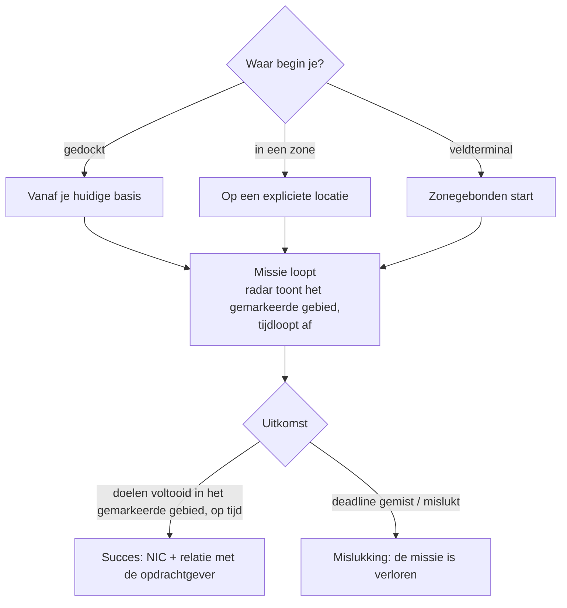

# Missies

**Missies** zijn gestructureerde doelen die je in een zone aangaat — lever items af, raak doelen,
gebruik structuren. Ze zijn de manier waarop je vooruitkomt, beloningen verdient en veel zonecontent
aandrijft (alarms, kiosken en sommige PBS/transportkoppelingen zijn missiegerelateerd).

> De UI-locaties zijn gebaseerd op het [client-UI-overzicht](/nl/features/ui/). De onderstaande mechanismen zijn geverifieerd tegen
> de server.

## Een missie starten

Je start een missie door een **categorie** en een **niveau** te kiezen (niveaus worden begrensd tot een
geldig bereik), op een **locatie**:

- Als je **gedockt** bent, start de missie vanaf de locatie van je huidige basis.
- Als je **in een zone** bent, geef je de locatie expliciet op.
- Missies kunnen ook direct **uit een zone** starten (een zonegebonden start) of **vanuit een veldterminal**.

Niet elke categorie/niveau is overal beschikbaar — beschikbaarheid is contentgedreven. De
volledige lijst met missies (type, categorie, niveau, duur, beloningsvergoeding en beloningsitems)
wordt gegenereerd in [Missies](/content/missions/).

## Waar missies voor dienen

Missies dienen tegelijk twee doeleinden: ze betalen NIC uit en ze bouwen je **relatie**
op met de uitgevende (opdrachtgevende) corporatie. Een betere relatie is een belangrijke factor om
een **hogere faciliteitsratio** te krijgen aan de terminals van die corporatie — productie en
andere faciliteitsactiviteiten worden voor jou goedkoper en sneller. Relaties kunnen ook *dalen*: sommige
missies botsen met de belangen van een andere corporatie, en de briefing vermeldt wanneer dat
je standing zal kosten.

- **Trainingsmissies** — makkelijk, gemarkeerd voor beginners; doe ze allemaal, de beloningen
  zijn een fijne vroege boost.
- **Gewone missies** komen in drie varianten:
  - *Gevecht* — verkenning (scan vijandelijke robots), beloningsjacht (doelen doden in een gemarkeerde
    cirkel), vernietig en herstel (doden + ophalen + afleveren), verkenning en herstel, speciale
    beloningen (moeilijk bereikbare doelen).
  - *Industrie* — geologie (scan naar een mineraal met de juiste lading), oogsten, minerale
    exploitatie, gespecialiseerde exploitatie (bewaakte mijnbouwlocaties — neem gewapende hulp mee).
  - *Logistiek* — transport (lever een pakket af tussen terminals) en ophalen
    (een groot pakket door gevaarlijk terrein — begeleid het).
- Er bestaat geen **veilige missie**: als je vijanden op de route ziet en
  de uitrusting mist om jezelf te verdedigen, vraag dan om hulp voordat je onderweg alles verliest.
- **Doelen tellen alleen in het gemarkeerde gebied** — de missiekaart markeert dit met een
  rode cirkel op de radar; doden en scans elders tellen voor niets. Mist je de deadline,
  dan faalt de missie direct.
- **Privétransportcontracten** — een door Syndicate beheerd systeem (tweede tab van het missieveld)
  waar spelers containers plaatsen zodat andere spelers ze tussen terminals vervoeren,
  met een vaste beloning en een **borg** die de vervoerder inzet (teruggestuurd bij succes, verloren als
  de container wordt vernietigd; afbreken onderweg geeft slechts de helft terug). Houd containers
  klein genoeg zodat iemand ze daadwerkelijk kan dragen.

## Missiedata en opties

- **Missiedata** — details van een missie.
- **Missieopties** — de keuzes/varianten die voor een missie beschikbaar zijn.
- **Missievoorziening** — de voorraden die een missie omvat.
- **Startitems** — de items waarmee een missie begint.

## Een missie uitvoeren

- **Lijst lopende missies** — wat je momenteel doet.
- **Afbreken** — annuleer een missie die je uitvoert.
- **Een deelnemer toevoegen** — neem een ander personage op in de missie (multiplayer-missies).
- **Missielog** — het gebeurtenislogboek van een missie.

## Bezorging

- **Afleveren** — voltooi een afleverdoel. Dit kan **gedockt** (op een basis) of
  **in een zone** (op een specifieke locatie/eid), afhankelijk van de missie.

## Agenten

- **Lijst agenten** — de beschikbare missieagenten (NPC's/facties die missies uitgeven).

## Veldterminals

- **Veldterminalinfo** — inspecteer een veldterminal in een zone (een structuur die missies kan starten
  of bedienen).

## Praktische notities

- **Missies zijn het bindende weefsel** — alarms, kiosken en sommige structuren zijn
  missieobjecten (zie [verzamelen](/nl/features/gathering/) en [gevecht](/nl/features/combat/)).
- **Multiplayer** — je kunt deelnemers toevoegen om samen te werken aan een missie.
- **Bezorgcontext is belangrijk** — sommige bezorgingen vereisen dat je gedockt bent, andere dat je op een
  zone-locatie bent.
- **Niveau wordt begrensd** — het aanvragen van een niveau buiten bereik wordt gecorrigeerd, niet als fout behandeld.
- **Afbreken is je uitweg** — als een missie misloopt, breek je af.

## Missiestructuren

Missies zijn in zones verankerd door **structuren**. De server implementeert deze types:

| Structuur | Wat het doet |
|---|---|
| **Eenvoudige schakelaar** | directe interactie — nader en het missiedoel is voltooid |
| **Alarmschakelaar** | een tijdgebonden taak — blijf binnen bereik gedurende een periode (uit de missieopties), gecontroleerd elke 2 s |
| **Itemvoorziening** | tijdgebonden zoals een alarmschakelaar, daarna **genereert items in de container van je robot** |
| **Kiosk** | een **iteminleveringspunt** — lever de vereiste items voor de missie in |

<!-- TODO: de volledige missielijst, categorieën, niveaubereiken en beloningen worden gegenereerd op
     /content/missions/. Geverifieerd: missiestructuurtypes
     (MissionEngine/MissionStructures: SimpleSwitch, AlarmSwitch, ItemSupply, Kiosk);
     verifieer de missie-UI.
     Ontwikkelaarsnotities: Missions/MissionStart.cs (categorie, niveau-begrenzing, gedockt vs zone-locatie), Missions/MissionDeliver.cs (gedockte vs zonebezorging), MissionAbort.cs,
     MissionData.cs / MissionGetOptions.cs / MissionGetSupply.cs / MissionStartItems.cs,
     MissionListRunning.cs / MissionListAgents.cs / MissionLogList.cs,
     MissionPlayerAddsParticipant.cs, FieldTerminalInfo.cs, MissionStartFromZone.cs;
     Services/MissionEngine/* (MissionProcessor, missiestructuren incl. AlarmSwitch,
     Kiosk). -->