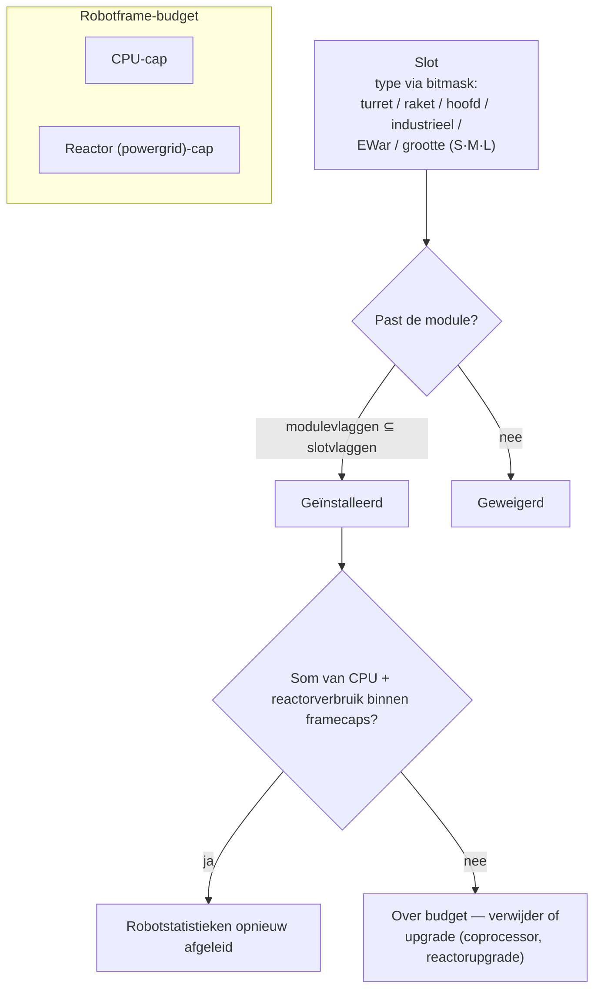

# Modules & uitrusting

“Een robot kopen levert je alleen het chassis op.” Pas bij het uitrusten met modules wordt een robot wat je nodig hebt. *Fitting* (uitrusting) betekent zowel de moduleuitrusting (“stuur me je fitting”) als het CPU/reactor-budget dat het verbruikt.

## Slots & hulpbronnen

Het frame van een robot heeft een vaste set **slots**, gedefinieerd door het chassis. Elke slot is getypeerd door een bitmask — turret, raketlanceerder, hoofd, industrieel, EWar/techniek, grootte (klein / medium / groot) — en een module past alleen in een slot als zijn eigen typemasker een deelverzameling is van dat van het slot. Een turret-slot op een caster accepteert dus kleine, medium *of* grote turretmodules, maar een raketlanceerder komt nooit in een turret-slot. Hoofdmodules (coprocessors, afstimmingsmodules) en chassis-/beenmodules (platen, frames) bezetten hun eigen toegewijde slots.

Elke module trekt **CPU** en **reactor** (powergrid) uit het frame — de som van alles wat is geïnstalleerd moet onder beide limieten blijven, en sommige modules trekken per cyclus ook **accumulator** (core). De resterende capaciteit is de *beschikbare output* in het fittingvenster. Ruwe schaal van chassis (T1/T2/T3-voorbeelden):

| Frameklasse | CPU | Reactor | Voorbeeld |
|---|---:|---:|---|
| Kleine crawler | ~250 | ~140 | Castel |
| Licht mech | ~480 | ~300 | Waspish |
| Zwaar mech | ~1 100 | ~1 000 | Tyrannos |
| Walker | ~3 200+ | ~1 100+ | Gropho |

Als je te weinig capaciteit hebt: **CPU** — coprocessormodules (bijv. de T3-coprocessor geeft +20% CPU) of T2-modulevarianten (lager verbruik). **Reactor** — reactorupgrades (bijv. T3 geeft +20% reactoroutput) of reactorafscherming (verlaagt straling, wat je ook beschermt tegen EnWar — zie hieronder).

## De modulefamilies

De getallen per model staan in de [itemscatalogus](/content/) en de [formatreferentie](/nl/formats/); dit is het familiebeeld.

### Wapens & munitie

Vier wapentechnologieën, elk met eigen munitie en afstandsprofiel:

| Wapen | Munitie | Afstandsprofiel | Opmerkingen |
|---|---|---|---|
| **Schietwapens** | Kogels | Korte optimale afstand, enorme afname | Projectielen die *nooit missen* — maar hun “nauwkeurigheid” werkt als een gebiedsradius, zodat kleine doelen nog steeds verminderde schade lijden van brede spreiding. |
| **Magnetisch (railguns)** | Slugs | Middelbare afstand, scherpe afname | Hoge impactsnelheid; zwaar energieverbruik. |
| **Lasers** | Energiecellen | Lange afstand | Meest energievretend; geconcentreerde stralen. |
| **Raketten** | Raketten | Lange afstand | Treffer of miss wordt bepaald door de *trefferkans*-stat van de *robot*, niet door afstand. Schade schaalt met de grootte van het doel ten opzichte van de explosieradius — grote raketten op kleine doelen doen veel minder schade. |

Schade neemt af met de afstand volgens een gladde cosinuscurve: volledige schade op optimale afstand, nul op optimum + afname (zie [schadeafname](/nl/features/combat/#schadestypen)).

Munitie is waar je schade afstemt: primaire + secundaire schadetypen laten je fijnafstemmen tegen een doel (zie [schadetypen](/nl/features/combat/#schadestypen)) — ten koste van wat totaalschade vergeleken met puur primaire munitie.

Turrets zijn er in klein/medium/groot; **pas de grootte aan op de robot** (kleine robots gebruiken kleine modules, mechs en heavies gebruiken medium/groot).

### Verdediging

- **Pantserplaten** — de hoofd-hitpointpool; als het pantser op nul staat, ontploft de robot. **LWF** (lightweight frame)-platen ruilen duurzaamheid in voor snelheid: een T2-LWF-plaat vermenigvuldigt pantser met ~0,73, maar geeft +19% snelheid, −0,2 signature en −0,2 massa.
- **Schildgenerator** — een door de accumulator gevoede barrière die schade vóór het pantser absorbeert. Het schild gebruikt *je eigen core* om te absorberen: een treffer die 100 schade zou doen op een 2×-schild trekt 50 core in plaats van 100 pantser. Zolang het schild actief is, kunnen je eigen wapens niet vuren. De absorptiekwaliteit schaalt met de schildradius ten opzichte van je signature — grote schilden op kleine frames werken het best.
- **Pantserreparatie** — actieve reparatiemodules (klein/medium/groot); **afstandspantserreparatie** bereikt een vergrendeld doel (bondgenoten of een PBS), maar heeft een korte reikwijdte en een langere cyclus.
- **Pantserverharders** — passieve weerstandspunten per schadetype (chemische / kinetische / thermische / explosieve varianten).
- **Adaptieve legering** — een passieve module die de schademix die het *leert* kennen en een vaste pool weerstandspunten herverdeelt naar wat je het vaakst te verduren krijgt.
- **Ontwijkend / manoeuvreerend** — signature-verlagingsmodules en NEXUS (hieronder) maken het doel kleiner: minder schade van gebiedseffecten en een moeilijkere vergrendeling.

### Energie

- **Reactor** — de duurzame outputlimiet; reactorupgrades verhogen deze, reactorafscherming verlaagt straling (minder EnWar-schade opgelopen, ten koste van een kleine reactoroutput).
- **Accumulator (core)** — de burst-energievoorraad die modulecycli aandrijft. Deze laadt over tijd op (chassis `core_recharge_time`, ~120 ms op een T1-crawler); **accumulatorladers** versnellen de oplading.
- **Energie-injectors (core boosters)** — verbruiken een lading om de accumulator direct bij te vullen.
- **Energie-overbrengers** — beammen core van je robot naar een vergrendelde bondgenoot (spellers kunnen niet naar NPCs beammen).

### Elektronica

- **Sensorversterker** — passief, zelf: verkort je vergrendeltijd en verlengt je vergrendelingsafstand.
- **Afstandssensorversterker** — actief, doel: dezelfde boost wordt ~10,5 s toegepast op een vergrendelde bondgenoot.
- **Coprocessors** — verhogen de CPU-limiet van het frame (T1 +10% … T3 +20%).
- **Wapenstabilisatoren** — verbeteren de wapennauwkeurigheid (kleinere effectieve gebiedsradius) en schaven wat massa af.
- **Afstimmingsmodules** (hoofdslots) — vaste bonussen voor specifieke families: schademodules (+25% schade per wapenfamilie op T3), mijnbouwupgrades (+10% mijnbouw en oogsten op T3), pantserreparatie-upgrades (+16% reparatie, −8% cyclus op T3).

### Elektronische oorlogsvoering (EWar)

Maak de vijand blind en doof:

- **Sensordemper** — debuff op afstand: verlengt de vergrendeltijd van het doel en verkleint de vergrendelingsafstand voor ~5,5 s. Slagt alleen als je ECM-sterkte de (gerandomiseerde) sensorsterkte van het doel verslaat.
- **Sensorjammer** — direct: zet *alle* vergrendelingen van het doel terug bij een geslaagde ECM-check.
- **ECCM** — zelfbuff voor 20 s: verhoogt sensorsterkte en vergrendelingsweerstand en *geneest* ECM-gevoelige debuffs (dempers, webs).
- **Neuralyzer** — zet de vergrendelingen van **elke** speler binnen ~1,65 km terug. Een paniekknop.

Tegenacties: sensorsterkte (chassis), ECCM en afstand houden.

### Verborgenheid & detectie

- **Stealthmodule** — ~10,5 s stealth; het verbruik schaalt met je signature-radius (groter frame, sneller coreverbruik).
- **Doelschilder** — ~10,5 s debuff die de stealthsterkte van het doel verwijdert.
- **Detectiemodule** — passieve boost voor je detectiestrekte.

Detectiestrekte versus stealthsterkte beslist of je een gecamoufleerd doel überhaupt kunt zien (en vergrendelen) — zie [detectie & maskering](/nl/features/combat/#detectie-maskering-en-snelheid).

### Energie-oorlogsvoering (EnWar)

Draai of kap de energie van de vijand af:

- **Drainers (energievampiers)** — zuigen core uit een vergrendeld doel en voegen dit toe aan je eigen accumulator.
- **Neutralizers** — hetzelfde, maar de gezuigde core wordt vernietigd.
- Beide worden verzwakt door de **reactorstraling** van het doel — afscherming is een echte tegenmaatregel.
- **Demobilizers (webs)** — ~5,5 s vertraging van het doel; het effect schaalt met de massa van het doel (zware frames worden minder vertraagd) en faalt tegen doelen buiten de optimale reikwijdte van de module.
- **Scorcher** — een elektrisch wapen dat *ketent* naar maximaal 5 doelen en schilden en pantser raakt met penetrerende schade.

### Industrieel

- **Boormachines** (klein / groot) en **oogstmachines** (klein / groot) — de verzamelmodules; opbrengst, cyclustijd en accumulatorgebruik zijn de stats die ertoe doen. Mijnbouw geeft EP (met een daglimiet en vloeistofboete).
- **Geoscanner** — scant het minerale veld om je heen met de nauwkeurigheid van de probe; het resultaat is een kaart van wat onder de grond zit (zie [verzamelen](/nl/features/gathering/)).
- **Excavator** — aura-module: verhoogt de mijnbouw-/oogstopbrengst van nabije eenheden (T3: +50%) ten koste van stealth.
- **Terraforming** (gamma-zones) — terreinvergrendelingen die grond verhogen, verlagen of egaliseren (maximale radius 5 m) en muurplanten laten groeien; zie de [zonessectie](/zones/zone-gamma-z106/).
- **Afstandsbesturders** — turrets en drones aan de leiband: elke besturingsmodule heeft een bandbreedte (hoeveel), een operationele reikwijdte en een dronelevensduur (5–10 min per tier). Varianten: tactisch (schade/cyclus), aanval (schade), ondersteuning (afstandsreparatie), industrieel (mijnbouw-/oogstdrones), jager. Een **afstandscommandotranslator**-module versterkt droneschade, pantser, mijnbouwopbrengst en reparatieoutput (T3: +7,5% elk) en kan de bandbreedte van de besturingsmodule verlengen.

### NEXUS

Genetwerkte uitbreidingsgebruikssystemen: **squadbuffs**. Een NEXUS-module zendt een aura uit rond zijn eigen robot die **gangleden** (en hun turrets/drones) binnen de aura-radius bufft — standaard 10 m, elke 10 s vernieuwbaar. Regels:

- een robot kan maximaal **3 NEXUS-aura’s** dragen, en maximaal **één van elk type**;
- de aura bereikt alleen eenheden in je **gang**, niet willekeurige bondgenoten.

De T3-typelijst (13): snelheid, pantser, schild, farlock (vergrendelingsafstand), lock booster (vergrendeltijd), kritische treffer, aanval (wapencyclus), EW (EWar-reikwijdte), ontwijkend (signature), reparateur, industrieel (accumulatorgebruik tijdens verzamelen), snelle extractor (verzamelcyclus), lader (core-oplading). Elke T3-module geeft ongeveer +7,5% van zijn stat; bijv. de snelheids-NEXUS vermenigvuldigt de topsnelheid met 1,075 voor elke gangmaat die binnen 10 m staat.

### NOX

Counters van cultistenklasse: **negator**-modules die vijandelijke modules *uitschakelen* binnen hun radius — een **schildnegator** (verlaagt schildabsorptie met ~90%), een **reparatienegator** (verlaagt reparatieoutput) en een **teleportnegator** (blokkeert teleporteren). Elke activering **verbruikt plasma** uit je cargo, en het gebruik ervan in een open (niet-training) zone **markeert je personage voor PvP**.

### Speciale toepassingen

- **Siege-hackmodule** — het actieve-SAP-gereedschap: 5 s cyclus, 3 m reikwijdte (zie [uitposten](/nl/features/outposts/)).
- **Zelfdestructie** — zet een aftelling van 8 seconden in; de straal is zichtbaar op 600 m. Opruiming als laatste redmiddel.
- **Mijnendetector** — verlengt de mijnendetectiereikwijdte van het frame.
- **Blobemitters** — plaatsen een emitter die een blobveld verspreidt; de emissiemodulatormodule stemt het veld af (zie [gevecht](/nl/features/combat/)).
- **PBS-constructie** — de module die wordt gebruikt om PBS-structuren op gamma-zones te plaatsen.

## Vuistregels

1. **Meng je wapens niet.** Magnetisch + laser + raketten op één robot presteert meestal slechter dan alle drie; het mengen van kort- en langafstandse wapens eindigt zelden goed.
2. **Let op de massa.** Elke plaat en schildmodule voegt massa en signature toe — soms is snelheid belangrijker dan verdediging.
3. **Probeer niet alles te doen.** Een robot die mijnbouwt, scant en schiet doet niets zo goed als een specialist.
4. **Pas de grootte van je modules** aan op de robot, en laat wat CPU/reactor-reserve over voor de afstimmingsmodules die een build daadwerkelijk laten werken.
5. …en ja, sommige niche-uitrustingen breken alles hierboven en werken toch. Denk er even over na.

<!--
Ontwikkelaarsnotities: in 2026 herschreven vanuit backendbronnen; geen community-wikitext hergebruikt.
Geverifieerd tegen:
- src/Perpetuum/Robots/RobotComponent.cs (slot-bitmask fitting: moduleFlagMask & slotFlagMask)
- src/Perpetuum/Modules/SlotFlags.cs (12 slotvlagbits)
- src/Perpetuum/Modules/Weapons/WeaponModule.cs + FirearmWeaponModule.cs +
  MissileWeaponModule.cs (nauwkeurigheid: schietwapens missen nooit, explosieradius uit
  Accuracy; raketten gebruiken ParentRobot.MissileHitChance)
- src/Perpetuum/Modules/Weapons/Damage.cs (cosinusafname, critical 1.75x +/-10%,
  explosieschaal signature/explosionRadius begrensd [0,1])
- src/Perpetuum/Units/Unit.cs GetResistByDamageType (resist/(resist+100))
- src/Perpetuum/Zones/DamageProcessors/DamageProcessor.cs (schild trekt core,
  elektrisch = penetrerend)
- src/Perpetuum/Modules/EffectModules/ShieldGeneratorModule.cs (absorptiemodificator =
  shieldRadius-ratio / shieldAbsorbtion; WeaponModule.cs:112 blokkeert
  vuren terwijl HasShieldEffect)
- src/Perpetuum/Modules/EffectModules/{Webber,SensorDampener,SensorBooster,
  Stealth,TargetPainter,Eccm,Detection,AdaptiveAlloy}.cs (duraties uit
  effectentabel: demper/web 5,5s, stealth/paint/afstands-boost 10,5s, ECCM 20s)
- src/Perpetuum/Modules/SensorJammerModule.cs + Neuralyzer.cs (vergrendelingsreset,
  NEURALYZER_RANGE=1650)
- src/Perpetuum/Modules/{EnergyVampire,EnergyNeutralizer,Scorcher,
  CoreBooster,EnergyTransferer}.cs (EnWar, reactorstraling-modificator, keten)
- src/Perpetuum/Modules/GangModule.cs + Zones/Effects/GangEffect.cs +
  EntitiesModule.cs:532-544 (13 aura-typen, alleen gangleden, effectentabel
  auraradius=10)
- src/Perpetuum/Modules/NoxModule.cs (plasmaconsumptie, PvP-vlag)
- src/Perpetuum/Modules/RemoteControl/* (bandbreedte/reikwijdte/levensduur, translator-
  versterking)
- entitydefaults-rijen: named1-3 pantserplaten/verharders, schildgeneratoren
  (absorbtion 2.0-2.3, radius 5-33), LWF (mass_reductor), cpu/powergrid-
  upgrades, schade/mijnbouw/reparateur-afstemming, NEXUS named3-waarden, NOX cultist-
  waarden, siege hack (5s/3m), chassis core_max/powergrid_max.
Correcties t.o.v. geïmporteerde pagina: NEXUS-aura’s bereiken alleen gangleden (niet "alle
vriendelijke eenheden"); er bestaat geen "co-reactor"-module (reactorupgrades/afscherming doen
dat); demobilizer-effect schaalt met doelmasse, geen "weerstandstat";
sensor suppressor = sensordemper (5,5s debuff).
-->