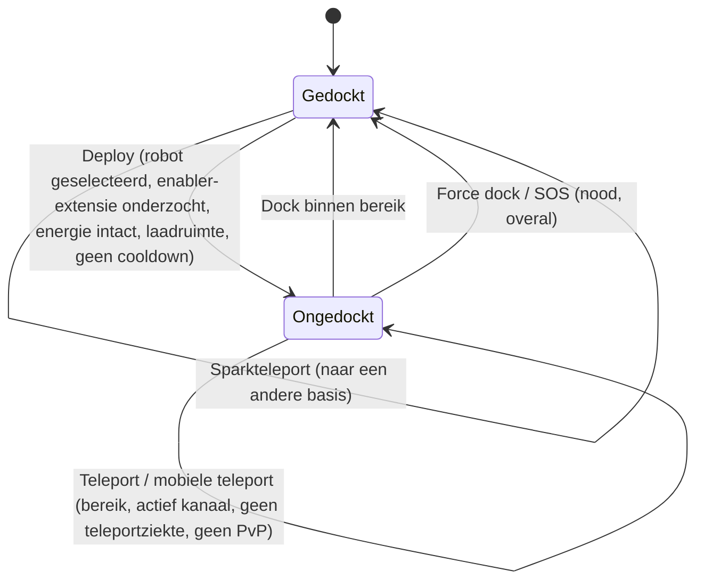

# Verplaatsing & zones

Je bevindt je altijd in een van twee staten: **gedockt** bij een basis of **ongedockt** in een zone,
waar je je actieve robot op afstand bestuurt. Alles op deze pagina gaat over het verplaatsen tussen die staten
en tussen zones.

> De UI-locaties volgen het [client-UI-overzicht](/nl/features/ui/): de **Deploy/Dock-knop** is de
> schakelaar in het midden van de bovenbalk. De werking hieronder is bevestigd via de server.

## Gedockt vs. ongedockt

- **Gedockt** — je bevindt je bij een basis. Je robots en items zitten in containers. Je kunt
  geen robot besturen, teleporteren of scannen, maar je kunt wel produceren, handelen, onderzoek doen en
  basisvoorzieningen gebruiken.
- **Ongedockt** — je bevindt je in een zone en bestuurt je actieve robot. Je kunt bewegen, scannen,
  vechten en
  interageren met zoneobjecten, maar de meeste activiteiten die alleen op een basis kunnen, zijn geblokkeerd.

## Ongedocken

Druk op **Deploy** (midden in de bovenbalk). De server controleert dan de volgende punten:

1. Je hebt een **actieve robot geselecteerd**.
2. Voor de klasse van die robot is de vereiste **enabler-extensie** op je
   personage onderzocht (zie [onderzoek](/nl/features/research/)).
3. Het **energiesysteem** van de robot is intact.
4. De **container** van de robot heeft vrije capaciteit.
5. Je zit niet in een **ongedock-cooldown** (een korte timer na bepaalde gebeurtenissen).

Als een van de controles faalt, wordt het ongedocken geweigerd.

## Terugdocken

- **Dock** bij een basis als je binnen het dockingbereik bent.
- **Force dock** is de noodactie: het haalt je uit de zone en dockt je direct bij de
  hoofdbasis (TMA), zelfs in gevecht. Gebruik het als je een gevecht verliest.
- **SOS** — een zonehulpactie die je bij de huidige basis dockt en het incident markeert.

## De zone-invoerwachtrij

Sommige zones zijn druk en gebruiken een **invoerwachtrij** als je uitdocked / binnenkomt:

- Controleer de wachtrijstatus (`zoneGetQueueInfo`).
- Stel je voorkeurslengte van de wachtrij in (`zoneSetQueueLength`).
- Annuleer het wachten als je van gedachten bent veranderd (`zoneCancelEnterQueue`).

## Teleporters

**Teleporters** zijn structuren in een zone. Om er een te gebruiken:

- Je moet **binnen het bereik van de teleporter** zijn.
- Het **kanaal** (bestemming) moet **actief** en geldig zijn.
- Je mag **niet** onder *teleportziekte* lijden — een korte cooldown na elke teleport,
  waarbij je niet opnieuw kunt teleporteren.
- Bepaalde effecten (bijv. *Nox*-negatie) of **in PvP-gevecht** zijn kan teleporteren blokkeren.

Teleportkanalen komen in drie soorten voor:

| Type | Effect |
|---|---|
| **Binnen zone** | Verplaatst je naar een willekeurig punt in dezelfde zone |
| **Andere zone** | Verplaatst je naar een willekeurig punt in een andere zone |
| **Trainingsexit** | Verlaat een trainingszone (met een beloningsniveau-optie) |

**Mobiele teleporters** zijn *eigenaarsgebonden* teleport-items (bijv. mobiele stronghold/world-teleporters).
Er gelden extra regels:

- Alleen de **eigenaar of een lid van de gang van de eigenaar** mag er een gebruiken.
- Ze **kunnen niet worden gebruikt tijdens PvP**.
- Elk gebruik past een **cooldown** toe op die teleporter.

Je kunt teleporters en hun kanalen opvragen en wereldwijde kanalen raadplegen.

## Sparkteleporters

**Sparkteleporters** zijn een snelreis-systeem tussen bases:

- Je **stelt** een sparkbestemming in bij een basis en **gebruikt** deze (terwijl je gedockt bent) om direct naar
  een andere basis te springen.
- Je kunt je sparkteleporters **lijsten, instellen, gebruiken en verwijderen**.
- De doelbasis moet **docking** voor jou toestaan.
- Bij aankomst kiest de server een geschikte robot voor je (een robot waarvan je de enabler-extensies
  hebt onderzocht).
- Het **aantal sparkteleporters dat je mag bezitten** is beperkt door een extensie
  (zie [onderzoek](/nl/features/research/)); het overschrijden wordt geweigerd.

## Poorten

**Poorten** zijn zonestructuren die van overal gebruikt kunnen worden (niet bereikbeperkt zoals
teleporters). Een basiseigenaar kan zijn poorten **hernoemen**.

## Basisinformatie

Je kunt elke basis inspecteren:

- **Info** — wat het is en waar het zich bevindt.
- **Eigendom** — wie het bezit.
- **Voorzieningen** — wat het aanbiedt (productie, markt, winkel, …).
- **Mijn items** — je items die op die basis zijn opgeslagen.
- **Dockingrechten** — een basiseigenaar kan instellen wie daar mag docken.

## Wat kan er misgaan

| Symptoom | Waarschijnlijke oorzaak |
|---|---|
| Ongedocken geweigerd | Geen actieve robot, ontbrekende enabler-extensie, beschadigd energiesysteem, volle robotcontainer of ongedock-cooldown |
| Teleport geweigerd | Buiten bereik, kanaal inactief, teleportziekte, Nox-effect of in PvP |
| Mobiele teleport geweigerd | Niet eigenaar/ganglid of in PvP |
| Sparkteleport geweigerd | Doelbasis verbiedt docking, geen geldige robot om te selecteren of sparkteleportlimiet bereikt |
| Vastgelopen bij zone-invoer | Zone-wachtrij — controleer de wachtrijstatus of annuleer |

<!-- TODO(fase 1): client-UI-flow verifiëren (dock/undock-knoppen, teleport-scherm).
     Ontwikkelaarsnotities: Dock.cs / Undock.cs / ForceDock.cs (TMA = baseEid 561) /
     ZoneSOS.cs; Zone/TeleportUse.cs (TeleportPlayerValidator, drie
     TeleportDescriptionType-strategieën, gang/PvP-regels voor mobiele teleporters);
     Sparks/SparkTeleportUse.cs (alleen gedockt, extensie-aantallimiet);
     Zone/ZoneCancelEnterQueue.cs + ZoneEnterQueueService; GateSetName.cs. -->