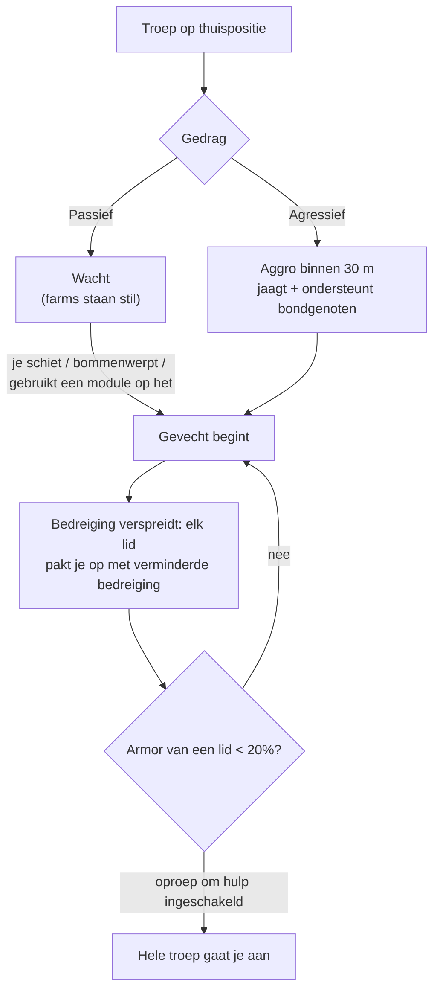

# NPC's & PVE-jacht

NPC's zijn de belangrijkste bron van [reactor plasma](/content/ores/),
[kernels](/nl/features/research/) en modules in het spel, en een betrouwbare manier om
uitbreidingspunten te verdienen op elk niveau. Ze bestaan in **troepen**: groepen die een
thuispositie, een thuisgebied, een respawn-tijd en een gedrag delen.

## Wie er rondloopt

NPC's komen in vier rassen voor — **Nuimqol, Pelistal, Thelodica en Industrial** —
elk met verschillende robotklassen (runners, crawlers, mechs, heavy mechs) en
rangen 1–5 die in stats en loot opschalen. Naast de reguliere rangen:

- **Goblins** — EWar-wachten op de beschermde eilanden. Kwetsbaar, maar hun
  locking-modifiers zijn extreem (ze locken je ~5× sneller dan normaal, vanaf
  ~2× verder): een goblin-kamp maakt het pijnlijk om in de buurt te vechten of te mijnen.
- **Elites** — zeldzame varianten van de gerangschikte NPC's met ongeveer verdubbelde
  basisstats en betere loot.
- **Observers** — rondzwervende, agressieve NPC's (Arbalest, Baphomet, Waspish,
  Tyrannos, Artemis, Kain, Gropho, Sequer, Seth, Mesmer…). Ze patrouilleren grote
  delen van het eiland en zijn aanzienlijk moeilijker dan gerangschikte NPC's van
  dezelfde klasse — *grand* observers op beschermde eilanden en hun open-eiland
  varianten zijn de sterkste reguliere jagers die er zijn.
- **Bosses** — zeldzame, individueel geconfigureerde NPC's. Ze vluchten nooit, kunnen
  zich server-breed aankondigen, en sommige zijn gekoppeld aan outposts (ze doden
  verplaatst [outpost-stabiliteit](/nl/features/outposts/)) of spawnen relic-rifts wanneer
  ze worden gedood. Zwakkere bosses zijn solo te doden op beschermde eilanden; de
  sterkste hebben een toegewijd team nodig.
- **Syndicaat-spawns** — een speciale factie (het Syndicaat, met zijn eigen
  genummerde NPC's) die zijn eigen statische farms runt, meestal op beschermde en
  ondiepe open eilanden.

## Passief vs agressief

- **Passieve troepen** vallen nooit vanzelf aan — je moet eerst schieten, bommenwerpen of
  een actieve module op hen gebruiken. De meeste klassieke statische farms zijn passief.
- **Agressieve troepen** aggroen vanzelf wanneer je binnen **30 m** komt,
  jagen je en ondersteunen bondgenoten die vechten. Alle Observers, de meeste rondzwervende
  spawns en outpost-wachten/aanvallers zijn agressief.

Wanneer een gevecht begint, **verspreidt de bedreiging door de troep**: elk lid pakt
je op met verminderde bedreiging, en als de armor van een lid onder **20%** daalt,
gaat de hele groep je aan (voor troepen met oproep-om-hulp ingeschakeld). Ga ervan uit
dat je de hele spawn vecht vanaf het moment dat de eerste bot vuurt.

## Spawns en respawning

- **Statische spawns** staan op een vaste thuispositie met een thuisgebied; leden
  respawnen **individueel** op hun eigen timer. Een troep die zwaar is afgegrast
  respawnen sneller; een verse respawnen trager.
- **Rondzwervende spawns** bewegen over het eiland — dit zijn de Observers en
  convoi-type troepen, en ze zijn meestal agressief.
- **Versterkingen op mijnbouwlocaties** — industriële NPC's die een resource-node
  bewerken hebben vooraf geconfigureerde versterkingsgolven: naarmate het gevecht
  langer duurt, arriveren verdere golven bij de node. Bosses roepen ook versterkingen
  wanneer ze beschadigd zijn. Een "één-robot" farm kan dus een groepsgevecht worden;
  controleer het gebied voordat je je commit.

## Wat ze droppen

Loot is per NPC-type geconfigureerd: **reactor plasma van het ras van het eiland**,
**kernels** (common, hitech, industrial en ras-specifiek), modulecomponenten en,
minder vaak, verpakte modules. Hogere rangen en speciale types droppen meer.

Elke kill betaalt ook **uitbreidingspunten**, geconfigureerd per NPC-type — en
verdubbeld op open (beta-laag) eilanden.

## Zone-laag voordelen

Eilanden komen in drie lagen — beschermde (alpha), open PvE (beta) en open
PvP (gamma). Jacht wordt gevaarlijker, maar ook lonender, naarmate je
dieper gaat:

- **Dood-explosies** — op beschermde eilanden *explodeert* een robot bij de dood
  niet. Op open eilanden (beta en gamma) explodeert elke vernietigde robot — speler
  of NPC — en doet gebiedsschade. Ketting-explosies maken farming sneller en
  gank-spots dodelijker.
- **Verdubbelde EP** — de basis-EP-beloning van elke activiteit is verdubbeld op
  beta-laag eilanden.
- **Beter missies** — de hogere missieniveaus zitten op de open eilanden,
  en hun missie-EP is ook verdubbeld.
- **Factie-missiemunten** — missies op de open eilanden betalen de missiemunt van
  dat ras (Nuimqol / Pelistal / Thelodica munt) in plaats van de universele
  munt. De factiemunten zijn ook direct te koop bij open-eiland terminals,
  en de universele munt kan worden gekocht waar de factie-munten niet te koop zijn.

## Praktische notities

- **Controleer de troep voordat je aanvalt** — tel de leden, noteer de rangen en
  of de spawn agressief is; een passieve farm waar je in loopt kan nog steeds
  vijf bots diep zijn.
- **Blijf buiten bereik** — statische spawns blijven in hun thuisgebied; positioneren
  voor duidelijke lange-afstandsschoten is meestal de goedkoopste manier om te winnen.
- **Resource-locaties zijn valkuilen** — mijnbouwlocatie-versterkingen betekenen dat
  hoe langer je vecht, hoe meer tegenstanders er zijn.
- **Observers onderweg** — als je verkent, artifacten verzamelt of een lange
  rit maakt, is een agressieve Observer op je pad een gevecht of een omweg.

<!--
Vanaf nul geschreven op basis van de server-backend, 2026-09-27:
Zones/NpcSystem/Flocks/ (Flock.cs, NormalFlock.cs — groeps-respawns, adaptieve
respawn-multiplicator), AI/Behaviors/ (Passief vs Agressief; bedreigingsverspreiding op
50%, oproep-om-hulp op 20% armor in SmartCreature.cs), AI/BodyPullThreatHelper.cs
(30 m aggro-bereik, agressief-alleen body-pull), Reinforcements/ + npcreinforcements
(mijnbouwlocatie- en boss-golven op HP-drempels), NpcSpecialType + npcbossinfo
(boss-respawn-ruis, outpost-stabiliteitskoppelingen, server-brede aankondiging),
entitydefaults (rank1-5 + dps/interceptor/scout/miniboss/elite-varianten, 30
elite-definities met ~2x-modifiers; 13 def_npc_roaming_* observers; goblin
lancer/shark met 5x lock-tijd / 2x lock-bereik modifiers),
npcloot (26k rijen: ras-plasma, common/hitech/industrial/ras-kernels,
modules), NpcEp.cs + GetNpcKillEp (EP per NPC, x2 op beta),
Unit.DoExplosion (dood-AoE onderdrukt op beschermde zones, actief op
beta/gamma; straal uit signature, schade uit resterende core),
MissionLocation.cs (ras-specifieke missiemunten; universele munt op beschermde
zones), ZoneConfiguration (IsAlpha/IsBeta/IsGamma).
Een eerdere versie van deze pagina was aangepast van de Open Perpetuum
community wiki (perpetuum.miraheze.org) en is volledig herschreven vanuit
backend-bronnen; er is geen tekst hergebruikt.
De ingevoerde "TAP"-sectie is weggelaten: er bestaat geen teleport-attractor
concept in deze backend (geen definitie, code of tabel).
-->