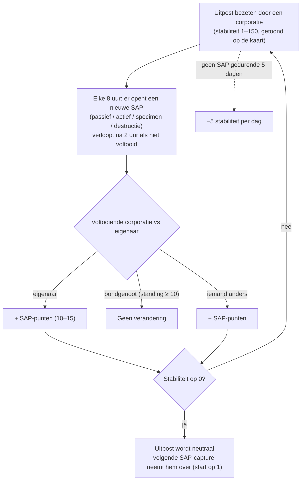

# Uitposten & SAP

Op de open-PvP-eilanden **kunnen uitposten bezeten worden door spelerscorporaties**.
De controle wordt gemeten met een **stabiliteitsmeter** (0–150) die boven de uitpost
in kaartweergave wordt getoond. Het **SAP**-systeem (Service Access Point) is de manier
waarop die meter beweegt — en hoe uitposten van eigenaar wisselen.

## De regels

- Als de **eigenaarscorporatie** een SAP voltooit, gaat de stabiliteit **omhoog** met
  de puntenwaarde van de SAP.
- Als een **corporatie die bondgenoot is van de eigenaar** (mutuele standing op +10 of
  hoger) er een voltooit, beweegt de stabiliteit **niet**.
- Als **iemand anders** er een voltooit, gaat de stabiliteit **omlaag** met hetzelfde
  aantal punten.
- Bij **nul** verliest de uitpost het eigendom en wordt neutraal. Als je op een
  neutrale uitpost een SAP voltooit, **verover** je hem (de corporatie die hem voltooit
  wordt de eigenaar, startend bij stabiliteit 1).
- **Verval**: als er **5 dagen** geen SAP is voltooid, begint de uitpost **5 stabiliteit
  per dag** te verliezen totdat er een is (of totdat hij verloren gaat).

## De vier SAP-typen

Elke 8 uur plaatst een uitpost een nieuwe SAP — een van de vier typen. Elk type heeft
zijn eigen puntenwaarde en zijn eigen voltooiingsmethode:

| Type | Uitvoering | Punten | Beloningsstijl |
|---|---|---|---|
| **Passief** | Blijf **8 minuten** in de SAP-straal staan. De voortgang is individueel (de eigen ononderbroken tijd van elke speler in de straal); de hoogste persoonlijke voortgang voltooit het. | +10 | Factieplasma (schaalt met stabiliteit), onderzoekskits, EP-boosters. |
| **Actief** | Kijk de SAP aan en houd een **SAP-hackingmodule** draaien — ongeveer 120 modulecycli (5 s elk), d.w.z. ~10 minuten. De voortgang blijft behouden als je stopt of vertrekt; individueel. | +15 | Plasma, kernels, onderzoekskits en **reactorkernen** (robotproductie). |
| **Specimen** | Breng **specimen-items** naar de SAP (binnen 7 m) en dien de 5–6 in die de SAP vraagt. Elke inzending heeft een cooldown van 90 seconden; de voortgang is individueel. | +15 | Plasma, kernels, onderzoekskits. |
| **Destructie** | Schiet hem neer: **30.000 pantser** en **150 weerstand tegen alle vier de schadetypen** (60% reductie), **6 m signatuur** — kleine wapens raken hem het beste. De schadevoortgang is **corporate, niet individueel**, zodat hele vlootten tegelijk afbreuk kunnen doen; de corporatie met de meeste schade op het moment dat hij sterft, past het resultaat toe. | ±15 | Factie-**PvP-munitie**, plasma, kernels. |

Alle vier de SAP's **stralen de huidige topscorers uit** (top 10) naar iedereen in de
buurt, en ze **verlopen na 2 uur** als ze niet zijn voltooid.

### De vijand ontzeggen

Omdat destructievoortgang corporate is en het teken van de stabiliteitsverandering
afhangt van wie wint, is een veelgebruikte tactiek om **genoeg schade toe te brengen om
bovenaan de ranglijst te staan, maar niet genoeg om de SAP af te maken**: als de eigen
bemanning van de eigenaar hem daarna afmaakt, is *jouw* corporatie nog steeds de
winnaar, en de stabiliteitsverandering valt tegen de eigenaar.

## Waarnemen en voorspellen

- De **intrusiescannerlading** in een geoscanner, geactiveerd in de buurt van de
  uitpost, meldt de **tijd tot de volgende SAP** voor uitposten in bereik (op
  open-PvP-eilanden meldt dezelfde lading in plaats daarvan de status van
  NPC-versterkingen).
- SAP's kondigen zich aan bij spelers in de buurt kort voordat ze openen.
- De topscorer-uitzending van de SAP betekent dat je een **omstreden SAP in realtime
  kunt volgen** en kunt beslissen of je hem wilt betwisten.

## Andere manieren waarop stabiliteit verandert

- **SAP-relics** — relic-objecten die 90–350 m van de uitpost spawnen (4 uur respawn,
  maximaal 12 uur oud). Als je er een activeert, wordt **±1 stabiliteit direct**
  toegepast (voor jouw corporatie), word je PvP-gemarkeerd en ontvang je EP plus een
  plasmacontainer.
- **Wachters en indringers** — de NPC-bossen van de uitpost:
  - **Guard**-NPC's houden zich dicht bij de uitpost op (~35 m). Als je er een doodt,
    **daalt** de stabiliteit **altijd** met 3, ongeacht wie hem doodt; ze respawnen na
    ~6 uur.
  - **Invader**-NPC's patrouilleren tot ~300 m. Als je er een doodt, **stijgt** de
    stabiliteit met 2 voor de corporatie die hem doodt; ~6 uur respawn.

## Waarom uitposten belangrijk zijn

Het bezitten van een uitpost geeft de corporatie haar bonussen (productie,
defensievoorzieningen, effecten) en is de ruggengraat van open-PvP-territoriaal spel —
zie [PBS](/nl/features/pbs/) voor de structuren die van een uitpost een echte operatiebasis
maken.

<!--
Geschreven vanaf nul op basis van de serverbackend, 2026-09-27:
Zones/Intrusion/Outpost.cs (stabiliteit 0-150, capture op 1, bondgenootsdrempel
+10, EP aan deelnemers), OutpostDecay.cs (5-dagen genade, -5/dag), SAP.cs +
PassiveHackingSAP.cs / ActiveHackingSAP.cs / SpecimenProcessingSAP.cs /
DestructionSAP.cs (8-min passief, 120x5s actief, 5-6 specimen-items met 90s
cooldown, corporate destructiescore, 2u verloop, top-10-uitzending),
entitydefaults opties (#increase=n10/n15), siegeitems (def_specimen_sap_item
2-3 x 5-6), def_sap_destruction stats (30k pantser, 150 res alle typen, 6m
signatuur), def_siege_hack_module (5s cyclus), intrusionsitestabilitythreshold
+ intrusionsaps, intrusionloot (plasma/kernels/onderzoekskits/kernen/PvP-munitie
per stabiliteitslaag), npcbossinfo + npcflock (guard -3 @ ~35m, invader +2 @
~300m, 6u respawn), OutpostRelicManager.cs + SAPRelic.cs (90-350m spawn,
4u respawn, 12u levensduur, +1 stabiliteit, PvP-markering), Scanner.Intrusion.cs
(scan tijd tot volgende SAP), EntitiesModule.cs (8u SAP-interval).
Een eerdere versie van deze pagina was aangepast vanuit de Open Perpetuum
community wiki (perpetuum.miraheze.org) en is volledig herschreven vanuit
backendbronnen; er is geen tekst hergebruikt.
Opmerking: de ingeleide tekst had enkele getallen die door deze server worden
tegensproken (3-dagenverval vs 5-dagenverval, 10-min passief vs 8-min,
"geen weerstanden" vs 150 alle typen, 3 km invaderbereik vs 300 m).
-->