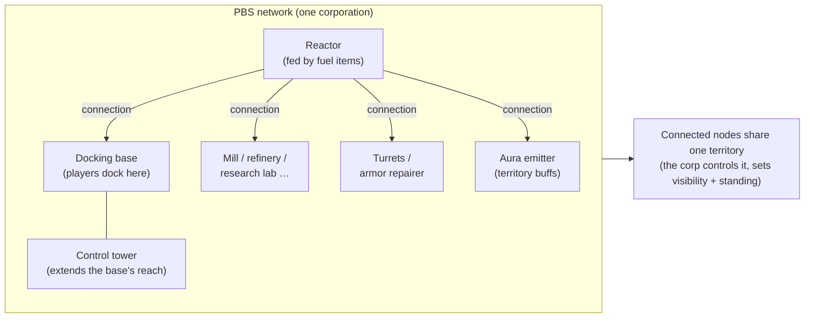
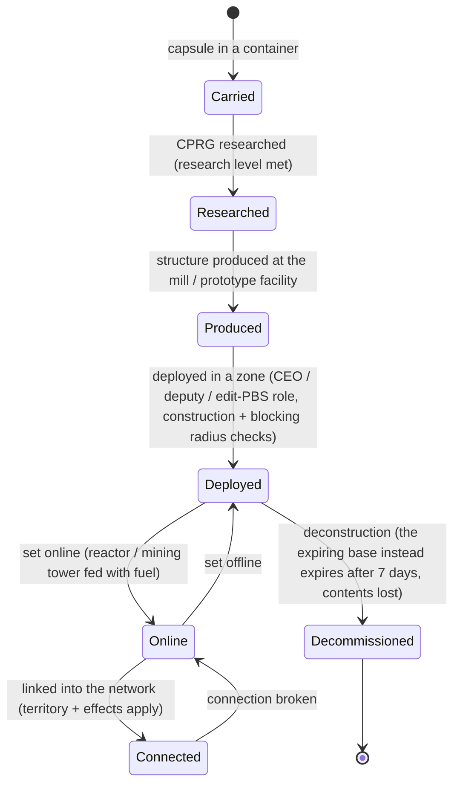

# Energiebasisstations (PBS)

Een **PBS** (Power Base Station) is een plaatsbare structuur in een zone. PBS-objecten kunnen
**verbonden** worden in een **netwerk**, dat **gebieden** definieert en **effecten** mogelijk maakt.
Dit is een corporatie/structuuractiviteit — de meeste acties vereisen de juiste corporatie-rol.

> UI-locaties volgen het [client UI-overzicht](/nl/features/ui/). De in-client naam voor "PBS" moet
> nog bevestigd worden. De mechanismen hieronder zijn bevestigd tegen de server.

## Wat een PBS doet

- Het is een **knoop** in een PBS-**netwerk**.
- Verbonden knopen vormen een gedeeld **gebied** dat de eigenende corporatie controleert.
- Een netwerk kan **effecten** (buffs/controles) projecteren over zijn gebied.
- Sommige PBS-structuren kunnen **voedingsitems** (brandstof) krijgen om te functioneren.

## Structurfamilies

Elke PBS-structuur komt in **klein / medium / groot** niveaus. Je draagt de
**capsule**, onderzoekt het item (CPRG) en **plaatst** het object — plaatsing is
bevoegdheidsgebonden (zie hieronder). De families:

| Familie | Structuren | Rol |
|---|---|---|
| Energie | reactor, energiebron, kernbatterij, kerntransmitter | genereren, opslaan en distribueren van de **kernenergie** waar alles op draait |
| Docking | dockingsbasis, verlopen dockingsbasis, controle-toren | waar spelers docken; de controle-toren vergroot het bereik van de basis |
| Productie | molen, raffinaderij, herverwerker, reparatie, prototyper, onderzoekslab, kalibratie (CPRG) smidse, onderzoekkit-smidse, productie-upgrade | de [productie](/nl/features/production/) faciliteiten, in de zone in plaats van op een thuisbasis |
| Verdediging | torens (laser / rail / raket / elektronische oorlogsvoering), pantserreparateur | geautomatiseerde verdediging van het gebied |
| Effecten | aura-emitter, effectleverancier, maskertoren, mijntoren | projecteren de gebiedseffectbonussen; de mijntoren extrahert erts automatisch |
| Transport | snelwegknoop | koppelt aan de **snelweg** van de zone (snelle reistroutes) |
| Bouw | bouwmodule | de bouwer die de andere structuren plaatst |

### Aura-emitter effecten

De aura-emitter is de hoofdgebiedsbuff. Elk niveau projecteert een van de drie
**niveauschaalbare basisbonussen**:

- **klein** — sensoren lvl1 / engineering lvl1 / industrie lvl1
- **medium** — dezelfde drie op lvl2
- **groot** — dezelfde drie op lvl3

Sensoren vergroten het scannen/verkenningbereik, engineering versnelt bouw, industrie versnelt
productie.

### De verlopen dockingsbasis

Een speciale PBS-basis met een vaste **levensduur van 7 dagen** (168 uur in de content). Deze kan
**niet worden ontmanteld** — deze **verloopt of wordt vernietigd**. De resterende levensduur wordt
aangekondigd door een in-game aankondiger (basis kanaal onderwerp, mail en MOTD); wanneer deze
op is, wordt de basis gedood en gaat de inhoud verloren. Dit is het "huur" model voor PBS
docking: je betaalt geen huur, je krijgt een tijdslimiet.

## Plaatsing

- **Plaatsing controleren** — voordat je plaatst, controleer of een PBS op een positie
  geplaatst kan worden (helling, blokkering en bevoegdheidscontroles). Dit vereist een
  corporatierol (**CEO / plaatsvervanger / PBS-bewerken**).
- Plaatsing gebruikt de **bouwstraal** en **blokkeerstraal** van de structuur.

## Netwerk & verbindingen

- **Netwerk ophalen** — bekijk het PBS-netwerk waaraan je bent aangesloten.
- **Knoopinformatie** — details van een PBS-knoop.
- **Een knoop hernoemen**.
- **Een verbinding maken** — twee PBS-knopen verbinden. (Verbinden met een netwerk dat al
  een dockingsbasis heeft, activeert een specifiek eigendomsoverdrachtsgeval.)
- **Een verbinding verbreken** — twee knopen ontkoppelen.
- **Verbindingsgewicht instellen** — de sterkte/prioriteit van een verbinding aanpassen.

## Controle & status

- **Online zetten** — een knoop online/offline zetten.
- **Een effect instellen** — het effect dat een knoop projecteert configureren.
- **Basisontmanteling instellen** — een basis markeren voor ontmanteling.

## Gebied

- **Gebieden ophalen** — de gebieden die je netwerk controleert, opsommen.
- **Gebiedszichtbaarheid instellen** — beheren of het gebied voor anderen zichtbaar is.
- **Standinglimiet instellen** — toegang beperken op basis van standing.
- **Versterkingsafstand instellen** — het versterkingsgedrag aanpassen.

## Voeding

- **Voedingsinformatie** — wat een PBS nodig heeft en de huidige voedingsstatus.
- **Items voeden** — items indienen om de PBS van stroom/bediening te voorzien.

De voederstructuren zijn de **reactor** en de **mijntoren**. Voeding zet
items met een energiewaarde (de `corecalories` per stuk) om in de kernenergiebuffer
van de knoop, tot het maximum — elke speler in bereik kan een knoop voeden. Wat je kunt verbranden:

| Brandstof | Kern per stuk |
|---|---|
| Reactor booster klasse C | 8.000.000 |
| Reactor booster klasse B | 4.000.000 |
| Reactor booster klasse A | 2.000.000 |
| SAP-specimen (intrusie) | 600.000 (flux-variant: 28.000) |
| Gamma-energieblok | 2.000 |
| Kernbooster munitie | 1.000 |
| Ruw erts (espitium) | 400 |
| Ruw erts (vitricyl / prilumium / chollonin) | 300 |
| Ruw erts (axicol) | 40 |

Boosters zijn de efficiënte brandstof; ruw erts is de goedkope fallback.

## Vergoeding

- **Vergoedingsinfo ophalen / instellen** — vergoeding voor PBS-gerelateerde kosten configureren.

## Logs

- **PBS-logs** — PBS-activiteit bekijken (verbindingen, plaatsingen, etc.).

## Praktische notities

- **Dit is een officiersactiviteit** — plaatsing en de meeste controles vereisen een corporatierol.
- **Verbindingen definiëren het gebied** — het netwerk dat je bouwt, is wat je controleert.
- **Plaatsing eerst controleren** — het vertelt je waarom een plaatsing zou mislukken (helling,
  blokkering, bevoegdheden) voordat je commit.
- **Voeding houdt het draaiend** — reactoren en mijntorens verbranden brandstofitems (boosters
  of ruw erts) om hun kernbuffer vol te houden.
- **De verlopen basis is je tijdslimiet** — 7 dagen, geen ontmanteling; plan voor de dood.
- **Gebiedszichtbaarheid & standing** laten je je zone voor anderen openen of sluiten.

## Verdedigingstorens

Niet door de speler bestuurbare — geplaatst als PBS-verdedigingsstructuren. Torens worden
samengesteld uit onderdelen zoals elke andere robot, maar ze zijn vastgezet op een PBS-pad
en kunnen niet worden bestuurd.

| Toren | Rol |
|---|---|
| PBS Toren | Algemene PBS-verdediging |
| PBS EW Toren | Energie-oorlogsvoering (schild/pantser verstoring) |
| PBS Laser Toren | Straalwapenverdediging |
| PBS Raket Toren | Raketverdediging |
| PBS Rail Toren | Projectiel (EM) verdediging |
| Politiewacht toren | Zone NPC-politie verdediging |

Zie de [robots referentie](/content/robots/) voor onderdeeldetails.

<!-- TODO: alleen de in-client naam voor PBS en de UI blijven (structuurlijst, netwerk
     editor, voedscherm).
     Bevestigd: 416 def_pbs_* definities, S/M/L niveaus met capsule/cprg/pr/object
     varianten; aura emitter #effect=N93..101 = pbs sensoren/engineering/industrie lvl1-3
     (EffectType enum); voederbaar = reactor + mijntoren (IPBSFeedable), brandstof =
     definitionconfig.corecalories (boosters A/B/C 2/4/8M, SAP 600k/28k, gamma blok
     2k, erts espitium 400 / vitricyl+prilumium+chollonin 300 / axicol 40);
     ExpiringPBSDockingBase: levensduur 168 uur van definitionconfig.lifetime, geen
     ontmanteling, aankondiger kanaal onderwerp + mail, dood bij verlopen. -->
     Ontwikkelaarsnotities: Zone/PBS/PBSCheckDeployment.cs (bouw/blokkeerstraal,
     CEO/plaatsvervanger/editPBS rol), PBSMakeConnection.cs / PBSBreakConnection.cs,
     PBSSetConnectionWeight.cs, PBSSetOnline.cs, PBSSetEffect.cs, PBSSetBaseDeconstruct.cs,
     PBSGetNetwork.cs, PBSNodeInfo.cs, PBSRenameNode.cs, PBSGetTerritories.cs,
     PBSSetTerritoryVisibility.cs, PBSSetStandingLimit.cs, PBSSetReinforceOffset.cs,
     PBSFeedableInfo.cs / PBSFeedItemsHander.cs, PBSGetReimburseInfo.cs /
     PBSSetReimburseInfo.cs, PbsGetLog.cs; Zones/PBS/* (IPBSObject, ConnectionHandler). -->