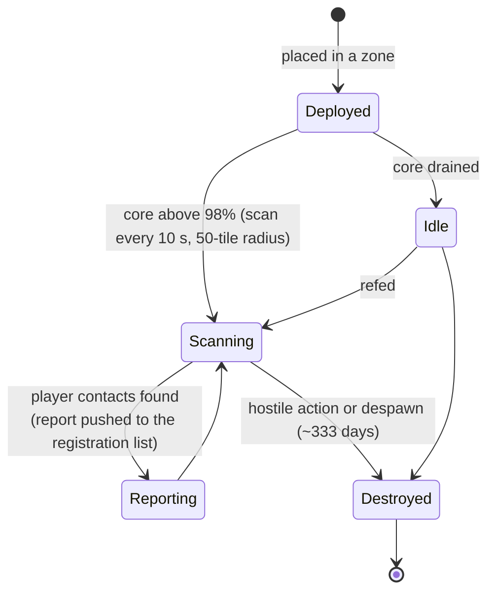

# Nabijheidssondes

Sonden zijn in twee families onderverdeeld:

- **Zichtbaarheids- (nabijheids-)sondes** — kleine apparaten die je in een zone plaatst om een
  **gebied in de gaten te houden**. Zolang ze stroom hebben, scannen ze spelerunits in de buurt en sturen ze rapporten naar de
  personages die je hebt geregistreerd. Dit is een surveillance-/verkenningstool.
- **Mijnbouwsondes** — een **module** die in je robot is gemonteerd (niveaus van *noob* tot
  *standard*, *industrial*, *named*, *elite* en *artifact*) plus **per-ore sondemunitie**
  (tegel-/richting-/gebiedvarianten voor elke ore). Als je deze afvuurt, wordt een scanresultaat
  voor die ore in het gebied gegenereerd, opgeslagen per personage (zie
  [verzamelen → scannen](/nl/features/gathering/)).

> De UI-locaties volgen het [client-UI-overzicht](/nl/features/ui/). De onderstaande mechanismen zijn bevestigd tegen
> de server.

## Beheer van je sondes

- **Lijst** van je sondes — bekijk de sondes die je hebt.
- **Registratie-informatie** — de registratiestatus/informatie voor een sonde.
- **Registratie instellen** — koppel personages aan de rapportlijst van de sonde.
- **Naam instellen** — geef een sonde een label.
- **Verwijder** de registratie van een sonde (in een zone) — stop het bewaken / wis deze.

### Hoe een zichtbaarheids- (nabijheids-)sonde werkt

- De sonde is **core-aangedreven**: hij scant alleen zolang de core bijna vol is (boven 98% van
  `core_max`); een lege sonde staat inactief.
- Tijdens actieve werking scant hij **elke 10 seconden** naar spelerrobots binnen de **detectieradius
  (50 tegels)** en stuurt hij een rapport (het personage-ID en de positie van elk contact) naar
  iedereen op de registratielijst.
- **Registratie** is een corporatieactiviteit: je kunt alleen **leden van je eigen corporatie**
  registreren, en de **CEO en adjunct staan automatisch altijd op de lijst**.
  De lijst heeft een maximale grootte.
- **Levensduur**: een geplaatste sonde verdwijnt na de content-gedefinieerde `despawn_time`
  (de zichtbaarheids- (nabijheids-)sonde is ingesteld op ~333 dagen) of wordt vernietigd.

## Levenscyclusgebeurtenissen

De server rapporteert levenscyclusgebeurtenissen van sondes zodra ze plaatsvinden:
- **created**, **updated**, **dead** — een sonde wordt geplaatst, rapporteert of wordt vernietigd.

Deze komen als pushmeldingen; je stuurt ze niet, je reageert erop.

## Praktische notities

- **Registreer voordat je leest** — een sonde rapporteert alleen naar de geregistreerde personages.
- **Sondes kunnen sterven** — vijandige actie of het verlopen van de levensduur kan een sonde vernietigen; houd de levenscyclusgebeurtenissen
  in de gaten.
- **Geef ze namen** — met meerdere sondes in het veld houden labels je gezond.
- **Verkenning, geen gevecht** — sondes verzamelen informatie; ze vechten niet.

<!-- TODO: alleen de UI blijft over (sondelijst, registratiekiezer).
     Bevestigd: zichtbaarheids- (nabijheids-)sonde (def_visibility_probe): core_max 50, actief alleen bij
     core>98%, scaninterval 10 s (ProximityDevice.cs _probingInterval), detectie via
     blob_emission 10 / blob_emission_radius 50, rapport = characterID + x/y per contact
     gestuurd naar geregistreerde personages (ProximityProbe.OnUnitsFound); registratie =
     alleen leden van eigen corporatie, CEO+Deputy altijd opgenomen, max aantal
     (ProximityProbeRegisterSet.cs); despawn_time 28.800.000 s (~333 d) op de capsule;
     stealth_strength 275 / detection_strength 45. Mijnbouwsondes: gemoduleerde niveaus
     (noob/standard/industrial1-2/named1-3/elite t2-t4/artifact) + per-ore tegel-/
     richting-/gebiedmunitie (79 def_*probe* definities).
     Ontwikkelaarsnotities: ProximityProbeList.cs / ProximityProbeGetRegistrationInfo.cs /
     ProximityProbeRegisterSet.cs / ProximityProbeSetName.cs; Zone/ProximityProbeRemove.cs;
     Zones/ProximityProbes/ProximityProbe.cs + ProximityProbeDeployer.cs +
     ProximityDevice.cs; Zones/Blobs/* (blob emissie/stealth); levenscyclusgebeurtenissen via
     ProximityProbeCreated/Update/Dead/Info commando's. -->
     Ontwikkelaarsnotities: ProximityProbeList.cs / ProximityProbeGetRegistrationInfo.cs /
     ProximityProbeRegisterSet.cs / ProximityProbeSetName.cs; Zone/ProximityProbeRemove.cs;
     Zones/ProximityProbes/ProximityProbe.cs + ProximityProbeDeployer.cs; levenscyclus
     gebeurtenissen via ProximityProbeCreated/Update/Dead/Info commando's. -->