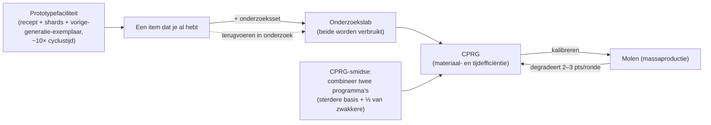

# Productie

Productie is hoe je grondstoffen en componenten omzet in bruikbare items. Het gebeurt in
een **productiefaciliteit** (een "molen") op je gedockte basis. Alles hier is **alleen gedockt**.

> UI-locaties volgen de [client-UI-overzicht](/nl/features/ui/) (de **Raffinaderij / Recyclage / Reparatie /
> Verzekering** categorieën in de bovenbalk). De mechanismen hieronder zijn geverifieerd tegen de server.

## Productielijnen

Een **productielijn** is een opgeslagen recept: het definieert wat je produceert en waaruit. De
volledige componentenlijst voor elk maakbaar item (met onderzoeksniveaus) wordt gegenereerd in
[Recepten](/content/recipes/). Je voert een lijn uit voor een aantal **rondes**.

- **Lijnen weergeven** — zie je beschikbare lijnen.
- **Lijn starten** — voer deze uit in een faciliteit voor een gekozen aantal ronden (minimum 1).
  - Je kunt betalen uit je **persoonlijke portemonnee** of de **corporatie-portemonnee**.
  - De broncomponenten kunnen worden gezocht in je **inventaris** of je **robots**.
- **Lijn kalibreren** — stel de instellingen van een lijn af.
- **Rondes instellen** — kies hoeveel ronden je wilt uitvoeren.
- **Volgende ronde opvragen** — bekijk wat de volgende ronde zal verbruiken/produceren.
- **Annuleren** — stop een lopende productie.
- **Lijn verwijderen** — verwijder een opgeslagen lijn.

Een lopende lijn verbruikt componenten (en credits) en produceert het doelitem over de
ronden.

## Eénmalige bewerkingen

Dit zijn eenmalige acties in plaats van meerrondelijnen. Elke actie heeft een **Query**-variant
die de kosten/output vooraf toont voordat je het bevestigt.

- **Raffineren** — grondstoffen → grondstof, gebruikmakend van het recept van het item (zie [Recepten](/content/recipes/)).
  Je kiest hoeveel van het doelitem je wilt maken; de nominale invoer van het recept wordt geschaald
  met een materiaalmultiplicator van `1 + 50/(bonus + 100)` waarbij *bonus* je raffineerskill is
  (extensies + faciliteitspunten + standing-punten). Zonder bonus verbruik je **150%** van
  het nominale recept; met maximale bonus daalt dit richting **100%**.
- **Recyclen / herverwerken** — breekt een item terug in de componenten van het recept (het omgekeerde
  recept). De opbrengst is `nominaal × (1 − 75/(bonus + 100)) × de gezondheidsratio van het item` —
  zonder skillbonus is dat een basis van **25%**, verbeterend richting 100%, en een **beschadigd item
  levert evenredig minder op** (repareer het eerst als het waardevol is). Alleen hele "batches"
  (volledige standaardhoeveelheden) worden gerecycled; de rest blijft over. Missie-items worden verwijderd,
  niet gerecycled.
- **Repareren** — herstelt een beschadigd item/robot naar volledige gezondheid. De prijs is
  `(ontbrekende gezondheid %) × de materiaalwaarde van het item × 75/(bonus + 100)`. De "materiaalwaarde"
  wordt recursief berekend: het recept van het item wordt afgebroken tot grondstoffen en geprijsd op de
  **wereldmarktgemiddelden**, zodat de reparatiekosten meebewegen met de markt. De
  skillmultiplicator begint op **75%** zonder bonus en neigt naar 0 met maximale bonus.
- **Onderzoekcomponenten** — produceer onderzoekcomponenten (query + uitvoeren).

## De levenscyclus van items (het circulaire proces)

Itemcreatie is een lus van drie verbonden faciliteiten:

1. **Onderzoek (reverse engineering)** — voed een exemplaar van het item dat je wilt
   produceren, plus een **onderzoeksset** waarvan het niveau het onderzoeksniveau van het item
   voldoet (sets zijn niveaus 0–10), in het onderzoekslab. Beide invoeritems worden **verbruikt**,
   en de taak levert één **CPRG** voor dat item op. De efficiënties van het resulterende programma
   starten vanaf de per-item basis van het item (meeste items 50, munitie hoger,
   torens tot 90) en worden verhoogd met *setniveau boven het vereiste niveau × 5*
   plus je onderzoeksskillbonus (tot +50 extra). Dus een set een paar niveaus
   boven het item — en redelijke productie-extensies — is wat een vers
   50/50-programma omzet in een competitief programma. Dit is hoe nieuwe items aan je
   productierepertoire worden toegevoegd.
2. **De molen (massaproductie)** — massaproduceer vanuit het programma. Elke ronde
   **degradeert** de efficiënties van de lijn (2–3 punten per ronde, per itemcategorie;
   zie [CPRG](#cprg-kalibratieprogramma-s)) — als afval te hoog wordt, kalibreer
   een vers programma op de lijn. Prototype-items nemen ook een **exemplaar van de
   vorige generatie** als component (één standaardmodule om een T2-prototype te maken, één T2 om een T3 te maken), die in het proces wordt verbruikt.
3. **De prototypefaciliteit** — produceer een **prototype** van een item direct:
   de materialen van het recept plus robotshards *en* het exemplaar van de vorige generatie,
   met ongeveer **10× de cyclustijd van de molen** (plus de gebruikelijke tijdmultiplicator). Je kunt alleen
   prototypes maken van items die in je techtree zijn ontgrendeld.
   Prototypes kosten dramatisch meer dan hun standaardvarianten; hun belangrijkste
   doel is om **onderzocht te worden tot hoogwaardige programma's** (onderzoek van een
   prototype-item is wat de volgende tier ontgrendelt) — of gebruikt te worden op de robot wanneer
   het item te zeldzaam is om te drop en te duur op de markt.

## Tierprogressie

De meeste modules en robots komen in **tiers T1 → T4** (de tierbadge van de client; de
`standard → named1 → named2 → named3` definitielijnen, dan de speciale `elitet4`/
`artifact`-lijnen). De regels:

- **Elke tier is een apart item met zijn eigen techtree-knoop.** Ontgrendelen van een
  knoop kost onderzoekspunten (onderzocht uit kernels) en vereist de
  **ouderknoop** — dus tiers moeten in volgorde worden ontgrendeld. Je kunt alleen
  **prototypes maken** (of massaproduceren) van een item waarvan de knoop al is ontgrendeld:
  er is geen manier om een hogere tier te maken zonder het onderzoek.
- **Elke hogere tier verbruikt één exemplaar van de vorige tier** als
  component (plus materialen en robotshards). Een T1-item kan daarom nooit
  "inleverd" worden voor een T3 — het T3-prototype heeft een **T2**-item nodig, en het
  exemplaar wordt **verbruikt**, niet geconverteerd: de output is een volledig nieuw item.
- Elke itempagina toont zijn **tierlijn** — de hele `T1 → T2 → T3 → T4`-keten
  als links — en de [techtree-knooppagina's](/content/techtree/) tonen
  de ouder/volgende knoop en de puntprijzen van elke tier.

Voorbeeld, de kleine mijnwerkmodulelijn: [standaard kleine mijnwerker (T1)](/content/items/standard-small-driller/) →
[Biroter 5050 kleine mijnwerkmodule (T2)](/content/items/named1-small-driller/) →
[Sublimator Low-D kleine mijnwerkmodule (T3)](/content/items/named2-small-driller/) →
[Scraper-990 kleine mijnwerkmodule (T4)](/content/items/named3-small-driller/) —
en hetzelfde patroon voor elke module/robotfamilie.

## Prototypes & onderzoekssets

- **Prototype** — produceer een prototype-item (starten + query). Eén prototype per
  slot; meer parallelle prototype-taken komen van productie-extensies.
- **Onderzoekssets samenvoegen** — combineer meerdere onderzoekssets tot een hogere
  (uitvoeren + query). Een hogere set verkort zowel de onderzoekstijd als verhoogt de
  efficiënties van het resulterende programma.

## CPRG (kalibratieprogramma's)

Een **CPRG** (kalibratieprogramma) is waar een productielijn op draait — een per-item programma
met **materiaalefficiëntie** en **tijdefficiëntie** punten (0–100 elk). Je krijgt er een door
**het item te onderzoeken** in een onderzoekslab (het onderzoeksniveau bepaalt welke items je
al kunt produceren), of door een **kalibratiecapsule** te activeren.

- Een vers onderzocht CPRG start op **50/50** punten.
- **CPRGs smeden** in de kalibratieprogrammasmidse: combineer twee CPRGs voor hetzelfde item;
  het resultaat behoudt de punten van het sterkere programma als basis en voegt een derde van
  het zwakkere toe. Smeden kost tijd en credits (tijd × de prijs per seconde van de faciliteit).
- **Kalibreer een lijn** met een CPRG om de efficiënties in te stellen. Elke productieronde
  **degradeert** de efficiëntie van de lijn (een per-item decalibratiewaarde), dus lijnen
  zakken met de tijd terug — herbereken vóór lange runs.

De efficiënties voeden de formules van de molen (per productiecyclus):

- **Verbruikte materialen** = recept × `1 + 50/(materiaalpunten + skill + 100 + millBonus)`
  — een nieuw 50-punten CPRG zonder skill en zonder techtree-massaproductiebonus verbruikt
  ≈ **133%** van het nominale recept.
- **Productietijd** = basistijd van de faciliteit (3.600 s per cyclus voor een molen) ×
  `1 + 100/(tijdpunten + skill + 100)` × de duuratijdmultiplicator van het item — een nieuw CPRG
  zonder skill duurt ≈ **1 uur 40 minuten** per item.
- **Prijs** = productietijd × de prijs per seconde van de faciliteit (7 credits/s voor de PBS-molen,
  3 voor de grote/middelgrote PBS-onderzoekslabs) × de prijzmultiplicator van het item (1–10).
- Missiegerelateerde CPRGs zijn gratis en vast op 10 seconden.

## Verzekering

De verzekeringsfaciliteit verzekert **je robots**, niet je productieoutput:

- **Koop** een polis voor een robot (die moet onbeschadigd, niet uitgepakt en geen starterbot zijn),
  **lijst** je polissen, **query** een polis, **verwijder** een polis.
- Dekking duurt **15 dagen** (+ extensiebonusdagen); je kunt polissen houden op
  1 + (extensiebonus) robots.
- Elke robot heeft een content-gedefinieerde **premie** en **uitkering** (de `insuranceprices`-tabel,
  67 robotdefinities); de premie wordt verlaagd door een premie-extensiebonus en kan worden
  betaald uit de corporatie-portemonnee.
- Als de verzekerde robot wordt vernietigd, wordt de **uitkering in credits betaald** (de robot is
  nog steeds verloren) — zie [gevecht](/nl/features/combat/).

## Faciliteit & status

- **Faciliteitsinfo / beschrijving** — wat een productiefaciliteit aanbiedt.
- **In uitvoering (mijn / corporatie)** — wat momenteel wordt geproduceerd.
- **Productiegeschiedenis** — je eerdere productie.
- **Componentenlijst** — beschikbare productiecomponenten.
- **Serverinfo** — productieserverstatus.

## Praktische notities

- **Je moet gedockt zijn op een basis met een productiefaciliteit.**
- **Query vóór je uitvoert** — de query-varianten tonen kosten en output zodat je geen
  componenten verbrandt door een fout.
- **Corporatie-portemonnee** — je kunt corp-geld uitgeven voor productie als dat is toegestaan.
- **Componenten komen ook van robots** — een lijn kan broncomponenten halen uit je
  gemonteerde robots, niet alleen uit je inventaris.
- **Recycleer bij volledige gezondheid** — een beschadigd item levert minder op; repareer dure items vóór
  je ze herwerkt.
- **Skillmultipliers zijn de echte economische hefbomen** — de raffineer/recycleer/repareer/molenbonussen
  schalen allemaal op dezelfde manier; investeren in productie-extensies betaalt zich terug in
  materiaalsparingen bij elke run.
- **Verzekering is een robotveiligheidsnet** — koop het voor dure fits vóór dieptruimte-PvP.
- **Onderzoekssets zijn de poort** — het onderzoeksniveau van een item (1–9) bepaalt welke
  sets het kunnen decoderen, en een set een paar niveaus boven het item uitvoeren is de
  goedkoopste manier om de efficiënties van het resulterende programma te verhogen.

<!--
Ontwikkelaarsnotities: in 2026 herschreven vanuit backendbronnen; geen community-wikitext hergebruikt.
Geverifieerd tegen:
- refine = 1 output per eenheid, input = nominaal x (1+50/(bonus+100)) (Refinery.cs);
- recycle = omgekeerd recept x (1-75/(bonus+100)) x healthRatio, alleen hele batches,
  missie-items verwijderd (ReprocessSessionMember.cs);
- repair price = (1-healthRatio) x PriceCalculator wereldmarktwaarde x
  75/(bonus+100) (Repair.cs + PriceCalculator.cs);
- ResearchLab.cs (StartResearch/EndResearch: bronitem + onderzoeksset beide
  verbruikt; setniveau moet >= itemresearchlevels.researchlevel (1-9);
  efficiency = per-item basis + levelDifference*5 + (1-100/(100+skill))*50);
- itemresearchlevels (1101 rijen, niveaus 1-9), research kits def_research_kit_0..10
  (#level optie), RandomResearchKit (missiesets, nep 100/100);
- calibrationdefaults (per-CPRG basisefficiënties 50-90; standaard fallback 50/50;
  CalibrationProgram.OnInsertToDb stelt 50/50 in);
- PBSFacilities.cs CalculateResultingPoints (forge = betere basis + weak/3 +
  (1-100/(100+skill))*25);
- productiondecalibration (2-3 punten afname per ronde per categorie,
  distorsion 0.5-1%);
- Prototyper.cs (StartPrototype: componenten bevatten vorige-generatie-exemplaar via de
  componententabel — bijv. T2 NEXUS verbruikt 1x standaardmodule, T3 verbruikt 1x T2;
  tijd = 10x cyclus x multiplier; techtree-ontgrendelingscheck in
  ProductionPrototypeStart.cs);
- prototypes tabel (339 rijen, standaard->prototype mapping);
- Mill.cs (CalculateFinalMaterialMultiplier 1+50/(pts+skill+100+millBonus) met
  techtree-massaproductiebonus; CalculateFinalTimeMultiplier;
  productionduration tabel);
- Insurance: InsuraceFacility.cs (15d + tijds-extensiebonus, 1+slot-extensie
  polissen, noob bot uitgesloten, moet single+unpacked zijn), InsuranceDescription.cs
  (uitkering in credits via centrale bank), insuranceprices (67 robotdefinities,
  uitkering = 80x premie behalve noob/arkhe2 op 4x).
- Faciliteitsopties (entitydefaults): def_pbs_facility_mill #perSecondPrice=7
  #productionTime=3600; refinery #materialEfficiency=0.95;
  calibration_program_forge #perSecondPrice=7; def_production_public_factory
  #materialEfficiency=0.6 #manufactureTime=3600 #perSecondPrice=3.
Ontwikkelaarsbestanden: Production/ProductionLineStart.cs (PrepareProductionForPublicContainer,
LineStartInMill, corp portemonnee, zoeken-in-robots, ronden); Production/ProductionLine*.cs;
Production/ProductionRefine*.cs, ProductionReprocess*.cs, ProductionRepair*.cs,
ProductionResearch*.cs (query+run paren); Production/ProductionPrototype*.cs,
ProductionMergeResearchKitsMulti*.cs; Production/ProductionCPRG*.cs,
ProductionGetCPRGFromLine*.cs; Production/ProductionInsurance*.cs;
Production/ProductionFacility*.cs, ProductionInProgress*.cs, ProductionHistory.cs;
Services/ProductionEngine/Facilities/*.cs; Services/ProductionEngine/PBSFacilities.cs;
Services/ProductionEngine/ResearchKits/*.cs; Services/ProductionEngine/CalibrationPrograms/*;
Services/Insurance/InsuranceHelper.cs; Items/PriceCalculator.cs.
Correcties t.o.v. geïmporteerde pagina: er bestaat geen "decoder"-item (onderzoekssets zijn de
niveau-gegateerde invoer); de claim "onderzocht tot 100%" is fout (techtree-ontgrendeling is
de poort; onderzoeksniveaus lopen 1-9); prototypetijd is 10x de molen-cyclus; exemplaarverbruik
geverifieerd vanuit de componententabel; verzekeringsuitkering is 80x de premie.
-->