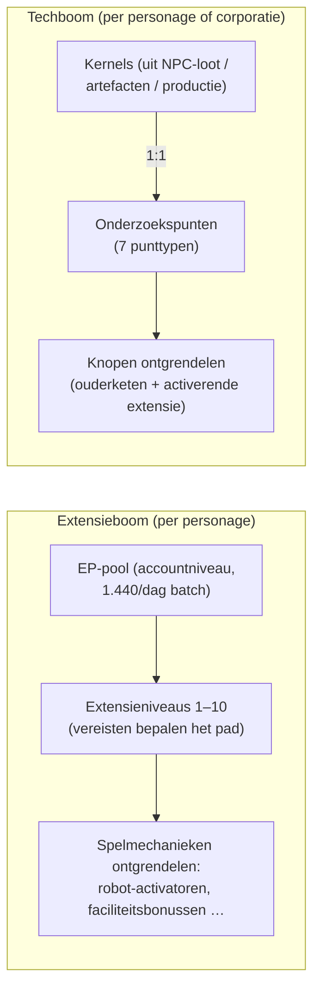

# Onderzoek

Er zijn **twee aparte voortgangssystemen**. Beide zijn alleen beschikbaar terwijl je gedockt bent.

> De UI-locaties volgen de [UI-overzicht van de client](/nl/features/ui/) (Personagewin → extensies; de
> techboom heeft een eigen venster). De mechanismen hieronder zijn bevestigd tegen de server.

## De extensieboom (personagevaardigheden)

Extensies zijn per-personage vaardigheidsniveaus die spelmechanieken ontgrendelen — het belangrijkste zijn de
**activerende extensies** die je in staat stellen een robotklasse te besturen (vereist om te ondocken en een
robot te selecteren, zie [beweging](/nl/features/movement/) en [robots](/nl/features/robots/)).

### Hoe leren werkt

- Je moet **gedockt** zijn om te leren.
- Elke extensie kan verhoogd worden naar **niveaus 1–10** (niveau 10 is het maximum).
- **Niveau 1 kost credits** (de `price` van de extensie), betaald uit je portemonnee.
- **Elk niveau kost Extensiepunten (EP)** volgens een vaste rang × niveau-tabel —
  voor niveaus 1–5 is de kosten `60 × rang × niveau`; niveaus 6–10 springen naar
  `rang × (1440, 2520, 3840, 5400, 12000)`. De tien niveaus van een rang-1 extensie kosten
  60 → 6.000 EP, in totaal 13.500; een rang-10 extensie kost tien keer zoveel op elk niveau.
- **Vereisten** moeten al geleerd zijn voordat je een extensie kunt nemen
  (de "prerequire"-lijst).
- EP is een **pool op accountniveau**: deze wordt gedeeld over je personages en verdient over
  tijd (zie "EP-bronnen" hieronder).

### Extensies beheren

- **Categorielijst / alles ophalen / geleerde lijst / vereistenlijst** — blader door de boom en wat
  je al hebt.
- **Beschikbare punten** — bekijk je huidige EP-pool.
- **Eén niveau verwijderen** — verlaag een enkel niveau van een extensie.
- **Personage-extensies resetten** — reset de hele boom voor een personage.
- **Geblokkeerde EP vrijgeven** — vrijgeven van EP die geblokkeerd is (bijv. na het verwijderen van niveaus).
- **EP-boost kopen** — een betaalde versneller die de EP-opbrengst verhoogt.
- **EP-voor-activiteit dagelijkse log** — bekijk hoeveel EP je uit spelen hebt verdiend.

### EP-bronnen

EP is geen besteedbare valuta die je koopt — het wordt opgebouwd in een **dagelijkse batch**:

- Elk account ontvangt **1.440 EP per dag** (eenmalig per dag toegekend, tussen 08:00 en
  11:00 servertijd, door de `extensionPointsAdd`-procedure). De code definieert ook een
  verdubbelde **2.880 EP**-batch voor betaalde-abonnementaccounts, maar de huidige procedure
  betaalt de basisbatch aan alle accounts.
- **Betaalde boosts** (EP-boost-aankopen) worden daarbovenop toegevoegd.
- Je **beschikbare EP** = alle ontvangen dagelijkse batches − boetes − EP besteed in het spel.
  (De EP-voor-activiteit log toont de dagelijkse inkomstenopbrengst.)

**Volledige catalogus** — elke extensie (rang, niveau-1 prijs, bonus, vereisten) staat in
[Extensies](/content/extensions/), en elke techboom-knoop (ontgrendeld item, activerende
extensie, puntkosten) staat in [Techboom](/content/techtree/).

## De techboom (ontgrendelingen)

De techboom is een graf van **knopen** die je ontgrendelt door **onderzoekspunten** te besteden. In tegenstelling
tot EP (accountpool) worden techboom-punten **verdiend door "kernels" te consumeren** — items die je
onderzoekt en vervolgens indient.

### Hoe het werkt

- **Kernels onderzoeken** — dien kernel-items in uit een container. Elke kernel wordt
  **1:1** omgezet in onderzoekspunten van een gegeven **punttype**; de kernels worden geconsumeerd.
  Er zijn zeven kerneltypes, één per punttype: Theodica, Pelistal, Nüimqol,
  Industrial, Common, HiTech en NewTech.
- **Een knoop ontgrendelen** — besteed de vereiste onderzoekspunten. Een knoop kan alleen worden ontgrendeld als:
  - al zijn **ouderknopen** al zijn ontgrendeld, en
  - je de **activerende extensie** van de knoop hebt geleerd op je personage.
- **Corporatie-ontgrendelingen** — met de juiste corporatierol kan een knoop worden ontgrendeld
  **voor de corporatie** (gedeeld). Corporatie-ontgrendelingen kosten meer (een corporatieprijs-
  vermenigvuldiger wordt toegepast) en worden betaald uit de punten van de corporatie.
- **Doneren** — doneer onderzoekspunten (bijv. aan je corporatie).
- **Info / logs** — bekijk knoopdetails en je ontgrendelings-/onderzoeksgeschiedenis.

### Waarom het belangrijk is

Ontgrendelde techboom-knopen bepalen de toegang tot hogere-tier content en functies. Controleer de
vereisten van een knoop (ouderketen + activerende extensie) voordat je punten besteedt.

## Praktische notities

- **Activerende extensies bepalen robots** — je kunt geen robotklasse besturen die je niet hebt
  onderzocht (dit is dezelfde check die ondocken/selecteren blokkeert).
- **Niveau 1 is de enige creditkosten** in de extensieboom; daarna is het allemaal EP.
- **De techboom is onomkeerbaar** — punten besteed aan een ontgrendeling zijn weg; plan je pad.
- **Corporatietechniek is een teaminspanning** — het gebruikt gedeelde punten en een prijsvermenigvuldiger.

<!-- TODO: only the research UI remains (window layout, point display).
     Confirmed: EP earn = 1440/day flat via dbo.extensionPointsAdd (08:00-11:00 window,
     once per day; 2880 bonus constant exists in GiveExtensionPointsService for paid
     subscriptions but the current SP pays base to all); available = batches -
     penalties - spent (extensionPointsAvailable fn); EP cost table in
     Services/ExtensionService/ExtensionPoints.cs (60*rank*level for levels 1-5, then
     rank*(1440,2520,3840,5400,12000)); kernels convert 1:1 (TechTreeResearch.cs), 7
     kernel definitions -> point types n1..n7 (Theodica/Pelistal/Nuimqol/Industrial/
     Common/HiTech/NewTech).
     Developer notes: Extensions/ExtensionBuyForPoints.cs (docked, prereq, level cap 10,
     level-1 credit price, EP by rank/level, account pool, training-char free);
     Extensions/ExtensionGetAvailablePoints.cs; Extensions/ExtensionBuyEpBoost.cs,
     ExtensionFreeLockedEp.cs, ExtensionRemoveLevel.cs, ExtensionResetCharacter.cs;
     EpForActivityDailyLog.cs; TechTree/TechTreeResearch.cs (kernels → points);
     TechTree/TechTreeUnlock.cs (parent chain + enabler extension, corp multiplier);
     TechTree/TechTreeDonate.cs; Services/ExtensionService/GiveExtensionPointsService.cs;
     Services/ExtensionService/ExtensionPoints.cs. -->
     Developer notes: Extensions/ExtensionBuyForPoints.cs (docked, prereq, level cap 10,
     level-1 credit price, EP by rank/level, account pool, training-char free);
     Extensions/ExtensionGetAvailablePoints.cs; Extensions/ExtensionBuyEpBoost.cs,
     ExtensionFreeLockedEp.cs, ExtensionRemoveLevel.cs, ExtensionResetCharacter.cs;
     EpForActivityDailyLog.cs; TechTree/TechTreeResearch.cs (kernels → points);
     TechTree/TechTreeUnlock.cs (parent chain + enabler extension, corp multiplier);
     TechTree/TechTreeDonate.cs. -->