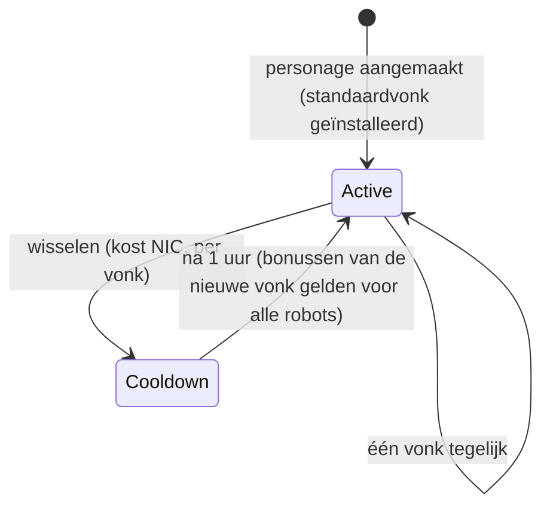

# Vonken

Een **vonk** is een nanotspecialisatie die op je personage is geïnstalleerd. Zolang deze
actief is, gelden de bonussen voor elke robot die je bestuurt — de vonk voor de
gevechtslijn van een factie verhoogt bijvoorbeeld wapenschade en kritieke kans per
niveau, terwijl een industriële lijn de kerncapaciteit en de mijnopbrengst verhoogt.

Elk personage heeft een **standaardvonk** die bij het aanmaken wordt gegeven. Daarbuiten
komen vonken in families voor — de basisstandaardlijnen, de per-factie gevechts/industriële/sociale
lijnen (drie niveaus per lijn), de betaalde Syndicate-lijnen en de speciale beperkte lijnen
— en de exacte bonussen van een vonk zijn niets meer dan een bundel vaste vaardigheidsniveaus
die je kunt zien op de [extensiepagina](/content/extensions/). Het [familieoverzicht hieronder](#vonkfamilies)
springt direct naar de vonken van elke familie.

## Een vonk ontgrendelen (autoriseren)

Het installeren van een vonk die je nog niet bezit vereist eerst **ontgrendelen**
(alleen gedockt). Afhankelijk van de vonk controleert de server:

- een **prijs** in NIC (de betaalde lijnen — bijv. de Syndicate-gebruiksvonken en de
  beperkte speciale vonken),
- **standing** bij de ontwikkelaarsmegacorporatie (de per-factie-lijnen vereisen een
  minimale standing bij de megacorp van die factie, opgebouwd door de
  [missies](/nl/features/missions/) te voltooien),
- of een **item** uit je inventaris (sommige speciale vonken worden ontgrendeld
  met een sleutelitem).

Ontgrendelen is eenmalig: zodra ontgrendeld, blijft de vonk in je collectie.

## Vonken wisselen

- Je kunt op elk moment maar **één actieve vonk** hebben; als je een andere installeert,
  wordt deze verwisseld.
- Elke wissel **kost NIC** — het bedrag is per vonk (de gewone lijnen kosten
  10k, de betaalde speciale lijnen tot een miljoen).
- Er is een **koeltijd van één uur** tussen wissels: de server bijhoudt wanneer je
  huidige vonk is geactiveerd en weigert een nieuwe totdat de koeltijd is verstreken.

Omdat wisselen altijd NIC kost en een uur duurt, kies de vonk die
past bij de activiteit waar je de meeste tijd aan besteedt, en behandel het opnieuw
specialiseren als een af en toe genomen beslissing in plaats van een beslissing per sessie.
<!-- sparkfamilies:generated -->

## Vonkfamilies

De 47 vonken in 6 families in één oogopslag: één vakje per familie (aantal vonken, hoe de lijn wordt ontgrendeld), in de volgorde waarin de lijnen zijn toegevoegd (van links naar rechts, van boven naar beneden). **Klik op een vakje om naar de vonken van die familie hieronder te springen.** **Scroll over het diagram om te zoomen**, sleep om te pannen en gebruik de ⟲-knop om de zoom te herstellen.

<button type="button" class="zoommap-reset" title="Herstel de zoom">⟲</button>
<svg class="zoommap" xmlns="http://www.w3.org/2000/svg" viewBox="0 0 1008 278" width="960" height="264" role="img" aria-label="Vonkfamilies: 6 families, 47 vonken; klik op een familie om naar de vonken hieronder te springen">
  <rect x="0" y="0" width="1008" height="278" fill="#10151f" stroke="#39445a" stroke-width="1"/>
  <g><title>Evenement &amp; speciaal: 9 vonken, ontgrendelt gratis</title><a href="#family-special"><rect x="24" y="40" width="300" height="84" rx="10" fill="#10151f" stroke="#c8d2e0" stroke-width="1.5"/><text x="174" y="68" text-anchor="middle" fill="#e8eefc" font-size="15" font-weight="700">Evenement &amp; speciaal</text><text x="174" y="92" text-anchor="middle" fill="#c8d2e0" font-size="12">9 vonken · gratis</text></a></g>
  <g><title>TM (Truhold-Markson): 9 vonken, ontgrendelt met TM-standing</title><a href="#family-tm"><rect x="354" y="40" width="300" height="84" rx="10" fill="#10151f" stroke="#41d3ff" stroke-width="1.5"/><text x="504" y="68" text-anchor="middle" fill="#e8eefc" font-size="15" font-weight="700">TM (Truhold-Markson)</text><text x="504" y="92" text-anchor="middle" fill="#41d3ff" font-size="12">9 vonken · TM-standing</text></a></g>
  <g><title>ICS: 9 vonken, ontgrendelt met ICS-standing</title><a href="#family-ics"><rect x="684" y="40" width="300" height="84" rx="10" fill="#10151f" stroke="#6ee7a0" stroke-width="1.5"/><text x="834" y="68" text-anchor="middle" fill="#e8eefc" font-size="15" font-weight="700">ICS</text><text x="834" y="92" text-anchor="middle" fill="#6ee7a0" font-size="12">9 vonken · ICS-standing</text></a></g>
  <g><title>ASI: 9 vonken, ontgrendelt met ASI-standing</title><a href="#family-asi"><rect x="24" y="154" width="300" height="84" rx="10" fill="#10151f" stroke="#f5a05a" stroke-width="1.5"/><text x="174" y="182" text-anchor="middle" fill="#e8eefc" font-size="15" font-weight="700">ASI</text><text x="174" y="206" text-anchor="middle" fill="#f5a05a" font-size="12">9 vonken · ASI-standing</text></a></g>
  <g><title>Syndicate (NIC): 5 vonken, ontgrendelt met NIC-prijs</title><a href="#family-syndicate"><rect x="354" y="154" width="300" height="84" rx="10" fill="#10151f" stroke="#a78bfa" stroke-width="1.5"/><text x="504" y="182" text-anchor="middle" fill="#e8eefc" font-size="15" font-weight="700">Syndicate (NIC)</text><text x="504" y="206" text-anchor="middle" fill="#a78bfa" font-size="12">5 vonken · NIC-prijs</text></a></g>
  <g><title>Beperkt: 6 vonken, ontgrendelt met NIC-prijs</title><a href="#family-limited"><rect x="684" y="154" width="300" height="84" rx="10" fill="#10151f" stroke="#f472b6" stroke-width="1.5"/><text x="834" y="182" text-anchor="middle" fill="#e8eefc" font-size="15" font-weight="700">Beperkt</text><text x="834" y="206" text-anchor="middle" fill="#f472b6" font-size="12">6 vonken · NIC-prijs</text></a></g>
</svg>

### Evenement &amp; speciaal (9)

Ontgrendelen: niets — dit zijn de basisstandaardlijnen. Elke wissel kost NIC (het bedrag is per vonk, zie de kaarten) en heeft een koeltijd van één uur — zie [Vonken wisselen](#vonken-wisselen) hierboven.

ww

ontgrendelen geen kosten · wisselen 10k NIC

Standaardvonk — geïnstalleerd bij personagecreatie

wi

ontgrendelen geen kosten · wisselen 10k NIC

Standaardvonk — geïnstalleerd bij personagecreatie

ws

ontgrendelen geen kosten · wisselen 10k NIC

Standaardvonk — geïnstalleerd bij personagecreatie

iw

ontgrendelen geen kosten · wisselen 10k NIC

Standaardvonk — geïnstalleerd bij personagecreatie

ii

ontgrendelen geen kosten · wisselen 10k NIC

Standaardvonk — geïnstalleerd bij personagecreatie

is

ontgrendelen geen kosten · wisselen 10k NIC

Standaardvonk — geïnstalleerd bij personagecreatie

sw

ontgrendelen geen kosten · wisselen 10k NIC

Standaardvonk — geïnstalleerd bij personagecreatie

si

ontgrendelen geen kosten · wisselen 10k NIC

Standaardvonk — geïnstalleerd bij personagecreatie

ss

ontgrendelen geen kosten · wisselen 10k NIC

Standaardvonk — geïnstalleerd bij personagecreatie

### TM (Truhold-Markson) (9)

Ontgrendelen: standing bij de TM-megacorporatie (2 → 4 → 6 per niveau). Elke wissel kost NIC (het bedrag is per vonk, zie de kaarten) en heeft een koeltijd van één uur — zie [Vonken wisselen](#vonken-wisselen) hierboven.

Combat Lvl1

ontgrendelen standing 2 bij TM · wisselen 10k NIC

Bundelt 2 extensieniveaus

Combat Lvl2

ontgrendelen standing 4 bij TM · wisselen 100k NIC

Bundelt 3 extensieniveaus

Combat Lvl3

ontgrendelen standing 6 bij TM · wisselen 1M NIC

Bundelt 3 extensieniveaus

Indy Lvl1

ontgrendelen standing 2 bij TM · wisselen 10k NIC

Bundelt 2 extensieniveaus

Indy Lvl2

ontgrendelen standing 4 bij TM · wisselen 100k NIC

Bundelt 3 extensieniveaus

Indy Lvl3

ontgrendelen standing 6 bij TM · wisselen 1M NIC

Bundelt 3 extensieniveaus

Social Lvl1

ontgrendelen standing 2 bij TM · wisselen 10k NIC

Bundelt 2 extensieniveaus

Social Lvl2

ontgrendelen standing 4 bij TM · wisselen 100k NIC

Bundelt 3 extensieniveaus

Social Lvl3

ontgrendelen standing 6 bij TM · wisselen 1M NIC

Bundelt 3 extensieniveaus

### ICS (9)

Ontgrendelen: standing bij de ICS-megacorporatie (2 → 4 → 6 per niveau). Elke wissel kost NIC (het bedrag is per vonk, zie de kaarten) en heeft een koeltijd van één uur — zie [Vonken wisselen](#vonken-wisselen) hierboven.

Combat Lvl1

ontgrendelen standing 2 bij ICS · wisselen 10k NIC

Bundelt 2 extensieniveaus

Combat Lvl2

ontgrendelen standing 4 bij ICS · wisselen 100k NIC

Bundelt 3 extensieniveaus

Combat Lvl3

ontgrendelen standing 6 bij ICS · wisselen 1M NIC

Bundelt 3 extensieniveaus

Indy Lvl1

ontgrendelen standing 2 bij ICS · wisselen 10k NIC

Bundelt 2 extensieniveaus

Indy Lvl2

ontgrendelen standing 4 bij ICS · wisselen 100k NIC

Bundelt 3 extensieniveaus

Indy Lvl3

ontgrendelen standing 6 bij ICS · wisselen 1M NIC

Bundelt 3 extensieniveaus

Social Lvl1

ontgrendelen standing 2 bij ICS · wisselen 10k NIC

Bundelt 2 extensieniveaus

Social Lvl2

ontgrendelen standing 4 bij ICS · wisselen 100k NIC

Bundelt 3 extensieniveaus

Social Lvl3

ontgrendelen standing 6 bij ICS · wisselen 1M NIC

Bundelt 3 extensieniveaus

### ASI (9)

Ontgrendelen: standing bij de ASI-megacorporatie (2 → 4 → 6 per niveau). Elke wissel kost NIC (het bedrag is per vonk, zie de kaarten) en heeft een koeltijd van één uur — zie [Vonken wisselen](#vonken-wisselen) hierboven.

Combat Lvl1

ontgrendelen standing 2 bij ASI · wisselen 10k NIC

Bundelt 2 extensieniveaus

Combat Lvl2

ontgrendelen standing 4 bij ASI · wisselen 100k NIC

Bundelt 3 extensieniveaus

Combat Lvl3

ontgrendelen standing 6 bij ASI · wisselen 1M NIC

Bundelt 3 extensieniveaus

Indy Lvl1

ontgrendelen standing 2 bij ASI · wisselen 10k NIC

Bundelt 2 extensieniveaus

Indy Lvl2

ontgrendelen standing 4 bij ASI · wisselen 100k NIC

Bundelt 3 extensieniveaus

Indy Lvl3

ontgrendelen standing 6 bij ASI · wisselen 1M NIC

Bundelt 3 extensieniveaus

Social Lvl1

ontgrendelen standing 2 bij ASI · wisselen 10k NIC

Bundelt 5 extensieniveaus

Social Lvl2

ontgrendelen standing 4 bij ASI · wisselen 100k NIC

Bundelt 6 extensieniveaus

Social Lvl3

ontgrendelen standing 6 bij ASI · wisselen 1M NIC

Bundelt 6 extensieniveaus

### Syndicate (NIC) (5)

Ontgrendelen: een NIC-prijs (1M per vonk). Elke wissel kost NIC (het bedrag is per vonk, zie de kaarten) en heeft een koeltijd van één uur — zie [Vonken wisselen](#vonken-wisselen) hierboven.

Syndicate Nic Combat

ontgrendelen 1M NIC · wisselen 100k NIC

Bundelt 2 extensieniveaus

Syndicate Nic Scout

ontgrendelen 1M NIC · wisselen 100k NIC

Bundelt 2 extensieniveaus

Syndicate Nic Coreboost

ontgrendelen 1M NIC · wisselen 100k NIC

Bundelt 2 extensieniveaus

Syndicate Nic Allresist

ontgrendelen 1M NIC · wisselen 100k NIC

Bundelt 4 extensieniveaus

Syndicate Nic Fitboost

ontgrendelen 1M NIC · wisselen 100k NIC

Bundelt 2 extensieniveaus

### Beperkt (6)

Ontgrendelen: een NIC-prijs (25–50M per vonk). Elke wissel kost NIC (het bedrag is per vonk, zie de kaarten) en heeft een koeltijd van één uur — zie [Vonken wisselen](#vonken-wisselen) hierboven.

Anniversary Combat

ontgrendelen 25M NIC · wisselen 1M NIC

Bundelt 6 extensieniveaus

Anniversary Logistic

ontgrendelen 25M NIC · wisselen 1M NIC

Bundelt 6 extensieniveaus

Amazon c1 Combat

ontgrendelen 25M NIC · wisselen 1M NIC

Bundelt 2 extensieniveaus

Amazon c1 Indy

ontgrendelen 25M NIC · wisselen 1M NIC

Bundelt 2 extensieniveaus

Steam a

ontgrendelen 50M NIC · wisselen 1M NIC

Bundelt 2 extensieniveaus

Steam b

ontgrendelen 50M NIC · wisselen 1M NIC

Bundelt 2 extensieniveaus

<!--
Geschreven volledig opnieuw op basis van de serverbackend, 2026-09-27:
RequestHandlers/Sparks/SparkUnlock.cs (ontgrendelregels: prijs, standing, item),
RequestHandlers/Sparks/SparkChange.cs + Services/Sparks/SparkHelper.cs
(60-minuten wisselkoeltijd, wisselprijs per vonk),
Services/Sparks/Spark.cs, sparks + sparkextensions-tabellen (47 vonken, bonusbundels per lijn).
Eerdere versie van deze pagina was afgeleid van de Open Perpetuum
community wiki (perpetuum.miraheze.org) en is volledig herschreven op basis van
backendbronnen; er is geen tekst hergebruikt.
-->