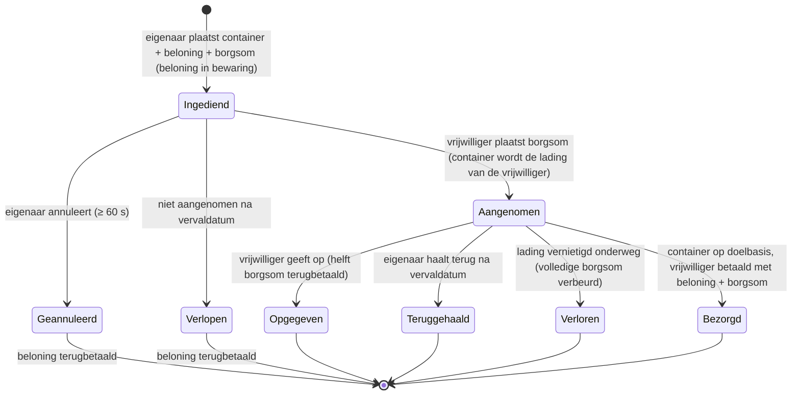

# Transport (goedverzending)

Een **transportopdracht** verplaatst een container met items van de ene basis naar de andere, met een
**vrijwillige vervoerder** die betaald wordt. Het is een tweezijdige markt: de **eigenaar** plaatst een
verzending, een **vrijwilliger** neemt die aan en bezorgt die.

> De UI-locaties volgen het [client-UI-overzicht](/nl/features/ui/) (de **Opdrachten**-categorie in de
> bovenbalk). De mechanismen hieronder zijn bevestigd op basis van de server.

## De twee kanten

- **Eigenaar (opdrachtgever)** — plaatst een verzending: een container die verplaatst moet worden, van een **oorsprongsbasis**
  naar een **doelbasis**, tegen een **beloning**, met een **borgsom**, met een **duur**.
- **Vrijwilliger (vervoerder)** — neemt de opdracht aan, vervoert de container en bezorgt die.

## Een transport indienen (eigenaar)

**Een transport indienen** met:
- de **container** (een volume-wrapper) die verzonden moet worden,
- de **beloning** die je bij bezorging betaalt,
- de **borgsom** (een waarborg die de vervoerder stopt),
- **oorsprongsbasis** en **doelbasis**,
- een **duur** (in dagen) dat de opdracht open blijft.

Bij indienen wordt de **beloning vastgehouden** uit je portemonnee (in bewaring).

## Een transport aannemen (vrijwilliger)

- **Neem** een opdracht aan — je stopt de **borgsom** als waarborg, en de container
  wordt jouw lading om te vervoeren.

## Bezorgen & terughalen

- **Bezorg** — breng de container naar de doelbasis. Bij bezorging wordt de **vrijwilliger
  betaald met beloning + borgsom**, en de eigenaar ontvangt de goederen.
- **Terughalen** — de eigenaar (of de vrijwilliger, in het relevante geval) haalt de
  container terug naar een basis; bij terughaling wordt de **borgsom teruggegeven** en de **beloning
  terugbetaald** aan de eigenaar.

## Annuleren / opgeven

- **Annuleer** — annuleer de opdracht.
- **Geef op** — de vrijwilliger geeft het op. Bij opgeven geldt een **borgsomboete**:
  slechts de **helft** van de borgsom wordt terugbetaald (de rest is verbeurd) — de boetefactor
  is 0,5 in `TransportAssignment.cs`.

## Inspecteren

- **Toon** transporten, **toon de inhoud** van een ervan, **containerinfo**, **draait het?**,
  en het **transportlogboek**.

## De geldstroom (in het kort)

De **beloning** is de betaling van de eigenaar, in bewaring bij indienen en alleen bij bezorging
uitbetaald.
De **borgsom** is de waarborg van de vrijwilliger: betaald aan de eigenaar bij aannemen, vastgehouden
terwijl de lading onderweg is, en teruggegeven (met de beloning) bij bezorging.

| Gebeurtenis | Voorwaarde | Eigenaar | Vrijwilliger | Container |
|---|---|---|---|---|
| Indienen | — | beloning in bewaring | — | verplaatst naar transportopslag |
| Aannemen | niet aangenomen | ontvangt borgsom | betaalt borgsom | wordt de lading van de vrijwilliger |
| Bezorgen | op doelbasis | goederen ontvangen | betaald **beloning + borgsom** | bezorgd |
| Annuleren | niet aangenomen, ≥ 60 s na indienen | beloning terugbetaald | — | terug naar oorsprongsbasis |
| Opgeven | aangenomen | beloning terugbetaald | **helft** borgsom terugbetaald (0,5 boete) | terug naar oorsprongsbasis |
| Verlopen | niet aangenomen, na vervaldatum | beloning terugbetaald | — | terug naar oorsprongsbasis |
| Terughalen | aangenomen **en** na vervaldatum | beloning terugbetaald | — | terug naar oorsprongsbasis (direct indien gedockt, anders bij de volgende docking van de vrijwilliger) |
| Lading vernietigd | onderweg | beloning terugbetaald **+ volledige borgsom** | volledige borgsom verbeurd | verloren |

## Praktische notities

- **Geen kosten** — het enige geld dat beweegt, is beloning en borgsom.
- **Beloning is in bewaring** — de eigenaar kan het niet uitgeven totdat het transport is afgerond.
- **Borgsom is de waarborg van de vervoerder** — het storten ervan is wat je in staat stelt een verzending aan te nemen;
  het verliezen van de lading onderweg verbeurt het **volledige** bedrag.
- **Opgeven kost je** — het opgeven van een transport verbeurt de helft van je borgsom.
- **Duur is belangrijk, maar alleen zolang niet aangenomen** — de vervaldatum die je bij indienen instelt, sluit alleen
  automatisch opdrachten af die niemand heeft aangenomen (de server ruimt verlopen, niet aangenomen
  opdrachten per uur op). Een **aangenomen** opdracht verloopt nooit vanzelf; de uitweg van de eigenaar
  is **Terughalen**, die beschikbaar wordt zodra de vervaldatum is verstreken en
  de lading (en de beloning) terugroept naar de oorsprongsbasis — direct als de vervoerder
  gedockt is, of automatisch bij de volgende docking van de vervoerder.
- **Controleer de inhoud voordat je aanneemt** — inspecteer wat er in de container zit en de route.

<!-- TODO: alleen de client-UI blijft over (indeling van het opdrachtenscherm).
     Geldmodel bevestigd: beloning in bewaring bij indienen (CashInOnSubmit), borgsom betaald
     door de vrijwilliger bij aannemen (TakeCollateral -> PayCollateralToPrincipal), bezorging betaalt
     vrijwilliger beloning+borgsom (PayOutReward); annuleren vereist 60 s na aanmaak;
     vervaldatum = indientijd + client-duur in dagen (<=0 -> 1), per uur opgeruimd door
     MissionProcessor (_transportAssignmentInterval 1h), alleen taken=0; terughalen vereist
     verlopen + aangenomen, voltooit automatisch bij volgende docking; vernietigde lading geeft beloning
     terug en verbeurt volledige borgsom aan de eigenaar.
     Ontwikkelaarsnotities: TransportAssignments/TransportAssignmentSubmit.cs;
     Services/MissionEngine/TransportAssignments/TransportAssignment.cs (beloning/borgsom
     in bewaring, PayOutReward = beloning+borgsom, PaybackCollateral, PaybackHalfCollateral
     = COLLATERAL_PENALTY bij opgeven, RetrieveToBasePublicContainer, vervaldatum);
     TransportAssignmentTake/Deliver/Retrieve/Cancel/GiveUp/List/ListContent/
     ContainerInfo/Running/Log. -->