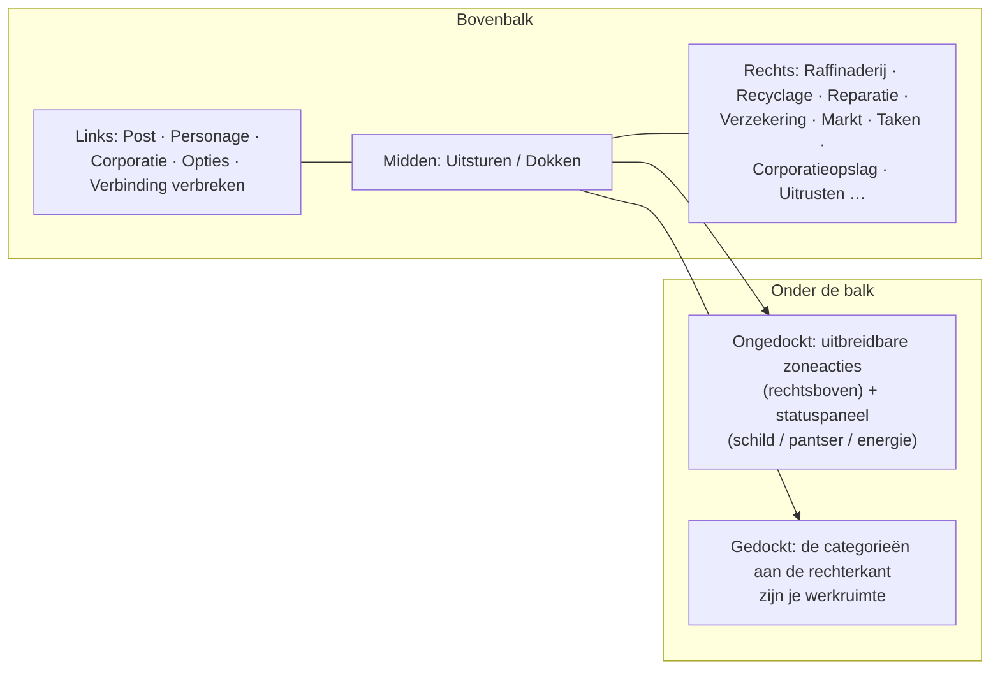

# Overzicht van de client-UI

De client is een **EVE Online-achtige** interface: een volledige schermweergave van ruimte/zone met
zwevende, **aanpasbare en verplaatsbare vensters** die naar wens **gesloten en opnieuw geopend** kunnen worden.
De werking is per systeem — zie de hieronder gekoppelde pagina's.

> Deze indeling is een werkmodel dat door het project is aangeleverd en wordt gebruikt om aan te geven waar acties
> staan. Exacte schermnamen kunnen iets afwijken; de structuur is de referentie.

## De bovenbalk

Een permanente balk over de bovenkant van het scherm.

| Gebied | Inhoud |
|---|---|
| **Links** | Hoofdknoppen: **Post**, **Personage**, **Corporatie**, overige **Opties** en **Verbinding verbreken** |
| **Midden** | De **Uitsturen / Dokken**-knop — je primaire schakelaar gedockt⇄ongedockt (zie [beweging](/nl/features/movement/)) |
| **Rechts** | Actiecategorieën als knoppen: **Raffinaderij**, **Recyclage**, **Reparatie**, **Verzekering**, **Markt**, **Taken** (transport), **Corporatieopslag**, **Uitrusten**, … |

De categorieën aan de rechterkant openen hun systeemvensters:

| Knop | Opent / functie | Wiki-pagina |
|---|---|---|
| Raffinaderij | Verwerkt ruwe grondstoffen tot componenten | [productie](/nl/features/production/) |
| Recyclage | Breekt items af tot basismaterialen | [productie](/nl/features/production/) |
| Reparatie | Repareert beschadigde robots/modules | [productie](/nl/features/production/) |
| Verzekering | Productie-/robotverzekeringen | [productie](/nl/features/production/) |
| Markt | Marktbestellingen en directe aankopen | [markt](/nl/features/market/) |
| Taken | Transporttaken (zendingen) | [transport](/nl/features/transport/) |
| Corporatieopslag | Corporatiehangar/opslag | [groepen](/nl/features/groups/) |
| Uitrusten | Plaatst modules en munitie op je actieve robot | [robots](/nl/features/robots/) |

## Gedockte staat

In de **gedockte** staat zijn de actiecategorieën aan de rechterkant de belangrijkste werkruimte: je verwerkt,
handelt, uitrust en beheert opslag zonder de basis te verlaten. De Uitsturen-knop dockt je uit in de zone (zie
[beweging](/nl/features/movement/) voor de voorwaarden voor uitdoken).

## Ongedockte staat

In de **ongedockte** staat (je stuurt je actieve robot in een zone):

- Het **gebied rechtsboven** krijgt een **uitbreidbare actieknop**: klik erop en een lijst met
  extra zoneacties wordt naar beneden uitgeklapt (scannen, oogst-/interactieacties, zonehulpmiddelen —
  de acties die onder [verzamelen](/nl/features/gathering/) en [gevecht](/nl/features/combat/) zijn gedocumenteerd).
- Het **hoofdstatuspaneel** toont de staat van je robot: **schild, pantser/hul, energie**
  en gerelateerde gevechtsstatus — dezelfde gegevens waarnaar je [gevecht](/nl/features/combat/)-pagina verwijst
  (bijv. de "energiesysteem intact"-controle voor uitdoken).
- Categorieën die alleen in de basis beschikbaar zijn (raffinaderij, markt, …) zijn niet beschikbaar tot je weer gedockt bent.

## Algemene vensters

De meeste systemen openen in een standaard zwevend venster: titelbalk, sluitknop, aanpasbare
randen, tab- of lijstinhoud. Herhaalde systemen (inventaris/containers, markt, productielijnen)
kunnen meerdere tegelijk geopende vensters hebben.

- **Inventaris / containers** — een container bekijken, items verplaatsen/stapelen/pakken, hernoemen, verwijderen —
  zie [items](/nl/features/items/).
- **Personagevenster** (knop linksboven) — profiel, extensies (onderzoek), instellingen,
  credits — zie [getting-started](/nl/features/getting-started/) en [onderzoek](/nl/features/research/).
- **Corporatievenster** (knop linksboven) — corporatie-informatie, hangar, documenten, stemmen,
  bulletin — zie [groepen](/nl/features/groups/).
- **Postvenster** (knop linksboven) — persoonlijke en massapost — zie [sociaal](/nl/features/social/).

## Gebruikte conventie in deze wiki

- **"Bovenbalk → X"** = de knop met de naam X op de bovenbalk.
- **"Ongedockte acties"** = de uitbreidbare lijst rechtsboven in een zone.
- **Uitsturen/Dokken-knop** = de schakelaar in het midden van de bovenbalk.

<!-- Opmerking: deze pagina is het overeengekomen UI-model (aangeleverd door het project). Als de echte client
     afwijkt in knopnamen of plaatsing, werk dan eerst deze pagina bij — elke andere
     features/-pagina verwijst naar de conventies die hier zijn gedefinieerd. -->