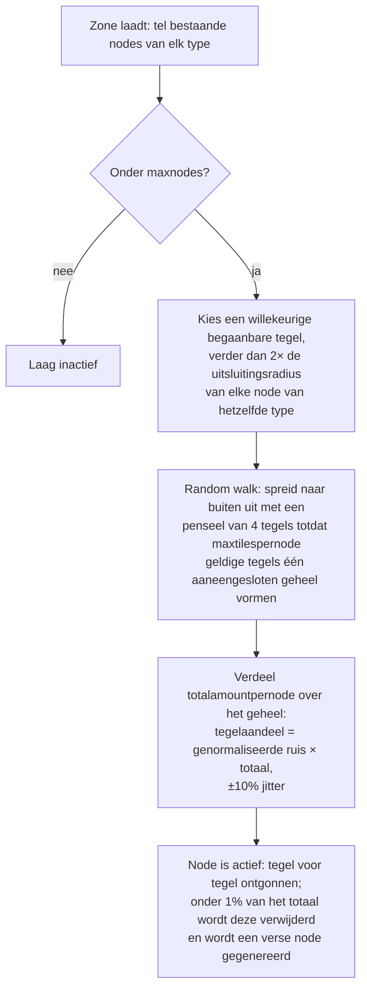

# Zone-grondstoffengeneratie

Deze pagina legt uit hoe de server de grondstoffen van een zone op peil houdt. Beide systemen draaien
continu op de achtergrond terwijl de zone geladen is; er is geen actie van een speler vereist
om ze te laten functioneren.

## De grondstoffenconfiguratie van de zone

Elke zone is in de database geconfigureerd met twee onafhankelijke lijsten:

- **Ertsconfiguratie** (`mineralconfigs`) — één rij per ertstype dat in de zone aanwezig is,
  met vier instellingen per type:
  | Kolom | Betekenis |
  |---|---|
  | `maxnodes` | Hoeveel nodes van dit type de zone onderhoudt |
  | `maxtilespernode` | Maximaal aantal tegels dat een enkele node kan beslaan |
  | `totalamountpernode` | Totale hoeveelheid materiaal in een verse node, verdeeld over de tegels |
  | `minthreshold` | Minimale vulverhouding per tegel (0–1); tegels die na het mijnen hieronder zakken, worden verwijderd |
- **Plantenconfiguratie** (`zones.fertility` + een plantenregelset) — het dekkingsdoel voor planten van
  de zone (een percentage) en de lijst van plantensoorten die daar mogen groeien (het gedrag van elke soort
  is een regelbestand, gedocumenteerd in [Planten](/nl/content/plants/)).

Zones zonder ertsconfiguratie (arena's, trainingszones, bolwerken en sommige gammazones)
bevatten helemaal geen ertslagen.

## Ertsnodes

### Hoe een node wordt geplaatst

Wanneer een zone laadt, telt de laag van elk ertstype de bestaande nodes (opgeslagen in de
tabel `mineralnodes`) en genereert nieuwe totdat `maxnodes` is bereikt. Een nieuwe node wordt
geplaatst via een **random walk** (willekeurige padwandeling):

1. Kies een willekeurige begaanbare tegel.
2. Deze moet ver verwijderd zijn van de dichtstbijzijnde bestaande node van hetzelfde type — de uitsluitingsradius
   is afgeleid van `maxtilespernode` (`√(maxtilespernode/π) × 2`, en de start moet minstens het dubbele
   daarvan verwijderd zijn), zodat nodes nooit samensmelten tot één gigantische afzetting.
3. Vanaf de starttegel verspreidt een wandeling zich willekeurig naar buiten (een penseel van 4 tegels tegelijk),
   waarbij tot `maxtilespernode` geldige tegels worden verzameld tot één aaneengesloten geheel.
4. Het `totalamountpernode`-materiaal van de node wordt verdeeld over het geheel: het aandeel van elke tegel
   is de (genormaliseerde) ruiswaarde vermenigvuldigd met het totaal, met een willekeurige jitter van ±10%,
   zodat geen twee nodes van hetzelfde type er ooit hetzelfde uitzien.

Een tegel is alleen geldig voor een node als deze binnen de zone ligt, geen eiland is, niet beschermd
is door PBS-terraforming en begaanbaar is. Twee zeldzame types hebben **uitsluitingszones** rond
dockingbases en teleports: **epriton** houdt een minimale afstand aan, en **flux-erts** houdt het
dubbele van die afstand aan — zodat flux-erts nooit direct naast een basis wordt aangetroffen.

### Hoe een node wordt verbruikt

- Mijnen verwijdert materiaal tegel voor tegel.
- Een node die onder **1% van zijn geconfigureerde totaal** zakt, wordt verwijderd en er wordt
  een nieuwe node gegenereerd (terug naar stap 1) om de zone op `maxnodes` te houden.
- Flux-erts-nodes sturen bovendien het **spawnen van NPC's** aan — nodes die worden ontgonnen (of verwijderd)
  publiceren gebeurtenissen waarnaar het NPC-systeem luistert, wat de reden is dat flux-ertssites
  aandacht trekken.

## Planten

### De plantenscan

De zone is verdeeld in tegels van **32×32**. Een plantenhandler doorloopt deze tegels op volgorde,
waarbij er één per tick wordt verwerkt, in een tempo waarin een **volledige ronde over de zone ongeveer 8 uur duurt**
(per zone overschrijfbaar). Elke 32×32 "kubus" wordt verwerkt door een vaste pijplijn:

1. **Valideren** — ongeldige planten verwijderen (verkeerde ondergrond, dood, niet op hun plek).
2. **Groeien** — elke plant door zijn groeistadia laten vorderen (zie
   [verzamelen](/nl/features/gathering/) voor `growRate` en vruchtdracht).
3. **Spawnen** — nieuwe planten toevoegen waar de kubus onder zijn vruchtbaarheidsdoel zit.
4. **Muren beschadigen** — de blokkeerhoogte van planten neemt na verloop van tijd af.
5. **Afstandshandhaving** — afstand tussen planten van hetzelfde type afdwingen (`killDistance`).
6. **Materiaal vernieuwen** — een kleine hoeveelheid vruchtmateriaal regenereert.

### Hoe een nieuwe plant wordt gekozen

Een tegel kan alleen ontkiemen als het zonebestand deze voorziet van **spawnpotentieel** (een byte per tegel
die is vastgelegd in de plantenlaag van de zone — 0 betekent dat de tegel nooit ontkiemt). Op elke tick, voor
elke in aanmerking komende tegel:

- **Eerst controle van de zonevruchtbaarheid**: als de bedekking met blokkerende planten van de kubus al voldoet
  aan `fertility%` van de grondtegels, spawnt daar niets nieuws.
- **Kans per tegel**: een willekeurige worp moet het spawnpotentieel van de tegel overtreffen.
- **Soortenselectie**:
  - Als de tegel **geen plantenburen heeft**, wordt de soort gekozen via een gewogen willekeurige trekking
    waarbij het gewicht van elke toegestane soort de `fertility` is (door spelers gezaaide soorten zijn
    uitgesloten van natuurlijke spawns).
  - Als deze **wel buren heeft**, is het een muntworp: 50% kans op de momenteel *heersende* buursoort
    (de meest voorkomende in de buurt), 50% kans op een **verspreidingstrekking** gewogen met
    `(aantal buren × spreading)` voor elke soort — dit zorgt ervoor dat clusters zich
    in hun eigen soort uitbreiden.
- **Limieten en afstand**: een soort met een `maxAmount`-limiet wordt overgeslagen zodra de zone er genoeg
  van heeft, en een tegel binnen `killDistance` van een andere plant van hetzelfde type wordt
  overgeslagen.

### Wat dit betekent voor spelers

- Plantendichtheid wordt begrensd door de vruchtbaarheid van de zone — je zult nooit een zone zien met
  100% plantendekking als de vruchtbaarheid 20 is.
- Clusters zijn de norm: verspreiding zorgt ervoor dat elke soort zijn eigen gebieden uitbreidt, zodat een
  zone neigt naar territoria per soort in plaats van een willekeurig gemengd geheel.
- Soorten met `killDistance` (zoals bepaalde hoogwaardige planten) zijn gelijkmatig verdeeld, wat
  hun locaties voorspelbaar maakt zodra je er één hebt gevonden.
- Nieuwe nodes verschijnen waar de random walk terechtkomt — er is geen vaste "ertslocatie" in een
  zone; scannen is noodzakelijk (zie [verzamelen](/nl/features/gathering/)).

<!-- Opmerkingen voor ontwikkelaars: TerrainsModule.cs (laagopbouw per zone: OreLayer voor
     Solid, LiquidLayer voor Liquid, GravelLayer voor TrainingZone; aanvulling in LoadMineralNodes);
     MineralLayer.cs (LoadMineralNodes: verwijder <1% nodes, genereer tot maxnodes;
     FluxOre -> OreNpcSpawnMessage bij vermindering/verstrijken);
     Generators/MineralNodeGeneratorBase.cs (FindStartPosition uitsluitingszones + afstand,
     NormalizeNoise, CreateMineralNode jitter); RandomWalkMineralNodeGenerator.cs
     (flood-fill penseel 4, limiet van 50k stappen); MineralNodeRepository.cs (tabel mineralnodes,
     gecomprimeerde waarden per tegel); PlantHandler.cs (32x32 gebieden, 8 uur volledige doorloop,
     PlantsGrowthTimerOverrideMin, scannermodi); NatureCube.cs (ProcessAll pijplijn,
     SpawnPlants vruchtbaarheid/spawn/killDistance-logica, GetNewPlantRule 50/50 heersend vs
     verspreiding); PlantRuleExtensions.cs (trekkingen gewogen naar vruchtbaarheid + verspreiding);
     PlantInfo.cs (de spawnbyte per tegel is afkomstig uit het bestand van de plantenlaag van de zone,
     nooit toegekend door servercode). -->
