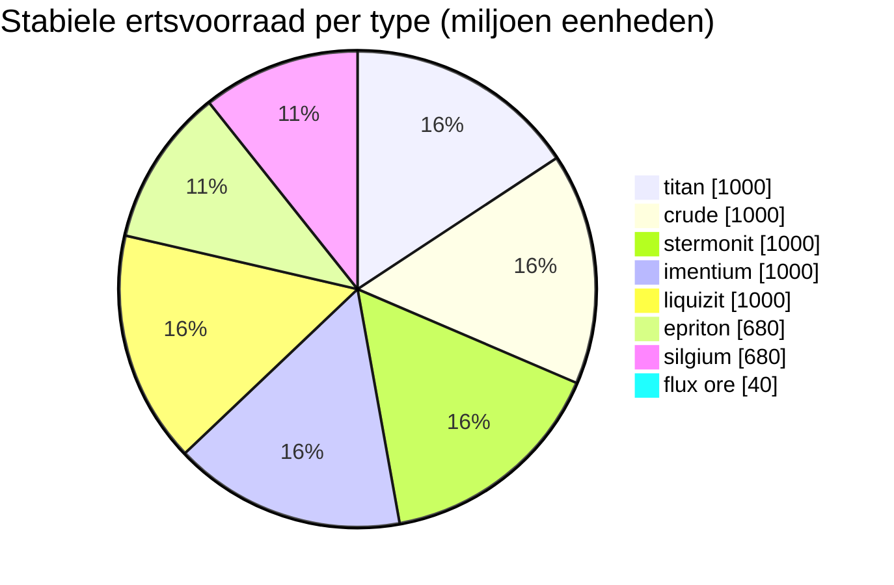

# Daoden (zone_ASI) — uitgewerkt voorbeeld

  <a href="/nl/zones/map/">
    
    <strong>Wereldkaart</strong> — waar deze zone zich bevindt tussen alle andere, met de teleportverbindingen. Open de volledige kaart.
  </a>

Waar de teleportkolommen van deze zone staan (stippen, aangeduid met de bestemming — gedimd wanneer
de kolom momenteel is uitgeschakeld), de landingslocaties van teleports die vanuit andere
zones arriveren (stippellijncirkels) en de uitgangspoorten (ruiten) waar deze bestaan. Posities zijn de
tegelcoördinaten die de server registreert.
De stippellijnen verbinden de paren van lokale (binnen de zone gelegen) teleportkolommen.

Een **open PvP**-zone van het alpha-niveau — de rijkste ertsconfiguratie in het spel en
de plek waar de zeldzame types voorkomen. Alles wat New Virginia heeft, plus epriton, silgium en
de flux-ertslocaties die NPC-aanvallen uitlokken.

| Gegeven | Waarde |
|---|---|
| Zone-id | 2 |
| Type | PvP (open) |
| Bescherming | [Beta](/nl/zones/protection/) — open PvP, standaardterrein |
| Afmeting | 2048 × 2048 tegels |
| Vruchtbaarheid | 20 |
| Plantenregelset | 2 — 19 soorten (incl. hoogwaardige oogstbare planten) |
| Ertstypen | 8 (titan, crude, stermonit, imentium, liquizit, epriton, silgium, flux ore) |
| Totaal aantal ertsnodes | 64 (8 per type) |

## Ertsconfiguratie

| Grondstof | Nodes | Max tegels/node | Totaal per node | Minimumdrempel |
|---|---|---|---|---|
| [titan](/nl/content/ores/titan/) | 8 | 500 | 125,000,000 | 0.5 |
| [crude](/nl/content/ores/crude/) | 8 | 1257 | 125,000,000 | 0.5 |
| [stermonit](/nl/content/ores/stermonit/) | 8 | 500 | 125,000,000 | 0.5 |
| [imentium](/nl/content/ores/imentium/) | 8 | 500 | 125,000,000 | 0.5 |
| [liquizit](/nl/content/ores/liquizit/) | 8 | 500 | 125,000,000 | 0.5 |
| [epriton](/nl/content/ores/epriton/) | 8 | 500 | 85,000,000 | 0.5 |
| [silgium](/nl/content/ores/silgium/) | 8 | 500 | 85,000,000 | 0.5 |
| [fluxore](/nl/content/ores/fluxore/) | 8 | 300 | 5,000,000 | 0.5 |

Opvallende details:

- **8× meer nodes dan New Virginia**, maar elke node is kleiner (500 tegels vergeleken met 1.000): de
  loopradius daalt van 34 naar 24 tegels voor de standaardertsen. Scannen is hier belangrijker —
  afzettingen zijn dunner en talrijker.
- **Epriton en silgium** hebben verlaagde totalen (85 M vs 125 M) — hogere waarde, zeldzamere
  voorraad. Epriton houdt bovendien een **minimale afstand van bases en teleports** aan, zodat
  de nodes ervan nooit bij een spawnlocatie liggen.
- **Flux-erts is het uiterste geval**: slechts 5 M per node over 300 tegels (~16.600 per
  tegel — een fractie, geen massieve afzetting), 8 nodes en een uitsluitingszone van **tweemaal** de
  epriton-afstand van bases. Het ontginnen van een flux-node verstuurt spawngebeurtenissen naar het
  NPC-systeem — fluxlocaties zijn doelbewust betwist gebied (zie [Inbraak- & NPC-systemen](/nl/features/intrusion/)).
- Stabiele voorraad: circa 6,4 miljard eenheden materiaal in totaal.

## Plantenmix

Regelset 2 staat 19 soorten toe — de complete alpha-mix: de basis, plus **devrinol**,
**wall**, **titanplant** en de **hoogwaardige oogstbare varianten** (hoogwaardige electroplant, hoogwaardige
ijzerboom, hoogwaardige rustbush, hoogwaardige slimeroot). De vruchtbaarheid is nog steeds 20, dus de dichtheid is
hetzelfde als New Virginia — wat verandert is *welke* soorten de vruchtbaarheidstrekking kunnen winnen. De
eigen `fertility`-gewichten van de hoogwaardige soorten bepalen hoe vaak zij het winnen van
de grassen.

Regels per soort staan in [Planten](/nl/content/plants/); opbrengsten per erts in
[Ertsen](/nl/content/ores/).

## Wat dit betekent voor de speler

- De volledige ertsladder is beschikbaar, inclusief de flux-ertseconomie — maar het is open
  PvP, dus alles wat je ontgint kan worden afgenomen (zie
  [transport](/nl/features/transport/) voor het veilig vervoeren van goederen tussen bases).
- Verwacht druk van NPC's nabij flux-ertsnodes; de spawner luistert naar mijnactiviteiten op
  die nodes.
- Plantenoogst richt zich hier op de hoogwaardige varianten, die betere vruchten leveren dan
  de soorten van een lager niveau in starterszones.

<!-- Opmerkingen voor ontwikkelaars: rij in tabel zones met id 2 (zonetype 2 = PvP, protected 0, fertility 20,
     plantruleset 2); 8 rijen in mineralconfigs (7 standaard + fluxore 8/300/5M);
     MineralNodeGeneratorBase.KeepOutDist: Epriton = MINERAL_DISTANCE_FROM_BASE_MIN,
     FluxOre = 2x; MineralLayer.OnNodeDecrease/OnNodeExpired -> OreNpcSpawnMessage voor
     FluxOre; plantrules rulesetid 2 = 19 bestanden (4 oogstbaar, incl. devrinol en
     wall). -->
