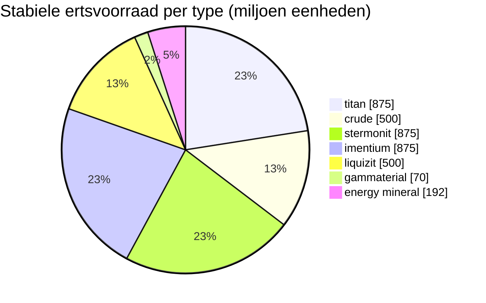

# zone_gamma_z106 — uitgewerkt voorbeeld

  <a href="/nl/zones/map/">
    
    <strong>Wereldkaart</strong> — waar deze zone zich bevindt tussen alle andere, met de teleportverbindingen. Open de volledige kaart.
  </a>

Waar de teleportkolommen van deze zone staan (stippen, aangeduid met de bestemming — gedimd wanneer
de kolom momenteel is uitgeschakeld), de landingslocaties van teleports die vanuit andere
zones arriveren (stippellijncirkels) en de uitgangspoorten (ruiten) waar deze bestaan. Posities zijn de
tegelcoördinaten die de server registreert.

Een **open PvP**-zone van een hoog niveau: terraformeerbaar, lage vruchtbaarheid, tier-2 plantenvarianten en
een krappere ertseconomie. Dit is de typische "endgame"-vorm van een zone — minder grondstoffen,
maar zwaarder bevochten.

| Gegeven | Waarde |
|---|---|
| Zone-id | 106 |
| Type | PvP (open) |
| Bescherming | [Gamma](/nl/zones/protection/) — open PvP, terraformeerbaar |
| Afmeting | 2048 × 2048 tegels |
| Vruchtbaarheid | 15 |
| Terraformeerbaar | ja (PBS techlimiet 2) |
| Plantenregelset | 22 — 17 soorten ("Gamma Plant Rules", tier-2 mix) |
| Ertstypen | 7 (titan, crude, stermonit, imentium, liquizit, gammaterial, energymineraal) |
| Totaal aantal ertsnodes | 44 |

## Ertsconfiguratie

| Grondstof | Nodes | Max tegels/node | Totaal per node | Minimumdrempel |
|---|---|---|---|---|
| [titan](/nl/content/ores/titan/) | 7 | 600 | 125,000,000 | 0.5 |
| [crude](/nl/content/ores/crude/) | 4 | 600 | 125,000,000 | 0.5 |
| [stermonit](/nl/content/ores/stermonit/) | 7 | 600 | 125,000,000 | 0.5 |
| [imentium](/nl/content/ores/imentium/) | 7 | 600 | 125,000,000 | 0.5 |
| [liquizit](/nl/content/ores/liquizit/) | 4 | 600 | 125,000,000 | 0.5 |
| [gammaterial](/nl/content/ores/gammaterial/) | 7 | 100 | 10,000,000 | 0.5 |
| [energymineral](/nl/content/ores/energymineral/) | 8 | 300 | 24,000,000 | 0.5 |

Opvallende details:

- **Minder nodes dan in alphazones** (44 vs 64 in Daoden): crude en liquizit dalen naar
  slechts 4 nodes elk. Dezelfde totalen per node als de standaardertsen in alpha, dus de stabiele
  toestand (~3,9 miljard eenheden in totaal) is schaarser en herstelt langzamer.
- **Twee exotische types**: **gammaterial** in kleine nodes van 100 tegels (loopradius 10 tegels —
  klein, gemakkelijk te vinden, ~1,4 M per node) en **energymineraal** met 24 M per node.
- Geen epriton, geen flux-erts — de zeldzame/economische ertsen blijven voorbehouden aan het alpha-niveau.

## Plantenmix

Regelset 22 staat 17 soorten toe: de basis, plus de **tier-2 varianten** — hoogwaardige ijzerboom
t2 en hoogwaardige rustbush t2 als wilde oogstbare planten, en de **tier-2 gezaaide planten**
(hoogwaardige electroplant t2, hoogwaardige slimeroot t2). De gezaaide varianten hebben de eigenschap `playerSeeded` — ze
spawnen **nooit** natuurlijk; ze bestaan uitsluitend in tuinen van spelers (zie
[verzamelen → planten](/nl/features/gathering/)).

Vruchtbaarheid is **15**, niet 20: een kubus van 32×32 mag maximaal ~15% blokkerende planten bevatten, waardoor
de plantendekking zichtbaar schaarser is dan in alphazones en de vruchtbaarheidstrekking
iets minder ruimte heeft om op te vullen voordat de kubus verzadigd raakt.

De regels per soort (inclusief de t2 vruchthoeveelheden) staan in
[Planten](/nl/content/plants/); opbrengsten per erts in [Ertsen](/nl/content/ores/).

## Wat dit betekent voor de speler

- Schaarser, trager herstellende economie: minder nodes van de gangbare ertsen betekent dat mijnbouwdruk
  zich sneller laat voelen — een uitgeputte crude-node kost de zone meer tijd om te vervangen.
- Dunnere begroeiing: met 15% vruchtbaarheid is open terrein de norm en zijn plantenclusters
  de uitzondering.
- Hoogwaardige oogst richt zich hier op de wilde tier-2 ijzerboom / rustbush-planten, plus
  het beheren van eigen tuinen met de gezaaide t2 electroplant en slimeroot.
- Terraforming (PBS techlimiet 2) betekent dat het terrein zelf kan worden hervormd door spelers
  (zie [Power Base Stations](/nl/features/pbs/)).

<!-- Opmerkingen voor ontwikkelaars: rij in tabel zones met id 106 (zonetype 2 = PvP, protected 0, fertility 15,
     terraformable 1, pbsTechLimit 2, plantruleset 22); mineralconfigs 7 rijen (crude
     en liquizit 4 nodes elk); plantrules rulesetid 22 = 17 bestanden, notitie "Gamma
     Plant Rules"; electroplant_seeded_t2.txt / slimeroot_seeded_t2.txt stellen
     playerSeeded=n1 in (overgenomen via source= van electroplant_hi.txt /
     slimeroot_hi.txt) -> uitgesloten van natuurlijke spawns in
     PlantRuleExtensions.GetWinnerPlantTypeBasedOnFertility. -->
