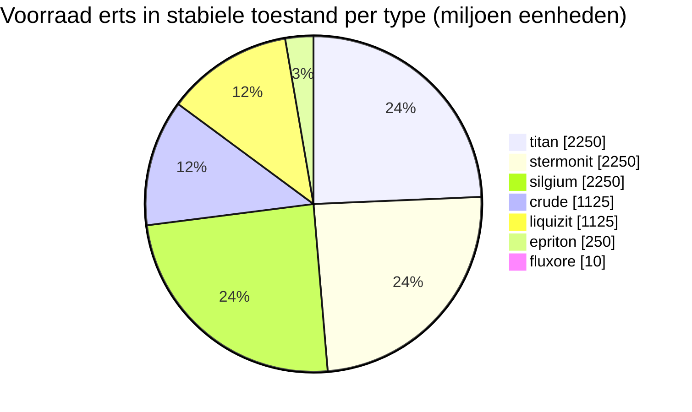

<!-- Generated by tools/generate from the live database (source: zones, mineralconfigs, plantrules, teleportdescriptions, strongholdexitconfig).
     Do not edit by hand; regenerate instead. -->
# zone_gamma_z119

  <a href="/nl/zones/map/">
    
    <strong>Wereldkaart</strong> — waar deze zone ligt tussen alle andere, met de teleportverbindingen. Open de volledige kaart.
  </a>

Waar de teleportkolommen van deze zone staan (stippen met bestemmingslabel — gedimd als de kolom is uitgeschakeld), landingsplekken van teleports uit andere zones (stippellijnen cirkels) en uitgangspoorten (ruiten) waar aanwezig. Posities zijn tegelcoördinaten die de server registreert.

Een open-PvP (beta) frontier belt-eiland — spelers kunnen vrij aanvallen en blobs zijn van toepassing. Het onderhoudt 7 erstypes.

| Feit | Waarde |
|---|---|
| Zone-ID | 119 |
| Type | PvP |
| Bescherming | [Beta](/nl/zones/protection/) — open PvP, standaard terrein |
| Grootte | 2048×2048 tegels |
| Tier | T0 (geregistreerd door server) |
| Vruchtbaarheid | 15 |
| Plantsoorten | 15 (regelset 30) |
| Erstypes | 7 |
| Totaal aantal ertsknopen | 47 |
| PBS-techlimiet | 0 |
| Max. dockingbases | geen |

## Ertsconfiguratie

De knoopgeneratie die deze zone handhaaft. Opbrengsten per erts en de generatieformules zijn te vinden in [Ertsen](/nl/content/ores/) (de sectie van deze zone is hieronder gelinkt).

| Materiaal | Knopen | Max. tegels/knoop | Totaal per knoop | Min. drempel |
|---|---|---|---|---|
| [titan](/nl/content/ores/titan/) | 10 | 600 | 225M | 0.5 |
| [crude](/nl/content/ores/crude/) | 5 | 600 | 225M | 0.5 |
| [stermonit](/nl/content/ores/stermonit/) | 10 | 600 | 225M | 0.5 |
| [liquizit](/nl/content/ores/liquizit/) | 5 | 600 | 225M | 0.5 |
| [epriton](/nl/content/ores/epriton/) | 5 | 300 | 50M | 0.5 |
| [silgium](/nl/content/ores/silgium/) | 10 | 600 | 225M | 0.5 |
| [fluxore](/nl/content/ores/fluxore/) | 2 | 200 | 5M | 0.5 |

[Zone-index](/nl/zones/zone-index/) · [Wereldkaart](/nl/zones/map/#t1) · [Beschermingsniveaus](/nl/zones/protection/)
