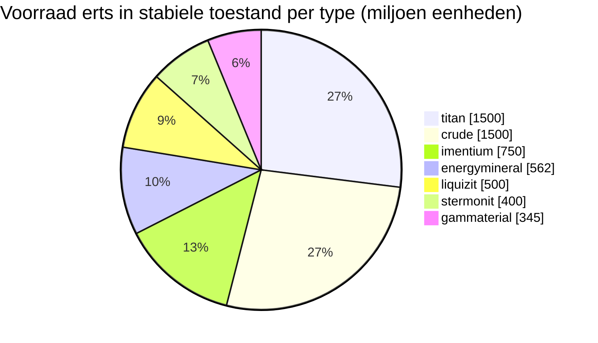

<!-- Generated by tools/generate from the live database (source: zones, mineralconfigs, plantrules, teleportdescriptions, strongholdexitconfig).
     Do not edit by hand; regenerate instead. -->
# Berger's Island (zone_ics_g_5)

  <a href="/nl/zones/map/">
    
    <strong>Wereldkaart</strong> — waar deze zone ligt tussen alle andere, met de teleportverbindingen. Open de volledige kaart.
  </a>

Waar de teleportkolommen van deze zone staan (stippen met bestemmingslabel — gedimd als de kolom is uitgeschakeld), landingsplekken van teleports uit andere zones (stippellijnen cirkels) en uitgangspoorten (ruiten) waar aanwezig. Posities zijn tegelcoördinaten die de server registreert.

Een open-PvP, terraformbaar (gamma) Attalica (ICS)-eiland — het terrein kan door spelers worden aangepast. Het onderhoudt 7 erstypes.

| Feit | Waarde |
|---|---|
| Zone-ID | 32 |
| Type | PvP |
| Bescherming | [Gamma](/nl/zones/protection/) — open PvP, terraformbaar |
| Grootte | 2048×2048 tegels |
| Vruchtbaarheid | 20 |
| Plantsoorten | 17 (regelset 3) |
| Erstypes | 7 |
| Totaal aantal ertsknopen | 55 |
| Max. dockingbases | 100 |

## Ertsconfiguratie

De knoopgeneratie die deze zone handhaaft. Opbrengsten per erts en de generatieformules zijn te vinden in [Ertsen](/nl/content/ores/) (de sectie van deze zone is hieronder gelinkt).

| Materiaal | Knopen | Max. tegels/knoop | Totaal per knoop | Min. drempel |
|---|---|---|---|---|
| [titan](/nl/content/ores/titan/) | 10 | 707 | 150M | 0.5 |
| [crude](/nl/content/ores/crude/) | 6 | 1.257k | 250M | 0.5 |
| [stermonit](/nl/content/ores/stermonit/) | 8 | 314 | 50M | 0.5 |
| [imentium](/nl/content/ores/imentium/) | 8 | 314 | 93.75M | 0.5 |
| [liquizit](/nl/content/ores/liquizit/) | 5 | 1.257k | 100M | 0.5 |
| [gammaterial](/nl/content/ores/gammaterial/) | 3 | 707 | 115M | 0.5 |
| [energymineral](/nl/content/ores/energymineral/) | 15 | 350 | 37.5M | 0.5 |

[Zone-index](/nl/zones/zone-index/) · [Wereldkaart](/nl/zones/map/#beta) · [Beschermingsniveaus](/nl/zones/protection/)
