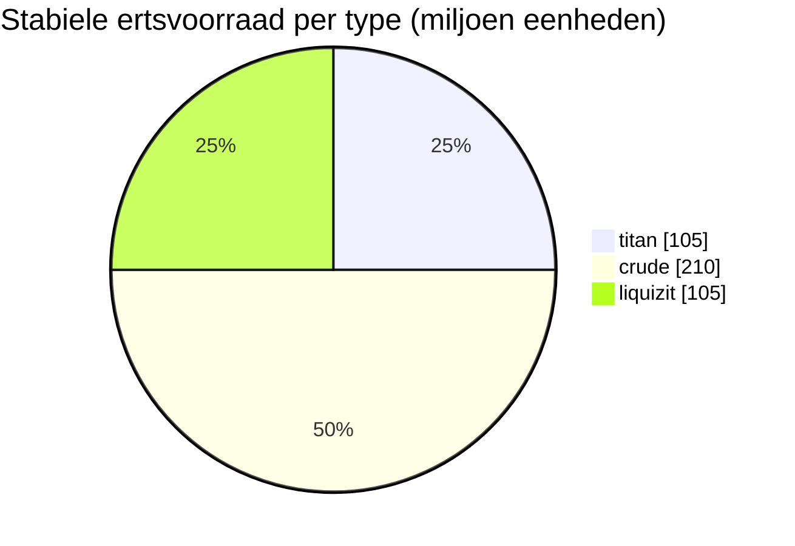

# New Virginia (zone_TM) — uitgewerkt voorbeeld

  <a href="/nl/zones/map/">
    
    <strong>Wereldkaart</strong> — waar deze zone zich bevindt tussen alle andere, met de teleportverbindingen. Open de volledige kaart.
  </a>

Waar de teleportkolommen van deze zone staan (stippen, aangeduid met de bestemming — gedimd wanneer
de kolom momenteel is uitgeschakeld), de landingslocaties van teleports die vanuit andere
zones arriveren (stippellijncirkels) en de uitgangspoorten (ruiten) waar deze bestaan. Posities zijn de
tegelcoördinaten die de server registreert.
De stippellijnen verbinden de paren van lokale (binnen de zone gelegen) teleportkolommen.

Een **beschermde PvE**-zone van laag niveau — een veilige plek waar nieuwe personages grondstoffen verzamelen. De
configuratie toont het eenvoudigste uiteinde van het spectrum: weinig ertstypen, grote nodes en
de basisplantenmix.

| Gegeven | Waarde |
|---|---|
| Zone-id | 0 |
| Type | PvE (beschermd) |
| Bescherming | [Alpha](/nl/zones/protection/) — beschermd, PvP uitgeschakeld |
| Afmeting | 2048 × 2048 tegels |
| Vruchtbaarheid | 20 |
| Plantenregelset | 0 — 15 soorten (basis "tm pve"-mix) |
| Ertstypen | 3 (titan, crude, liquizit) |
| Totaal aantal ertsnodes | 21 (7 per type) |

## Ertsconfiguratie

| Grondstof | Nodes | Max tegels/node | Totaal per node | Minimumdrempel |
|---|---|---|---|---|
| [titan](/nl/content/ores/titan/) | 7 | 1000 | 15,000,000 | 0.5 |
| [crude](/nl/content/ores/crude/) | 7 | 1257 | 30,000,000 | 0.5 |
| [liquizit](/nl/content/ores/liquizit/) | 7 | 1000 | 15,000,000 | 0.5 |

Opvallende details:

- **Grote, verspreide nodes** — 1.000–1.257 tegels elk (loopradius
  `(int)√(tiles/π)×2` = 34–40 tegels), waardoor elke node een aanzienlijke afzetting vormt en er slechts 7
  van elk type per zone aanwezig zijn. De stabiele voorraad bedraagt in totaal circa 420 miljoen eenheden materiaal
  (105 M titan + 210 M crude + 105 M liquizit).
- **Geen zeldzame types** — geen epriton, geen flux-erts, dus er zijn geen uitsluitingszones rond
  bases en geen ertslocaties die NPC's spawnen.
- Een `minthreshold` van 0.5 betekent dat een tegel alleen bruikbaar is als de ruisopvulling van de node daar minstens
  de helft van het maximum bedraagt — de randen van elke afzetting zijn dun.

Opbrengsten per type (wat één eenheid van elk erts oplevert na raffinage en de formules
voor nodegeneratie achter de bovenstaande cijfers) staan in [Ertsen](/nl/content/ores/).

## Plantenmix

Regelset 0 staat 15 soorten toe — de elementaire startersset: gras (a/b), den, struiken (a/b),
rango, koperboom, riet, nanotarwe, laagniveau rustbush/slimeroot/electroplant, bonsai
en laagniveau ijzerboom. Geen muren, geen devrinol, geen hoogwaardige oogstbare planten.

Bij een vruchtbaarheid van 20 mag een kubus van 32×32 maximaal ~20% blokkerende planten bevatten; over de volledige
kaart van 2048×2048 is dat een bovengrens van ruwweg 838.000 plantentegels (in de praktijk minder —
water en eilanden zijn geen grond). De soortenselectie wordt gewogen door de `fertility` van elke regel,
waardoor de standaardgrassen en -struiken domineren terwijl de laagniveau oogstbare soorten
zeldzaam blijven.

De volledige regels per soort (growRate, vrucht, gezondheid) staan in [Planten](/nl/content/plants/).

## Wat dit betekent voor de speler

- Veilige starterseconomie: drie veelvoorkomende ertsen in grote, gemakkelijk te scannen afzettingen.
- Oogstbare planten hier zijn de laagniveau-varianten — hoogwaardige planten (hoogwaardige varianten
  van electroplant/ijzerboom/rustbush/slimeroot) verschijnen in latere zones.
- Omdat de zone beschermd is, is PvP-risico het enige dat ontbreekt in de
  verzamelcyclus (zie [beweging](/nl/features/movement/) voor zone-toegang).

<!-- Opmerkingen voor ontwikkelaars: rij in tabel zones met id 0 (zonetype 1 = PvE, protected 1, fertility 20,
     plantruleset 0); 3 rijen in mineralconfigs (titan/crude/liquizit, 7 nodes elk);
     plantrules rulesetid 0 = 15 bestanden, notitie "tm pve". Noderadiusformule en
     drempelwaardesemantiek: zie generation.md. -->
