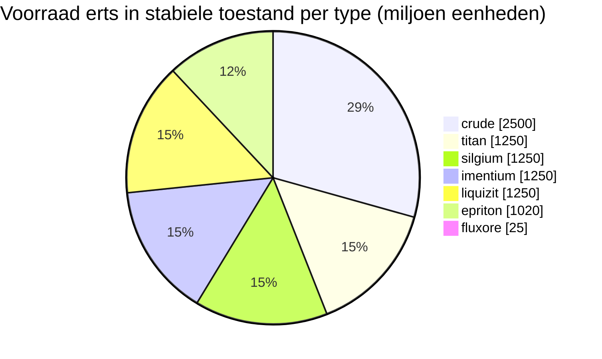

<!-- Generated by tools/generate from the live database (source: zones, mineralconfigs, plantrules, teleportdescriptions, strongholdexitconfig).
     Do not edit by hand; regenerate instead. -->
# Alsbale (zone_TM_pvp)

  <a href="/nl/zones/map/">
    
    <strong>Wereldkaart</strong> — waar deze zone ligt tussen alle andere, met de teleportverbindingen. Open de volledige kaart.
  </a>

Waar de teleportkolommen van deze zone staan (stippen met bestemmingslabel — gedimd als de kolom is uitgeschakeld), landingsplekken van teleports uit andere zones (stippellijnen cirkels) en uitgangspoorten (ruiten) waar aanwezig. Posities zijn tegelcoördinaten die de server registreert. De stippellijnen verbinden de paren lokale (binnen de zone) teleportkolommen.

Een open-PvP (beta) New Virginia (TM)-eiland — spelers kunnen vrij aanvallen en blobs zijn van toepassing. Het onderhoudt 7 erstypes.

| Feit | Waarde |
|---|---|
| Zone-ID | 10 |
| Type | PvP |
| Bescherming | [Beta](/nl/zones/protection/) — open PvP, standaard terrein |
| Grootte | 2048×2048 tegels |
| Vruchtbaarheid | 20 |
| Plantsoorten | 17 (regelset 5) |
| Erstypes | 7 |
| Totaal aantal ertsknopen | 67 |
| Max. dockingbases | geen |

## Ertsconfiguratie

De knoopgeneratie die deze zone handhaaft. Opbrengsten per erts en de generatieformules zijn te vinden in [Ertsen](/nl/content/ores/) (de sectie van deze zone is hieronder gelinkt).

| Materiaal | Knopen | Max. tegels/knoop | Totaal per knoop | Min. drempel |
|---|---|---|---|---|
| [titan](/nl/content/ores/titan/) | 10 | 500 | 125M | 0.5 |
| [crude](/nl/content/ores/crude/) | 10 | 500 | 250M | 0.5 |
| [imentium](/nl/content/ores/imentium/) | 10 | 500 | 125M | 0.5 |
| [liquizit](/nl/content/ores/liquizit/) | 10 | 500 | 125M | 0.5 |
| [epriton](/nl/content/ores/epriton/) | 12 | 350 | 85M | 0.5 |
| [silgium](/nl/content/ores/silgium/) | 10 | 500 | 125M | 0.5 |
| [fluxore](/nl/content/ores/fluxore/) | 5 | 300 | 5M | 0.5 |

[Zone-index](/nl/zones/zone-index/) · [Wereldkaart](/nl/zones/map/#beta) · [Beschermingsniveaus](/nl/zones/protection/)
