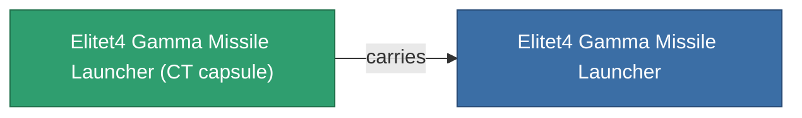

<!-- Generated by tools/generate from the live database (source: entitydefaults definition 6214, aggregatevalues via aggregatefields).
     Do not edit by hand; regenerate instead. -->

# Elitet4 Gamma Missile Launcher

|  |  |
|---|---|
| Definicja | `def_elitet4_gamma_missile_launcher` |
| Poziom | T4 (special) |
| Zdrowie | 100 |
| Objętość | 2 |
| Masa | 550 |
| Kategoria | Modules / Weapons |
| Uwaga | elite module |

## Statystyki

| Pole | Wartość |
|---|---|
| accuracy | 1 |
| core_usage | 2 |
| cpu_usage | 43 |
| cycle_time | 10.5k |
| damage_modifier | 1.1 |
| module_missile_range_modifier | 1.2 |
| powergrid_usage | 162 |

## Kapsuła transportowa

A transport capsule (CT) exists for this item — it is how the item moves between players and zones.

## Gdzie kupić

Fixed-price vendors that sell this item (see the [Item shop](/pl/content/shop/) for the full catalog).

| Vendor | Qty | TM Coin | Credits |
|---|---|---|---|
| Daoden outpost | ∞ | 5k | 750M |

<!-- production:generated -->
## Produkcja

**Produkcja z 2 komponentów** — zmontuj komponenty, aby go zbudować (pełna lista w [Przepisy](/pl/content/recipes/)):

**Nakładka:** [Elitet4 Gamma Missile Launcher Cprg](/content/items/elitet4-gamma-missile-launcher-cprg/)

<svg class="prod-card-icon" aria-hidden="true"><use href="#mi-grid"/></svg><a class="prod-card-name" href="/pl/content/items/material-boss-gamma-pelistal/">Material Boss Gamma Pelistal</a>

wymagane: <b>400</b>

<svg class="prod-card-icon" aria-hidden="true"><use href="#mi-star"/></svg><a class="prod-card-name" href="/pl/content/items/named3-missile-launcher/">Pelistec-TR250 medium missile launcher</a>

wymagane: <b>1</b>

