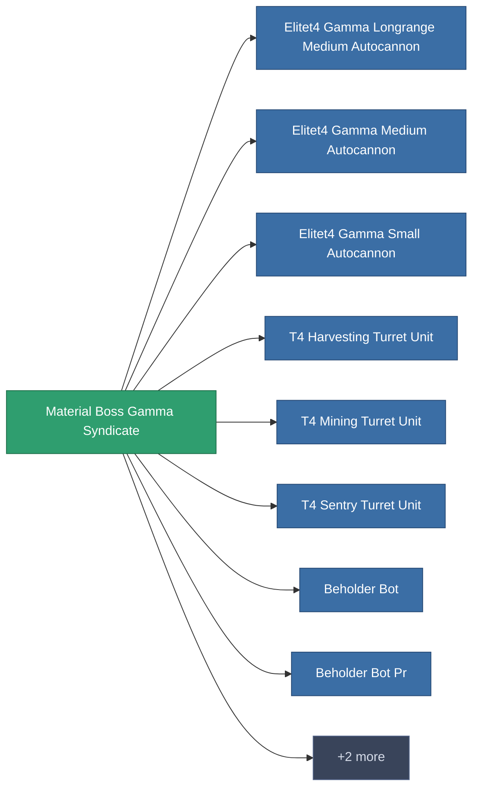

<!-- Generated by tools/generate from the live database (source: entitydefaults definition 6203, aggregatevalues via aggregatefields).
     Do not edit by hand; regenerate instead. -->

# Material Boss Gamma Syndicate

|  |  |
|---|---|
| Definicja | `def_material_boss_gamma_syndicate` |
| Poziom | – |
| Zdrowie | 100 |
| Objętość | 0 |
| Masa | 0.25 |
| Kategoria | Materials |
| Uwaga | elite module material |

_Brak statystyk — ten przedmiot nie niesie żadnych wartości agregowanych._

<!-- production:generated -->
## Użyte w produkcji

**Komponentem 10 przedmiotów** — przykład tego, co można z niego wyprodukować (pełna lista w [Przepisy](/pl/content/recipes/)).

