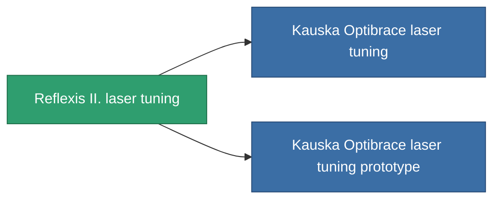

<!-- Generated by tools/generate from the live database (source: entitydefaults definition 930, aggregatevalues via aggregatefields).
     Do not edit by hand; regenerate instead. -->

# Reflexis II. laser tuning

|  |  |
|---|---|
| Definicja | `def_named1_damage_mod_laser` |
| Poziom | T2 |
| Zdrowie | 100 |
| Objętość | 0.5 |
| Masa | 90 |
| Kategoria | Modules / Weapons |
| Tier line | [Standard laser tuning](/pl/content/items/standard-damage-mod-laser/) (T1) → **Reflexis II. laser tuning** (T2) → [Kauska Optibrace laser tuning](/pl/content/items/named2-damage-mod-laser/) (T3) → [Oqulus laser tuning](/pl/content/items/named3-damage-mod-laser/) (T4) |

## Statystyki

| Pole | Wartość |
|---|---|
| cpu_usage | 19 |
| damage_laser_modifier | 0.15 |
| powergrid_usage | 9 |

<!-- production:generated -->
## Produkcja

**Produkcja z 8 komponentów, poziom badań 4** — zmontuj komponenty, aby go zbudować (pełna lista w [Przepisy](/pl/content/recipes/)):

**Nakładka:** [Reflexis II. laser tuning CT](/content/items/named1-damage-mod-laser-cprg/)

<svg class="prod-card-icon" aria-hidden="true"><use href="#mi-grid"/></svg><a class="prod-card-name" href="/pl/content/items/axicol/">Cryoperine</a>

wymagane: <b>100</b>

<svg class="prod-card-icon" aria-hidden="true"><use href="#mi-grid"/></svg><a class="prod-card-name" href="/pl/content/items/axicoline/">Axicoline</a>

wymagane: <b>50</b>

<svg class="prod-card-icon" aria-hidden="true"><use href="#mi-grid"/></svg><a class="prod-card-name" href="/pl/content/items/polynucleit/">Polynucleit</a>

wymagane: <b>50</b>

<svg class="prod-card-icon" aria-hidden="true"><use href="#mi-grid"/></svg><a class="prod-card-name" href="/pl/content/items/prilumium/">Prilumium</a>

wymagane: <b>100</b>

<svg class="prod-card-icon" aria-hidden="true"><use href="#mi-crystal"/></svg><a class="prod-card-name" href="/pl/content/items/robotshard-common-basic/">Damaged common fragment</a>

wymagane: <b>15</b>

<svg class="prod-card-icon" aria-hidden="true"><use href="#mi-crystal"/></svg><a class="prod-card-name" href="/pl/content/items/robotshard-thelodica-basic/">Damaged thelodica fragment</a>

wymagane: <b>15</b>

<svg class="prod-card-icon" aria-hidden="true"><use href="#mi-robots"/></svg><a class="prod-card-name" href="/pl/content/items/standard-damage-mod-laser/">Standard laser tuning</a>

wymagane: <b>1</b>

<svg class="prod-card-icon" aria-hidden="true"><use href="#mi-grid"/></svg><a class="prod-card-name" href="/pl/content/items/titanium/">Titanium</a>

wymagane: <b>50</b>

## Użyte w produkcji

**Komponentem 2 przedmiotów** — wszystko, co go używa w produkcji:

