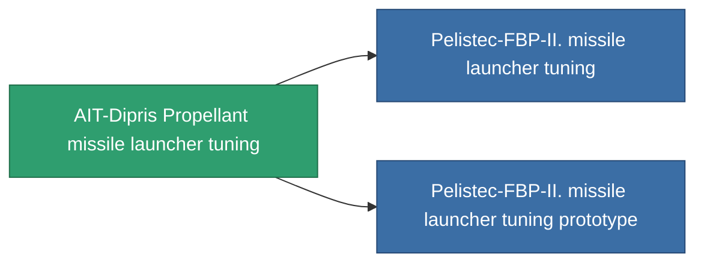

<!-- Generated by tools/generate from the live database (source: entitydefaults definition 927, aggregatevalues via aggregatefields).
     Do not edit by hand; regenerate instead. -->

# AIT-Dipris Propellant missile launcher tuning

|  |  |
|---|---|
| Definicja | `def_named1_damage_mod_missile` |
| Poziom | T2 |
| Zdrowie | 100 |
| Objętość | 0.5 |
| Masa | 90 |
| Kategoria | Modules / Enhancements |
| Tier line | [Standard missile launcher tuning](/pl/content/items/standard-damage-mod-missile/) (T1) → **AIT-Dipris Propellant missile launcher tuning** (T2) → [Pelistec-FBP-II. missile launcher tuning](/pl/content/items/named2-damage-mod-missile/) (T3) → [Dozer-IMT missile launcher tuning](/pl/content/items/named3-damage-mod-missile/) (T4) |

## Statystyki

| Pole | Wartość |
|---|---|
| cpu_usage | 23 |
| damage_missile_modifier | 0.15 |
| powergrid_usage | 4 |

<!-- production:generated -->
## Produkcja

**Produkcja z 8 komponentów, poziom badań 4** — zmontuj komponenty, aby go zbudować (pełna lista w [Przepisy](/pl/content/recipes/)):

**Nakładka:** [AIT-Dipris Propellant missile launcher tuning CT](/pl/content/items/named1-damage-mod-missile-cprg/)

<svg class="prod-card-icon" aria-hidden="true"><use href="#mi-grid"/></svg><a class="prod-card-name" href="/pl/content/items/axicol/">Cryoperine</a>

wymagane: <b>100</b>

<svg class="prod-card-icon" aria-hidden="true"><use href="#mi-grid"/></svg><a class="prod-card-name" href="/pl/content/items/axicoline/">Axicoline</a>

wymagane: <b>50</b>

<svg class="prod-card-icon" aria-hidden="true"><use href="#mi-grid"/></svg><a class="prod-card-name" href="/pl/content/items/phlobotil/">Phlobotil</a>

wymagane: <b>50</b>

<svg class="prod-card-icon" aria-hidden="true"><use href="#mi-crystal"/></svg><a class="prod-card-name" href="/pl/content/items/robotshard-common-basic/">Damaged common fragment</a>

wymagane: <b>15</b>

<svg class="prod-card-icon" aria-hidden="true"><use href="#mi-crystal"/></svg><a class="prod-card-name" href="/pl/content/items/robotshard-pelistal-basic/">Damaged pelistal fragment</a>

wymagane: <b>15</b>

<svg class="prod-card-icon" aria-hidden="true"><use href="#mi-star"/></svg><a class="prod-card-name" href="/pl/content/items/standard-damage-mod-missile/">Standard missile launcher tuning</a>

wymagane: <b>1</b>

<svg class="prod-card-icon" aria-hidden="true"><use href="#mi-grid"/></svg><a class="prod-card-name" href="/pl/content/items/titanium/">Titanium</a>

wymagane: <b>50</b>

<svg class="prod-card-icon" aria-hidden="true"><use href="#mi-grid"/></svg><a class="prod-card-name" href="/pl/content/items/vitricyl/">Vitricyl</a>

wymagane: <b>100</b>

## Użyte w produkcji

**Komponentem 2 przedmiotów** — wszystko, co go używa w produkcji:

