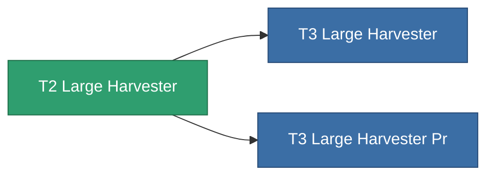

<!-- Generated by tools/generate from the live database (source: entitydefaults definition 8863, aggregatevalues via aggregatefields).
     Do not edit by hand; regenerate instead. -->

# T2 Large Harvester

|  |  |
|---|---|
| Definicja | `def_named1_large_harvester` |
| Poziom | T2 |
| Zdrowie | 100 |
| Objętość | 2.5 |
| Masa | 1500 |
| Kategoria | Modules / Harvesting |
| Tier line | [Standard Large Harvester](/pl/content/items/standard-large-harvester/) (T1) → **T2 Large Harvester** (T2) → [T3 Large Harvester](/pl/content/items/named2-large-harvester/) (T3) → [T4 Large Harvester](/pl/content/items/named3-large-harvester/) (T4) |

## Statystyki

| Pole | Wartość |
|---|---|
| core_usage | 135 |
| cpu_usage | 432 |
| cycle_time | 12k |
| powergrid_usage | 1.215k |

<!-- production:generated -->
## Produkcja

**Produkcja z 4 komponentów** — zmontuj komponenty, aby go zbudować (pełna lista w [Przepisy](/pl/content/recipes/)):

**Nakładka:** [T2 Large Harvester Cprg](/content/items/named1-large-harvester-cprg/)

<svg class="prod-card-icon" aria-hidden="true"><use href="#mi-grid"/></svg><a class="prod-card-name" href="/pl/content/items/axicol/">Cryoperine</a>

wymagane: <b>600</b>

<svg class="prod-card-icon" aria-hidden="true"><use href="#mi-crystal"/></svg><a class="prod-card-name" href="/pl/content/items/robotshard-common-basic/">Damaged common fragment</a>

wymagane: <b>120</b>

<svg class="prod-card-icon" aria-hidden="true"><use href="#mi-grid"/></svg><a class="prod-card-name" href="/pl/content/items/standard-large-harvester/">Standard Large Harvester</a>

wymagane: <b>1</b>

<svg class="prod-card-icon" aria-hidden="true"><use href="#mi-grid"/></svg><a class="prod-card-name" href="/pl/content/items/titanium/">Titanium</a>

wymagane: <b>2.4k</b>

## Użyte w produkcji

**Komponentem 2 przedmiotów** — wszystko, co go używa w produkcji:

