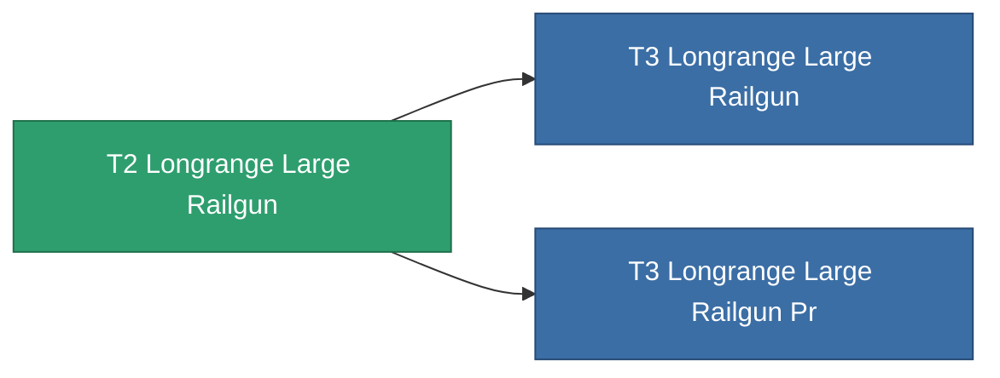

<!-- Generated by tools/generate from the live database (source: entitydefaults definition 1021, aggregatevalues via aggregatefields).
     Do not edit by hand; regenerate instead. -->

# T2 Longrange Large Railgun

|  |  |
|---|---|
| Definicja | `def_named1_longrange_large_railgun` |
| Poziom | T2 |
| Zdrowie | 100 |
| Objętość | 1.5 |
| Masa | 1170 |
| Kategoria | Modules / Weapons |
| Tier line | **T2 Longrange Large Railgun** (T2) → [T3 Longrange Large Railgun](/pl/content/items/named2-longrange-large-railgun/) (T3) → [T4 Longrange Large Railgun](/pl/content/items/named3-longrange-large-railgun/) (T4) |

## Statystyki

| Pole | Wartość |
|---|---|
| accuracy | 42 |
| core_usage | 17.5 |
| cpu_usage | 90 |
| cycle_time | 10k |
| damage_modifier | 3 |
| falloff | 25.5 |
| optimal_range | 46 |
| powergrid_usage | 277.5 |

<!-- production:generated -->
## Produkcja

**Produkcja z 9 komponentów** — zmontuj komponenty, aby go zbudować (pełna lista w [Przepisy](/pl/content/recipes/)):

**Nakładka:** [T2 Longrange Large Railgun Cprg](/pl/content/items/named1-longrange-large-railgun-cprg/)

<svg class="prod-card-icon" aria-hidden="true"><use href="#mi-grid"/></svg><a class="prod-card-name" href="/pl/content/items/axicol/">Cryoperine</a>

wymagane: <b>75</b>

<svg class="prod-card-icon" aria-hidden="true"><use href="#mi-grid"/></svg><a class="prod-card-name" href="/pl/content/items/axicoline/">Axicoline</a>

wymagane: <b>150</b>

<svg class="prod-card-icon" aria-hidden="true"><use href="#mi-grid"/></svg><a class="prod-card-name" href="/pl/content/items/chollonin/">Chollonin</a>

wymagane: <b>75</b>

<svg class="prod-card-icon" aria-hidden="true"><use href="#mi-robots"/></svg><a class="prod-card-name" href="/pl/content/items/longrange-standard-large-railgun/">Longrange Standard Large Railgun</a>

wymagane: <b>1</b>

<svg class="prod-card-icon" aria-hidden="true"><use href="#mi-grid"/></svg><a class="prod-card-name" href="/pl/content/items/polynitrocol/">Polynitrocol</a>

wymagane: <b>150</b>

<svg class="prod-card-icon" aria-hidden="true"><use href="#mi-crystal"/></svg><a class="prod-card-name" href="/pl/content/items/robotshard-common-basic/">Damaged common fragment</a>

wymagane: <b>45</b>

<svg class="prod-card-icon" aria-hidden="true"><use href="#mi-crystal"/></svg><a class="prod-card-name" href="/pl/content/items/robotshard-nuimqol-basic/">Damaged nuimqol fragment</a>

wymagane: <b>45</b>

<svg class="prod-card-icon" aria-hidden="true"><use href="#mi-grid"/></svg><a class="prod-card-name" href="/pl/content/items/specimen-sap-item-flux/">Specimen Sap Item Flux</a>

wymagane: <b>10</b>

<svg class="prod-card-icon" aria-hidden="true"><use href="#mi-grid"/></svg><a class="prod-card-name" href="/pl/content/items/titanium/">Titanium</a>

wymagane: <b>150</b>

## Użyte w produkcji

**Komponentem 2 przedmiotów** — wszystko, co go używa w produkcji:

