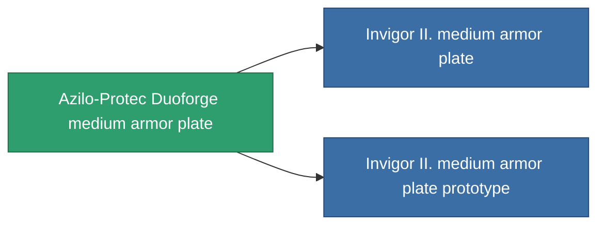

<!-- Generated by tools/generate from the live database (source: entitydefaults definition 687, aggregatevalues via aggregatefields).
     Do not edit by hand; regenerate instead. -->

# Azilo-Protec Duoforge medium armor plate

|  |  |
|---|---|
| Definicja | `def_named1_medium_armor_plate` |
| Poziom | T2 |
| Zdrowie | 100 |
| Objętość | 2 |
| Masa | 2400 |
| Kategoria | Modules / Armor |
| Tier line | [Standard medium armor plate](/pl/content/items/standard-medium-armor-plate/) (T1) → **Azilo-Protec Duoforge medium armor plate** (T2) → [Invigor II. medium armor plate](/pl/content/items/named2-medium-armor-plate/) (T3) → [THL-Testudo medium armor plate](/pl/content/items/named3-medium-armor-plate/) (T4) |

## Statystyki

| Pole | Wartość |
|---|---|
| armor_max | 1.35k |
| cpu_usage | 2 |
| massiveness | 0.12 |
| powergrid_usage | 60 |
| signature_radius | 1 |

<!-- production:generated -->
## Produkcja

**Produkcja z 4 komponentów, poziom badań 4** — zmontuj komponenty, aby go zbudować (pełna lista w [Przepisy](/pl/content/recipes/)):

**Nakładka:** [Azilo-Protec Duoforge medium armor plate CT](/content/items/named1-medium-armor-plate-cprg/)

<svg class="prod-card-icon" aria-hidden="true"><use href="#mi-grid"/></svg><a class="prod-card-name" href="/pl/content/items/plasteosine/">Plasteosine</a>

wymagane: <b>700</b>

<svg class="prod-card-icon" aria-hidden="true"><use href="#mi-crystal"/></svg><a class="prod-card-name" href="/pl/content/items/robotshard-common-basic/">Damaged common fragment</a>

wymagane: <b>60</b>

<svg class="prod-card-icon" aria-hidden="true"><use href="#mi-tree"/></svg><a class="prod-card-name" href="/pl/content/items/standard-medium-armor-plate/">Standard medium armor plate</a>

wymagane: <b>1</b>

<svg class="prod-card-icon" aria-hidden="true"><use href="#mi-grid"/></svg><a class="prod-card-name" href="/pl/content/items/titanium/">Titanium</a>

wymagane: <b>500</b>

## Użyte w produkcji

**Komponentem 2 przedmiotów** — wszystko, co go używa w produkcji:

