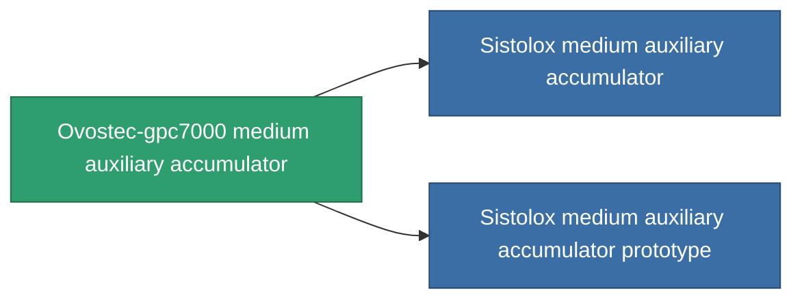

<!-- Generated by tools/generate from the live database (source: entitydefaults definition 816, aggregatevalues via aggregatefields).
     Do not edit by hand; regenerate instead. -->

# Ovostec-gpc7000 medium auxiliary accumulator

|  |  |
|---|---|
| Definicja | `def_named1_medium_core_battery` |
| Poziom | T2 |
| Zdrowie | 100 |
| Objętość | 1 |
| Masa | 1350 |
| Kategoria | Modules / Power |
| Tier line | [Standard medium auxiliary accumulator](/pl/content/items/standard-medium-core-battery/) (T1) → **Ovostec-gpc7000 medium auxiliary accumulator** (T2) → [Sistolox medium auxiliary accumulator](/pl/content/items/named2-medium-core-battery/) (T3) → [Pheter Charge-M medium auxiliary accumulator](/pl/content/items/named3-medium-core-battery/) (T4) |

## Statystyki

| Pole | Wartość |
|---|---|
| core_max | 375 |
| cpu_usage | 36 |
| powergrid_usage | 100 |

<!-- production:generated -->
## Produkcja

**Produkcja z 4 komponentów, poziom badań 5** — zmontuj komponenty, aby go zbudować (pełna lista w [Przepisy](/pl/content/recipes/)):

**Nakładka:** [Ovostec-gpc7000 medium auxiliary accumulator CT](/pl/content/items/named1-medium-core-battery-cprg/)

<svg class="prod-card-icon" aria-hidden="true"><use href="#mi-grid"/></svg><a class="prod-card-name" href="/pl/content/items/axicol/">Cryoperine</a>

wymagane: <b>400</b>

<svg class="prod-card-icon" aria-hidden="true"><use href="#mi-crystal"/></svg><a class="prod-card-name" href="/pl/content/items/robotshard-common-basic/">Damaged common fragment</a>

wymagane: <b>60</b>

<svg class="prod-card-icon" aria-hidden="true"><use href="#mi-grid"/></svg><a class="prod-card-name" href="/pl/content/items/standard-medium-core-battery/">Standard medium auxiliary accumulator</a>

wymagane: <b>1</b>

<svg class="prod-card-icon" aria-hidden="true"><use href="#mi-grid"/></svg><a class="prod-card-name" href="/pl/content/items/titanium/">Titanium</a>

wymagane: <b>200</b>

## Użyte w produkcji

**Komponentem 2 przedmiotów** — wszystko, co go używa w produkcji:

