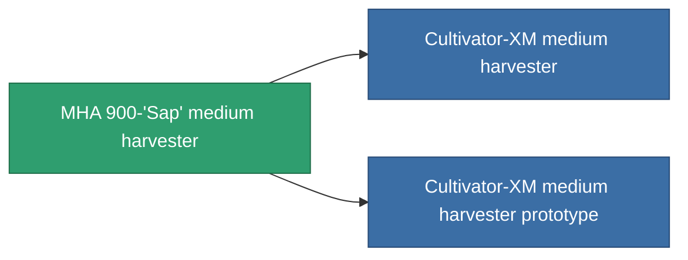

<!-- Generated by tools/generate from the live database (source: entitydefaults definition 810, aggregatevalues via aggregatefields).
     Do not edit by hand; regenerate instead. -->

# MHA 900-'Sap' medium harvester

|  |  |
|---|---|
| Definicja | `def_named1_medium_harvester` |
| Poziom | T2 |
| Zdrowie | 100 |
| Objętość | 1.5 |
| Masa | 900 |
| Kategoria | Modules / Harvesting |
| Tier line | [Standard medium harvester](/pl/content/items/standard-medium-harvester/) (T1) → **MHA 900-'Sap' medium harvester** (T2) → [Cultivator-XM medium harvester](/pl/content/items/named2-medium-harvester/) (T3) → [Protrim V-II medium harvester](/pl/content/items/named3-medium-harvester/) (T4) |

## Statystyki

| Pole | Wartość |
|---|---|
| core_usage | 45 |
| cpu_usage | 48 |
| cycle_time | 12k |
| optimal_range | 3 |
| powergrid_usage | 135 |

<!-- production:generated -->
## Produkcja

**Produkcja z 4 komponentów, poziom badań 4** — zmontuj komponenty, aby go zbudować (pełna lista w [Przepisy](/pl/content/recipes/)):

**Nakładka:** [MHA 900-'Sap' medium harvester CT](/pl/content/items/named1-medium-harvester-cprg/)

<svg class="prod-card-icon" aria-hidden="true"><use href="#mi-grid"/></svg><a class="prod-card-name" href="/pl/content/items/axicol/">Cryoperine</a>

wymagane: <b>100</b>

<svg class="prod-card-icon" aria-hidden="true"><use href="#mi-crystal"/></svg><a class="prod-card-name" href="/pl/content/items/robotshard-common-basic/">Damaged common fragment</a>

wymagane: <b>60</b>

<svg class="prod-card-icon" aria-hidden="true"><use href="#mi-grid"/></svg><a class="prod-card-name" href="/pl/content/items/standard-medium-harvester/">Standard medium harvester</a>

wymagane: <b>1</b>

<svg class="prod-card-icon" aria-hidden="true"><use href="#mi-grid"/></svg><a class="prod-card-name" href="/pl/content/items/titanium/">Titanium</a>

wymagane: <b>300</b>

## Użyte w produkcji

**Komponentem 2 przedmiotów** — wszystko, co go używa w produkcji:

