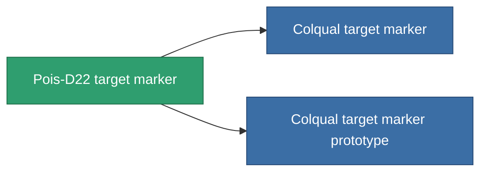

<!-- Generated by tools/generate from the live database (source: entitydefaults definition 2905, aggregatevalues via aggregatefields).
     Do not edit by hand; regenerate instead. -->

# Pois-D22 target marker

|  |  |
|---|---|
| Definicja | `def_named1_target_painter` |
| Poziom | T2 |
| Zdrowie | 100 |
| Objętość | 0.5 |
| Masa | 450 |
| Kategoria | Modules / Enhancements |
| Tier line | [Standard target marker](/pl/content/items/standard-target-painter/) (T1) → **Pois-D22 target marker** (T2) → [Colqual target marker](/pl/content/items/named2-target-painter/) (T3) → [Pulsus target marker](/pl/content/items/named3-target-painter/) (T4) |

## Statystyki

| Pole | Wartość |
|---|---|
| core_usage | 110 |
| cpu_usage | 50 |
| cycle_time | 10k |
| effect_stealth_strength_modifier | -70 |
| optimal_range | 75 |
| powergrid_usage | 20 |

<!-- production:generated -->
## Produkcja

**Produkcja z 5 komponentów, poziom badań 5** — zmontuj komponenty, aby go zbudować (pełna lista w [Przepisy](/pl/content/recipes/)):

**Nakładka:** [Pois-D22 target marker CT](/pl/content/items/named1-target-painter-cprg/)

<svg class="prod-card-icon" aria-hidden="true"><use href="#mi-grid"/></svg><a class="prod-card-name" href="/pl/content/items/axicol/">Cryoperine</a>

wymagane: <b>450</b>

<svg class="prod-card-icon" aria-hidden="true"><use href="#mi-grid"/></svg><a class="prod-card-name" href="/pl/content/items/axicoline/">Axicoline</a>

wymagane: <b>50</b>

<svg class="prod-card-icon" aria-hidden="true"><use href="#mi-crystal"/></svg><a class="prod-card-name" href="/pl/content/items/robotshard-common-basic/">Damaged common fragment</a>

wymagane: <b>60</b>

<svg class="prod-card-icon" aria-hidden="true"><use href="#mi-grid"/></svg><a class="prod-card-name" href="/pl/content/items/standard-target-painter/">Standard target marker</a>

wymagane: <b>1</b>

<svg class="prod-card-icon" aria-hidden="true"><use href="#mi-grid"/></svg><a class="prod-card-name" href="/pl/content/items/titanium/">Titanium</a>

wymagane: <b>200</b>

## Użyte w produkcji

**Komponentem 2 przedmiotów** — wszystko, co go używa w produkcji:

